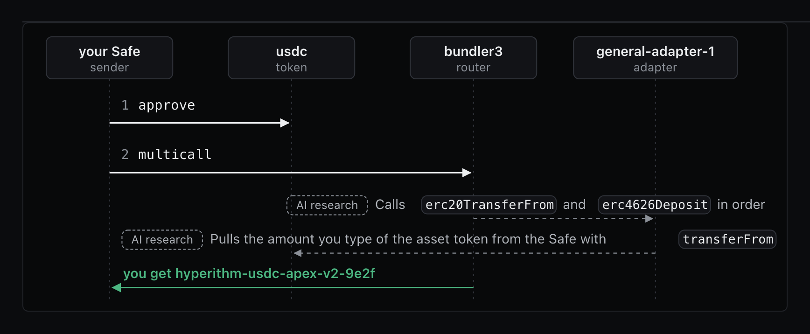
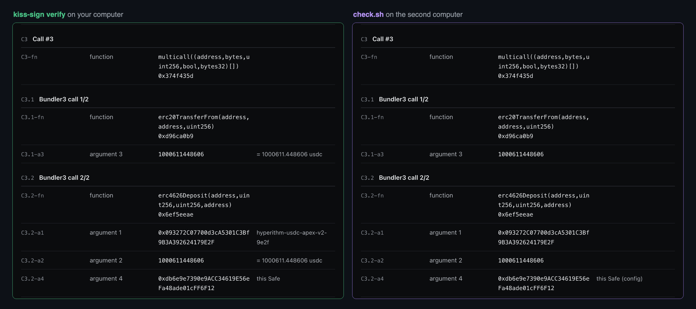

<p align="center">
  <picture>
    <source media="(prefers-color-scheme: dark)" srcset="docs/logo-dark.svg">
    
  </picture>
</p>

<h1 align="center">kiss-sign</h1>

<p align="center"><b><i>Keep it simple, stupid, and sign.</i></b></p>

> [!WARNING]
> kiss-sign is still under development and is not ready for real use. Do not rely on it to sign transactions yet.

Signing tools today show you a transaction and ask whether it looks right. Your intent is checked last, by you, at the moment you are most likely to click through. kiss-sign turns that around: you say what you want first, your AI researches the operation once and writes a report you review, and every Safe transaction is checked against what you said before you sign on a hardware wallet.

<picture>
  <source media="(prefers-color-scheme: dark)" srcset="docs/readme/overview-dark.png">
  
</picture>

## Contents

- [Why](#why)
- [How it works](#how-it-works)
  - [1. Tell your AI what you want](#1-tell-your-ai-what-you-want)
  - [2. Review the report and merge](#2-review-the-report-and-merge)
  - [3. Fill a card](#3-fill-a-card)
  - [4. Verify on your computer, and check on a second one](#4-verify-on-your-computer-and-check-on-a-second-one)
  - [5. Sign](#5-sign)
- [Threat model](#threat-model)
- [Scope](#scope)
- [Contributing](#contributing)
- [Disclaimer](#disclaimer)
- [Donate](#donate)
- [License](#license)

## Why

- **You are responsible for the exact bytes you sign.** Today the transaction is built first and checked last, when most people just click sign. At Bybit in 2025, the signers saw a normal transfer in a tampered Safe web app and signed the attacker's transaction.
- **Checking by hand is slow and needs expertise.** Tools such as [safe-tx-hashes](https://github.com/pcaversaccio/safe-tx-hashes-util) compute the hashes your wallet should show, but you still decode the data yourself. Here is one real Morpho vault deposit, from another Safe:

  

  Then the real questions start. Is this data really what you meant to sign, and do you know what every field does? Is `0x4A6c…0aE0` Morpho's GeneralAdapter1 or a look-alike? Is `0x7777…7777` the vault you meant? Is `1.054e15` a sane maximum share price? And again for the next transaction.

- **[Clear signing (ERC-7730)](https://eips.ethereum.org/EIPS/eip-7730) shows only what someone has described.** A wallet with clear signing shows a call as readable fields, using a descriptor: a JSON file in the [ERC-7730 registry](https://github.com/ethereum/clear-signing-erc7730-registry) that says how to show one contract's functions. Here is the part of Bundler3's descriptor that shows the multicall in the deposit above ([`calldata-MorphoBundlerV3.json`](https://github.com/ethereum/clear-signing-erc7730-registry/blob/3bebbd05cbc2d2d2bf9c41a8edbf5e5cc88e4eb4/registry/morpho/calldata-MorphoBundlerV3.json), registry commit `3bebbd0`):

  ```json
  "multicall((address to, bytes data, uint256 value, bool skipRevert, bytes32 callbackHash)[] bundle)": {
    "intent": "Bundler3 Multicall",
    "fields": [{ "path": "#.bundle.[].data", "label": "Action", "format": "calldata",
                 "params": { "calleePath": "#.bundle.[].to", "amountPath": "#.bundle.[].value" } }]
  }
  ```

  It names the call "Bundler3 Multicall" and hands each action to the descriptor of the contract that action calls. Both actions here, `erc20TransferFrom` and `erc4626Deposit`, call GeneralAdapter1, which has no descriptor, so the two steps that move your USDC into the vault have nothing to show them by. MultiSend, which wraps the whole batch, has none either. The screen can look reasonable while the parts that move your money are not shown. kiss-sign needs no descriptor: your wallet only has to show the hashes.

## How it works

> [!CAUTION]
> kiss-sign is provided as is, with no warranty. It can be wrong, and you alone are responsible for what you sign. See [Disclaimer](#disclaimer).

The pictures below come from one real run: another Safe's deposit of 1,000,611.448606 USDC into a Morpho vault, the Hyperithm USDC Apex vault. One address crop is from another vault's report, as marked.

**Set up once.** Fork this repository and clone your fork. Your fork's `main` is the program `verify` trusts. You merge each template and registry pull request into it, and merging is your confirmation; program changes your AI merges itself, behind a gate (see [Your AI](#your-ai)).

```sh
git clone https://github.com/<you>/kiss-sign.git && cd kiss-sign
pnpm install
pnpm kiss-sign init --safe 0x… --language en   # or zh-TW for Traditional Chinese; see Language
pnpm kiss-sign key add alchemy
pnpm kiss-sign key add etherscan   # to build or review templates
pnpm kiss-sign key add github      # optional: raises GitHub's hourly limit to build or review templates
```

You need:

- Node 22.21 or later and pnpm.
- Free [Alchemy](https://dashboard.alchemy.com/) and [Etherscan](https://etherscan.io/myapikey) keys. A GitHub token is optional: a fine-grained, read-only one for public repositories raises GitHub's hourly limit when you build or review templates.
- A hardware wallet that shows a Safe transaction's domain hash and message hash, or its safeTxHash.
- For the hardened tier, a second computer with [kiss-sign-check](https://github.com/ipromise2324/kiss-sign-check), its `LANGUAGE` set to the language you gave `init`. It runs no AI and no kiss-sign, so malware or an AI on your computer cannot also change what you compare. Without it you are on the basic tier, kiss-sign alone. See [Two tiers](docs/design.md#two-tiers).

**Language.** English (`en`, the default) or Traditional Chinese (`zh-TW`). Change it later with `pnpm kiss-sign init --language zh-TW`. It sets the terminal text, `verify`'s page and `pnpm history`; addresses, hashes and verdict words stay the same, and so do verdicts. Set `LANGUAGE` in `check.sh`'s `config` to the same language, or the comparison rows differ.

### 1. Tell your AI what you want

In Claude Code, from the clone, say it in one sentence: "deposit 1,000,611.448606 USDC into Morpho's Hyperithm USDC Apex vault". If no template covers it yet, the AI builds one with the [kiss-sign skill](.claude/skills/kiss-sign/SKILL.md) and opens a pull request with a generated report.


### 2. Review the report and merge

The report shows what the transaction will do and where every fact came from. Text the AI wrote is marked `AI`; everything else the program read or checked.

**The call flow.** Which contract the Safe calls, in which order, and what comes back.



**Every field.** Each argument is fixed by the template, filled from your card, or, like a deadline or a route, left to the protocol's app within limits the template states.


**Every address.** Each place it was found, whether that site belongs to the protocol, and whether the newest version still lists it. This crop is from the CoW swap report, where CoW's settlement contract is confirmed in five places.


Weak evidence is shown, not hidden. The Hyperithm vault was confirmed only by its factory, so the report flags it and lists it under To review, with the AI's suggestion: open the vault from the Morpho app's list, compare the address, and send a small amount first.


The report was made on the AI's computer. Before you merge, read its facts again with your own `main`'s code; any fact that differs is printed:

```sh
git fetch origin <branch>
pnpm report <protocol>/<operation> [--instance-of <instance>] --compare --data origin/<branch>
```

This review happens once per operation. Merging is your confirmation. Then approve the template on your own computer, which records its hash so `verify` refuses any other version:

```sh
git pull
pnpm kiss-sign template approve morpho/vault-deposit
```

Approval records the template's hash, so another contract the same template can name needs only its report reviewed and merged.

### 3. Fill a card

In your own terminal, pick the vault from a list with full addresses and type the amount. Values the protocol's app fills in by itself, such as the minimum shares, are computed from an on-chain read, the app's default slippage and a small margin the template states (0.10% in all for a Morpho deposit). The card is sealed under its hash before you see any transaction.


### 4. Verify on your computer, and check on a second one

Propose the transaction in the Safe web app as usual. Then, on your computer:

```sh
pnpm kiss-sign verify --card <card hash> --safe-tx-hash <safeTxHash>
```

On the second computer, run the command `verify` prints after `MATCH`:

```sh
./check.sh <nonce> --hints '…'   # --hints only when the template reads bytes no ABI describes
```

`check.sh` fetches the same transaction from Safe's API, recomputes its hashes, and decodes each call with Foundry's `cast`, using the ABI [Sourcify](https://sourcify.dev) has for the contract. It talks only to Safe's API and Sourcify, with no API key.

On `MATCH`, both pages show the same comparison list. Every row must be equal, except the last column, where each side writes its own names. If any other row differs, stop. `check.sh` does not judge the transaction: read its warnings, which say what it could not decode, and read its calls against what you meant to do.

First the hashes. They must be identical on both pages and on your hardware wallet's screen:


Then every call, row by row, down to the calls inside a batch: both sides split Bundler3's `multicall` into the token transfer and the vault deposit it runs. Every column must be identical except the names on the right, which each side writes from its own list:



`--hints` tell `check.sh` how to read bytes that hold data rather than a call, such as a Vault V2 cap id. They carry positions and types only and never change a row, so a wrong hint cannot make the rows match. See [Hints from kiss-sign](https://github.com/ipromise2324/kiss-sign-check#hints-from-kiss-sign).

### 5. Sign

Compare the hashes on `verify`'s page with your hardware wallet's screen, character by character: the domain hash and message hash, or the safeTxHash if that is what your wallet shows. Then sign. The first time you use a template or a new contract, send a small amount first.

## Threat model

`verify` is the check you run on your own computer before you sign ([step 4](#4-verify-on-your-computer-and-check-on-a-second-one)): it compares the transaction with your card, using the template you reviewed and checks that every template gets.

### The Safe web app or Transaction Service

`verify` never uses what the web app shows. It checks the transaction in the Transaction Service, and comparing the hashes on your wallet checks that you sign that one.

| Attack | Stopped by |
|---|---|
| The Transaction Service gives `verify` the attacker's transaction, as at Bybit | `verify` checks it against your card: `MISMATCH` |
| The Transaction Service gives `verify` the transaction you meant, but your wallet is asked to sign another | You compare the hashes on your wallet with `verify`'s page: they differ. The attacker also needs the web app, which decides what your wallet is asked to sign |

### The RPC providers

`verify` reads the chain and simulates through two providers run by different companies, Alchemy and drpc, and uses an answer only when both give it.

| Attack | Stopped by |
|---|---|
| One provider gives a false answer, or none | `verify` compares the two answers: they differ, `UNVERIFIABLE` |
| Both give the same false answer, such as a simulation that hides your funds going elsewhere | The attacker needs both companies at once, and a bad transaction must still reach your Safe. The Safe web app's own simulation, run by Tenderly rather than these two providers, may still show your funds going elsewhere, if the web app itself is not compromised |

### Fake sources

Your AI finds each contract's address on the web, and a program fetches each contract's source code from Etherscan, so a fake page or fake source can mislead them. The report checks the site, the address and the source, and you review it before you merge.

| Attack | Stopped by |
|---|---|
| The AI uses a fake site | A program, not the AI, compares the site with those the protocol's listings name, on DefiLlama, CoinGecko, its bug bounty and GitHub: not among them, flagged for you. To pass, the fake site must be listed there too |
| The AI uses a wrong address | The address must be found in two places, such as the protocol's site, CoinGecko, the factory, the bug bounty or the SDK: fewer, flagged for you. To pass, the wrong address must be planted in two of them |
| Etherscan serves source code that is not the contract's, so a harmful call reads as a harmless one | A program compiles it with a pinned compiler and compares it with the code on chain: different, refused |

On the hardened tier, `check.sh` also marks every address not in your own list as unknown, and takes its ABIs from Sourcify, not Etherscan.

### Your AI

Models are trained to resist prompt injection, but a page your AI reads can still steer it, and it can simply be wrong. kiss-sign assumes both can happen.

| Attack | Stopped by |
|---|---|
| The AI gets something wrong, such as a template that allows too much | `verify` refuses a delegatecall, an unlimited approval, a Safe setting change and an unexplained balance change whatever the template says; the rest shows in the report you review |
| A steered AI changes the report, `verify`'s code or its verdict | A bad transaction must still reach your Safe, through a compromised web app or protocol app; otherwise the attack fails. `--compare` reads the report's facts again with your `main`'s code, and a program change never shares a pull request with a template or the registry |

On the hardened tier, `check.sh` decodes the transaction without kiss-sign, so you see the real functions and arguments.

### The protocol you use

You choose the protocol; kiss-sign checks its state, its app's transactions and its code.

| Attack | Stopped by |
|---|---|
| The protocol or vault you pick is unsafe right now, such as one just hacked, or a vault made yesterday with no holders | The report shows the protocol's TVL and hacks from DefiLlama, and the vault's size over 12 months and its holders, read through both providers, for you to judge before you merge |
| The protocol's app is compromised and sets a field you do not fill to a value no real user sends, such as a CoW order valid for a year | Other senders' CoW orders expired within 1.5 hours, so the template allows 7 days at most: later is `MISMATCH`. Drift was exploited in April 2026 through pre-signed transactions that durable nonces kept valid |
| A contract is upgraded or reconfigured to act maliciously | The simulation: a balance or allowance change the card does not explain, `MISMATCH`. The recorded code: a registry contract whose code changed since your review, `MISMATCH`. Settings, and contracts behind it such as a market's oracle, are not checked |
| The protocol is hacked while your funds are in it | Nothing: kiss-sign checks only the transactions you sign |

### You

kiss-sign checks a transaction against the card you sealed and the reports you merged, so it cannot catch your own mistake in them. A card with the wrong vault or an extra zero in the amount gets `MATCH`. Nothing catches a signature you give without comparing the hashes on your wallet, or a flagged address you merge without reading the report.

## Scope

Safe multisig transactions on Ethereum mainnet. Not EOAs, Safe off-chain messages or other chains. It checks only what you sign: not what other owners sign without it, a module's transactions, or a hardware wallet that shows false hashes. A Vault V2 curator's cap change covers one cap id per transaction: one market, one collateral or one adapter.

## Contributing

Issues, security problems included, and pull requests are welcome. A change to the program starts with [docs/design.md](docs/design.md), the source of truth.

## Disclaimer

kiss-sign is provided as is, without warranty of any kind. It can be wrong: a bug, a wrong template or registry entry, a compromised service or a compromised computer can make it print `MATCH` for a transaction you did not mean. `MATCH` says only that the transaction matches the template you approved and the card you sealed. It does not say that a protocol, a contract or a transaction is safe, and nothing here is financial, legal or security advice.

You alone are responsible for every transaction you sign. The authors and contributors are not liable for any loss, however it arises, including through the use of kiss-sign or `kiss-sign-check`.

## Donate

If kiss-sign is useful to you, you can support it here.

**Ethereum mainnet only:**

```
0x085e5A79318931FA87050B8B677f2dc0Df303D67
```

Copy the address from this page on GitHub, and compare it in full before you send.

## License

[MIT](LICENSE), except the diagram font (Excalifont, SIL Open Font License) and other projects' logos in the diagrams, which belong to their owners.
