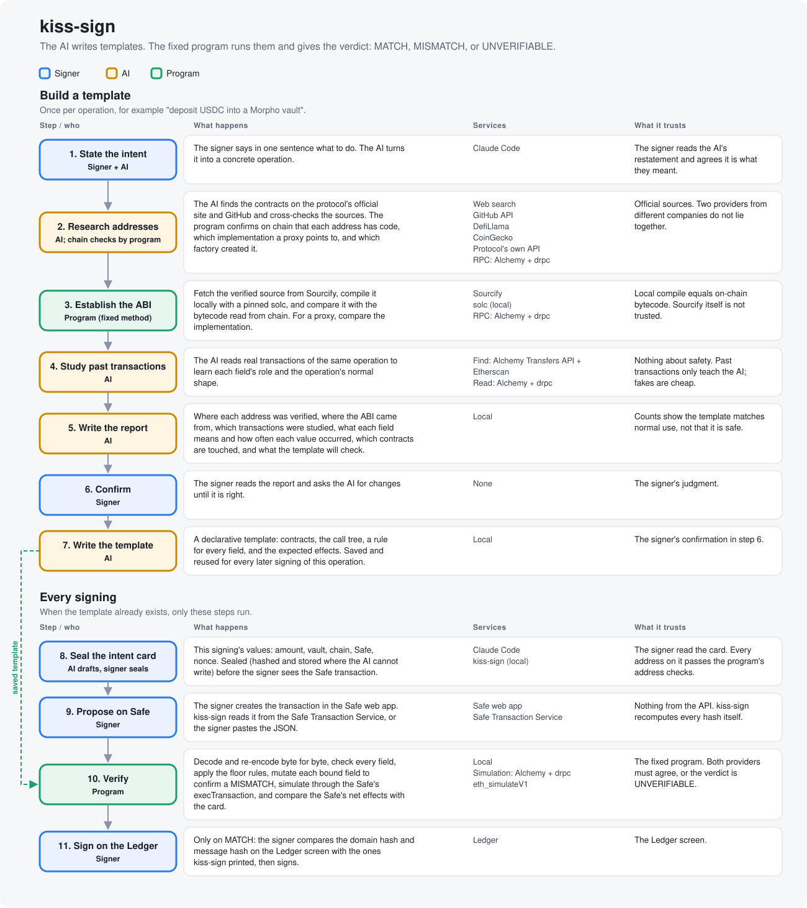

# kiss-sign

kiss-sign checks a Safe transaction against what you meant to do, before you sign it on a Ledger.

You state an intent in plain words. An AI researches the operation and writes a reusable template for it. A fixed program runs that template against the proposed transaction and prints one of three verdicts:

- `MATCH`: the transaction does exactly what the intent card says. kiss-sign prints the hashes your Ledger will show.
- `MISMATCH`: something differs. Do not sign.
- `UNVERIFIABLE`: kiss-sign could not prove it either way, for example because two chain providers disagreed. Do not sign.

**The AI writes templates, the program runs them.** The verdict is never the AI's judgment. If the AI is fooled, the worst outcome is `UNVERIFIABLE` or `MISMATCH`, never a wrong `MATCH`.

> Status: early development. Nothing here is ready to use yet.

## How it works

There are two flows:

1. **Build a template**, once per operation, such as "deposit USDC into a Morpho vault". The AI researches the contract addresses and past transactions and writes a report. A fixed method proves the ABI by compiling the verified source and comparing it with the bytecode on chain. You confirm the report, and the AI saves the template.
2. **Every signing.** You seal an intent card with this signing's values before you see the transaction. Then you propose the transaction on Safe. The program decodes it, checks every field against the template and the card, mutates it to confirm the checks catch changes, and simulates it. On `MATCH`, you compare the hashes on your Ledger and sign.

Every on-chain read goes to two providers run by different companies, and both must agree.

See [docs/design.md](docs/design.md) for the full design: data shapes, engine checks, chain access, and known limits.

## Scope

Safe multisig transactions on Ethereum mainnet, signed with a Ledger. EOA signing, off-chain EIP-712 signatures, and other chains are out of scope.
