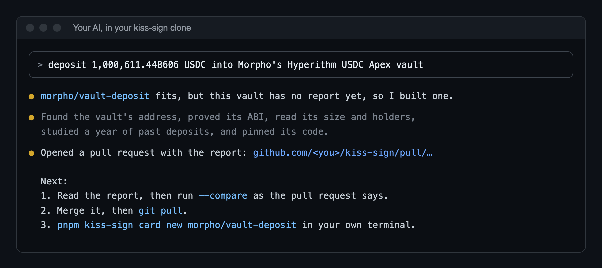
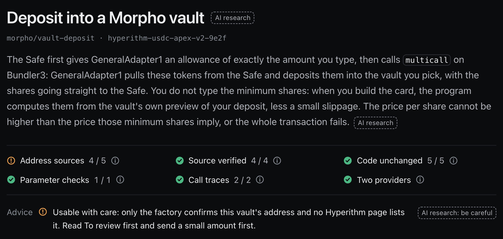
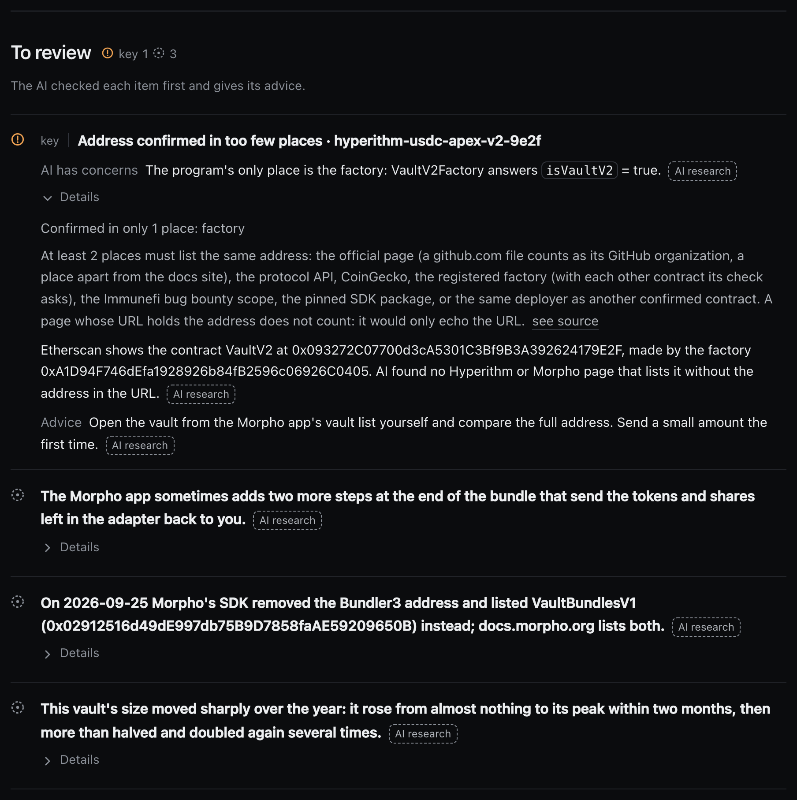
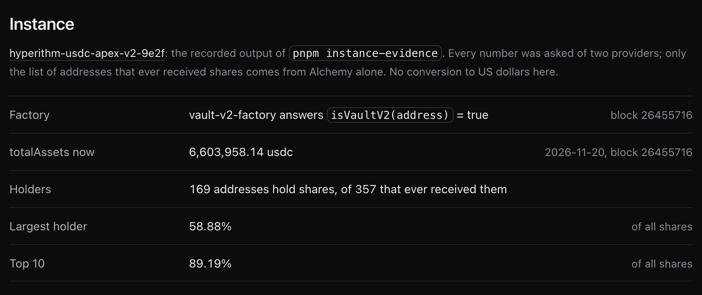
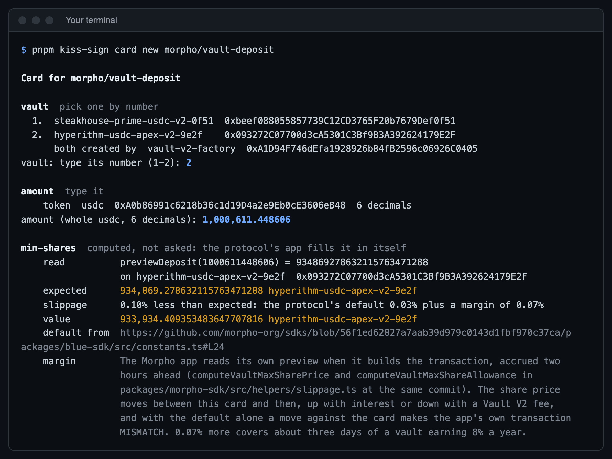
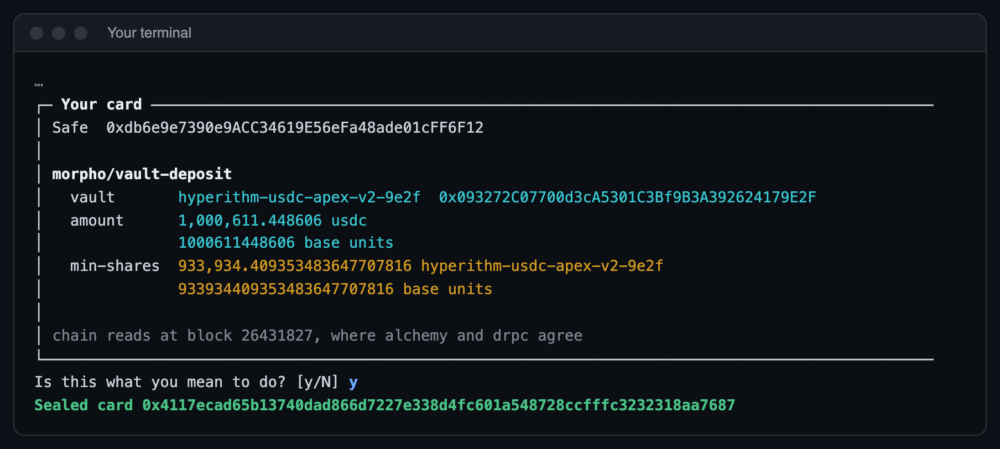

<p align="center">
  <picture>
    <source media="(prefers-color-scheme: dark)" srcset="docs/logo-dark.svg">
    
  </picture>
</p>

<h1 align="center">kiss-sign</h1>

<p align="center"><b><i>Keep it simple, stupid, and sign.</i></b></p>

Signing tools today show you a transaction and ask whether it looks right. Your intent is checked last, by you, at the moment you are most likely to click through. Two losses show where that breaks:

- **Bybit, February 2025, about $1.5 billion.** The attacker [masked the signing interface](https://announcements.bybit.com/en/article/incident-update---eth-cold-wallet-incident-blt292c0454d26e9140/) of a Safe transaction the signers approved. What was missing: an independent check of the transaction.
- **Drift, April 2026, about $280 million.** Two signers gave approvals Drift later called ["misrepresented"](https://x.com/DriftProtocol/status/2039564437795836039). What was missing: a check of what the transaction was meant to do.

kiss-sign does both: you write down what you want first, and before you sign, it checks the transaction itself, not the app's screen, against what you wrote.

<picture>
  <source media="(prefers-color-scheme: dark)" srcset="docs/readme/overview-dark.png">
  
</picture>

## Contents

- [Why](#why)
- [Install](#install)
  - [Your computer: kiss-sign](#your-computer-kiss-sign)
  - [A second, clean computer: kiss-sign-check (strongly recommended)](#a-second-clean-computer-kiss-sign-check-strongly-recommended)
- [How it works](#how-it-works)
  - [1. Tell your AI what you want](#1-tell-your-ai-what-you-want)
  - [2. Review the report and merge](#2-review-the-report-and-merge)
  - [3. Fill a card](#3-fill-a-card)
  - [4. Verify on your computer, and check on a second one](#4-verify-on-your-computer-and-check-on-a-second-one)
  - [5. Sign](#5-sign)
- [Threat model](#threat-model)
- [Token cost](#token-cost)
- [Scope](#scope)
- [Contributing](#contributing)
- [Disclaimer](#disclaimer)
- [Donate](#donate)
- [License](#license)

## Why

- **You are responsible for the exact bytes you sign.** Today the transaction is built first and checked last, when most people just click sign. At Bybit in 2025, the signers saw a normal transfer in a tampered Safe web app and signed the attacker's transaction.
- **Checking by hand is slow and needs expertise.** Tools such as [safe-tx-hashes](https://github.com/pcaversaccio/safe-tx-hashes-util) compute the hashes your wallet should show, but you still decode the data yourself. Here is one real Morpho vault deposit, from another Safe: first what safe-tx-hashes prints, shortened, then the data decoded by hand with cast.

  ![Two terminal runs on one Morpho vault deposit. First, safe-tx-hashes prints the hashes your hardware wallet should show; Safe's API decodes the first call, an approve, and leaves the second call, the one that moves the USDC into the vault, undecoded (dataDecoded: null); the script warns that it does not verify the decoded parts and that you must decode the data yourself. Second, decoding by hand with cast: you count byte offsets to split MultiSend's packed calls; the approve lets 0x4A6c…0aE0 spend 10,001 USDC; the second call is Bundler3's multicall holding an erc20TransferFrom that pulls 10,001 USDC from the Safe and an erc4626Deposit into vault 0x7777…7777 with a maximum share price of 1.054e15 (scaled by 1e27), shares to the Safe](docs/readme/decode.png)

  Safe's API decoded the approve but not the call that moves your USDC (`"dataDecoded": null`), and even the part it decoded you must verify yourself. And verifying it yourself is hard: you must find which functions it really runs and the ABI of each, then ask: is `0x4A6c…0aE0` really Morpho's GeneralAdapter1, is `0x7777…7777` the vault you meant, is `1.054e15` a sane maximum share price? And again for the next transaction.

- **[Clear signing (ERC-7730)](https://eips.ethereum.org/EIPS/eip-7730) shows only what someone has described.** A descriptor is a JSON file in the [ERC-7730 registry](https://github.com/ethereum/clear-signing-erc7730-registry) that tells a wallet how to show one contract's calls. For the deposit above, the chain of descriptors breaks at the first link (registry commit [`3bebbd0`](https://github.com/ethereum/clear-signing-erc7730-registry/tree/3bebbd05cbc2d2d2bf9c41a8edbf5e5cc88e4eb4)):

  1. [Safe's descriptor](https://github.com/ethereum/clear-signing-erc7730-registry/blob/3bebbd05cbc2d2d2bf9c41a8edbf5e5cc88e4eb4/registry/safe/common-eip712-Safe.json) shows the SafeTx and hands its data to the descriptor of the contract it calls.
  2. That contract is MultiSend, which wraps the whole batch. MultiSend has no descriptor, so neither call inside is shown.
  3. Past MultiSend, [Bundler3's descriptor](https://github.com/ethereum/clear-signing-erc7730-registry/blob/3bebbd05cbc2d2d2bf9c41a8edbf5e5cc88e4eb4/registry/morpho/calldata-MorphoBundlerV3.json) names its call "Bundler3 Multicall" and hands each action to GeneralAdapter1, which has no descriptor either. The two steps that move your USDC into the vault have nothing to show them by. This is the part of the descriptor that shows the multicall:

     ```json
     "multicall((address to, bytes data, uint256 value, bool skipRevert, bytes32 callbackHash)[] bundle)": {
       "intent": "Bundler3 Multicall",
       "fields": [{ "path": "#.bundle.[].data", "label": "Action", "format": "calldata",
                    "params": { "calleePath": "#.bundle.[].to", "amountPath": "#.bundle.[].value" } }]
     }
     ```

  kiss-sign needs no descriptor. Your wallet only has to show the hashes.

- **What kiss-sign adds.** Kirk Baird's talk [Why Blockchain Security Has Failed: Single Points of Failure](https://www.youtube.com/watch?v=J9q6FMKIQrw&t=163s) names three ways to reduce risk: harden, diversify and bound. kiss-sign does the first two; bound, how much a transaction can lose, depends on what you choose to sign, such as the amount.
  - **Harden.** The web app flags general risks: unverified contracts, new or lookalike addresses, known threats. kiss-sign checks what you meant: every byte against your card and the template, each address against the protocol's own sources, each contract's code against the code you reviewed.
  - **Diversify.** Not only the web app's word: your computer, two RPC providers, your hardware wallet's hashes and, ideally, a second computer must agree.

## Install

> [!CAUTION]
> kiss-sign is provided as is, with no warranty. It can be wrong, and you alone are responsible for what you sign. See [Disclaimer](#disclaimer).

### Your computer: kiss-sign

Fork this repository and clone your fork. Your fork's `main` is the program `verify` trusts. You merge each template and registry pull request into it, and merging is your confirmation; program changes your AI merges itself, behind a gate (see [Your AI](#your-ai)).

```sh
git clone https://github.com/<you>/kiss-sign.git && cd kiss-sign
pnpm install
pnpm kiss-sign init --safe 0x… --language en   # or zh-TW for Traditional Chinese; see Language
pnpm kiss-sign key add alchemy
pnpm kiss-sign key add drpc
pnpm kiss-sign key add etherscan   # to build or review templates
pnpm kiss-sign key add github      # optional: lets your AI search GitHub and raises its hourly limit
```

You need:

- Node 22.21 or later and pnpm.
- Free [Alchemy](https://dashboard.alchemy.com/), [drpc](https://drpc.org/login) and [Etherscan](https://etherscan.io/myapikey) keys. Commands that read the chain ask both Alchemy and drpc, and refuse to run without either key.
- Optionally, a [GitHub token](https://github.com/settings/personal-access-tokens/new), for building or reviewing templates. It changes no verdict.
  - With it, your AI can search a protocol's GitHub organization for files that list an address, reading up to 20 code-search hits per address, which can add a source to a report.
  - GitHub then allows 5,000 requests an hour instead of 60. Without it, every command on your computer shares the 60, and a build can wait for the limit to reset.
  - Make it a fine-grained token with repository access "Public repositories" and no permissions added. kiss-sign sends it only to `api.github.com`.
- A hardware wallet that shows a Safe transaction's domain hash and message hash, or its safeTxHash.

**Language.** English (`en`, the default) or Traditional Chinese (`zh-TW`); change it with `pnpm kiss-sign init --language zh-TW`. It changes only the text you read, never a verdict. Give `./check.sh init` on the second computer the same language, so the comparison rows match.

### A second, clean computer: kiss-sign-check (strongly recommended)

kiss-sign-check runs on a second computer that has no AI and no kiss-sign. Malware or an AI on your computer cannot change what that computer shows, so it catches a tampered computer or AI that kiss-sign alone would miss. kiss-sign works without it.

To install it, follow the [kiss-sign-check README](https://github.com/ipromise2324/kiss-sign-check#set-up) on the second computer.

## How it works

The pictures below come from real reports kiss-sign generated from other senders' transactions.

### 1. Tell your AI what you want

Open an AI coding agent, such as Claude Code or Codex, in the clone and say it in one sentence: "deposit 1,000,611.448606 USDC into Morpho's Hyperithm USDC Apex vault". If no template covers it yet, the AI builds one by following the [kiss-sign skill](.claude/skills/kiss-sign/SKILL.md) and opens a pull request with a generated report. Claude Code loads the skill by itself; point another agent at that file.



### 2. Review the report and merge

The report shows what the transaction will do and where each fact came from. Text the AI wrote is marked `AI`; the program read or checked the rest. Read it top to bottom.

**The top.** A summary, the program's checks and the AI's advice. Here one check needs attention: 5 of the 6 addresses the transaction touches are confirmed in two places.



**To review.** What needs your attention, each with the AI's conclusion. Open Details for the reasons and the advice.



**The flow.** A diagram of where your tokens go: which contracts the Safe calls, which contracts those call in turn, and what comes back to the Safe. A solid line is a call the AI read in the contract's source and the program also saw in other senders' past transactions.


Under it, each argument says who decides it: you, the program or the template, or the app up to a limit. Fixed values are folded; changing one is a MISMATCH.


**The protocol and the instance.** The protocol's TVL, audits and incidents, then facts about the one contract you use, each read from two providers. For this vault: the factory that made it, its size and its holders, then a year of monthly size and the AI's notes on where your deposit goes.



**Addresses.** Where each address was found and who owns that site. Sites with one owner count as one place. An address the transaction touches needs two places; a reference address, which the transaction never touches and `card new` only reads a number from, needs one. CoW's settlement contract is in five sources but four places: CoW's docs, two repositories of CoW's GitHub, Immunefi and its deployer.


Weak evidence is shown, not hidden. Here the Hyperithm vault is confirmed only by its factory, so it is flagged.


**Past transactions.** Other senders' executed transactions of this operation: here no Safe among the transactions studied sent this deposit through VaultBundlesV1, and 2 EOAs made the same call, both of which succeeded.

You review an operation once. After that you review only what is new or changed: a report for another contract the template can call, a registry pull request, or a changed template. Merging is your confirmation. Then approve the template on your own computer, which records its hash so `verify` refuses any other version:

```sh
git pull
pnpm kiss-sign template approve morpho/vault-deposit
```

A changed template has a new hash, so `verify` refuses it until you approve it again.

### 3. Fill a card

In your own terminal, answer what the template asks: pick each contract, such as a token, a recipient or a vault, from a list with full addresses, and type each amount. You never type a value the protocol's app fills in by itself, such as a vault deposit's minimum shares: the program computes it from an on-chain read, the app's default slippage and a small margin the template states. A swap's minimum to receive is the exception: you type the slippage or the minimum, and the program compares it with an independent price when a price feed covers both tokens.



Then it prints the whole card and asks you to confirm it. Type `y` only if every line is what you mean to do. The card is sealed under its hash before you see any transaction.



### 4. Verify on your computer, and check on a second one

Propose the transaction in the Safe web app as usual. Then, on your computer:

```sh
pnpm kiss-sign verify --card <card hash> --safe-tx-hash <safeTxHash>
```

On the second computer, where you installed [kiss-sign-check](https://github.com/ipromise2324/kiss-sign-check), run the command `verify` prints after `MATCH`:

```sh
./check.sh <nonce> --hints '…'   # --hints only when the template reads bytes no ABI describes
```

`check.sh` fetches the same transaction from Safe's API, recomputes its hashes, and decodes each call with Foundry's `cast`, using the ABI [Sourcify](https://sourcify.dev) has for the contract. It talks only to Safe's API and Sourcify, with no API key.

On `MATCH`, both pages show the same comparison list. Every row must be equal, except the last column, where kiss-sign writes its names and notes. If any other row differs, stop. `check.sh` does not judge the transaction: read its warnings, which say what it could not decode, and read its calls against what you meant to do.

First the hashes. They must be identical on both pages and on your hardware wallet's screen:


Then every call, row by row, down to the calls inside a batch. This is another Safe's executed deposit through VaultBundlesV1, into the Steakhouse Prime vault: both sides split its MultiSend into the USDC approval and the VaultBundlesV1 deposit, call #3 below. Every column must be identical except the names on the right, which only kiss-sign writes, from its registry:


`--hints` tell `check.sh` how to read bytes that hold data rather than a call, such as a Vault V2 cap id. They carry positions and types only and never change a row, so a wrong hint cannot make the rows match. See [Hints from kiss-sign](https://github.com/ipromise2324/kiss-sign-check/blob/main/docs/hints.md).

### 5. Sign

Compare the hashes on `verify`'s page with your hardware wallet's screen, character by character: the domain hash and message hash, or the safeTxHash if that is what your wallet shows. Then sign. The first time you use a template or a new contract, send a small amount first.

## Threat model

`verify` is the check you run on your own computer before you sign ([step 4](#4-verify-on-your-computer-and-check-on-a-second-one)): it compares the transaction with your card, using the template you reviewed and checks that every template gets.

### The Safe web app or Transaction Service

`verify` checks the transaction you give it, from the Transaction Service by its safeTxHash or from a file, against your card, and comparing the hashes on your wallet checks that you sign that one.

| Attack | Stopped by |
|---|---|
| The Transaction Service gives `verify` the attacker's transaction, as at Bybit | `verify` checks it against your card: `MISMATCH` |
| The Transaction Service gives `verify` the transaction you meant, but your wallet is asked to sign another | You compare the hashes on your wallet with `verify`'s page: they differ. The attacker also needs the web app, which decides what your wallet is asked to sign |

### The RPC providers

`verify` reads the chain and simulates through two providers run by different companies, Alchemy and drpc, and uses an answer only when both give it.

| Attack | Stopped by |
|---|---|
| One provider gives a false answer, or none | `verify` compares the two answers: they differ, `UNVERIFIABLE` |
| Both give the same false answer, such as a simulation that hides your funds going elsewhere | The attacker needs both companies at once, and a bad transaction must still reach your Safe. The Safe web app's own simulation, run by Tenderly rather than these two providers, may still show your funds going elsewhere, if the web app itself is not compromised |

### Fake sources

Your AI finds each contract's address on the web, and a program fetches each contract's source code from Etherscan, so a fake page or fake source can mislead them. The report checks the site, the address and the source, and you review it before you merge.

| Attack | Stopped by |
|---|---|
| The AI uses a fake site | A program, not the AI, compares the site with those the protocol's listings name, on DefiLlama, CoinGecko, its bug bounty and GitHub: not among them, flagged for you. To pass, the fake site must be listed there too |
| The AI uses a wrong address | The address must be found in two places with different owners, such as the protocol's site, CoinGecko, the factory, the bug bounty or the SDK: fewer, flagged for you. To pass, the wrong address must be planted in two of them |
| Etherscan serves source code that is not the contract's, so a harmful call reads as a harmless one | A program compiles it with a pinned compiler and compares it byte for byte with the code on chain, except values set at deployment (immutables and linked libraries) and a metadata hash that differs, which the report flags as a finding: any other difference, refused |

With the second computer, `check.sh` takes its ABIs from Sourcify, not Etherscan. It does not judge addresses: whether one is the protocol's real contract stays on kiss-sign's source checks and your review of the report.

### Your AI

Models are trained to resist prompt injection, but a page your AI reads can still steer it, and it can simply be wrong. kiss-sign assumes both can happen.

| Attack | Stopped by |
|---|---|
| The AI gets something wrong, such as a template that allows too much | `verify` refuses a delegatecall other than to the official MultiSend, an unlimited approval other than one the template keeps for a registry contract that declares a standing allowance (no shipped template keeps one), a Safe setting change other than an owner or threshold change the card declares, and an unexplained balance change, whatever the template says; the rest shows in the report you review |
| A steered AI changes the report, `verify`'s code or its verdict | A bad transaction must still reach your Safe, through a compromised web app or protocol app; otherwise the attack fails. A program change never shares a pull request with a template or the registry |
| A steered AI adds a fake contract to the registry and makes the report look normal | Only you. `verify` and the second computer pass, since the transaction matches the card. The AI must be steered and change kiss-sign's code: hard, but possible. Open the sources the report lists, check that each domain is the protocol's own and that the page lists this address |

With the second computer, `check.sh` decodes the transaction without kiss-sign, so you see the real functions and arguments.

### The protocol you use

You choose the protocol; kiss-sign checks its state, its app's transactions and its code.

| Attack | Stopped by |
|---|---|
| The protocol or vault you pick is unsafe right now, such as one just hacked, or a vault made yesterday with no holders | The report shows the protocol's TVL and hacks from DefiLlama, and the vault's size over 12 months and its holders, found through Alchemy and their balances read through both providers, for you to judge before you merge |
| The protocol's app is compromised and sets a field you do not fill to a value no real user sends, such as a CoW order valid for a year | Of 90 CoW orders other Safes pre-signed in the template's shape, half were valid for 29 minutes or less and the longest for about 11 hours, so the template allows 12 hours at most: later is `MISMATCH`. Drift was exploited in April 2026 through pre-signed transactions that durable nonces kept valid |
| A contract is upgraded or reconfigured to act maliciously | The simulation: a balance or allowance change the card does not explain, `MISMATCH`. The recorded code: a registry contract whose code changed since your review, `MISMATCH`. Settings an admin can change, such as a vault's curator, fees or caps, and contracts that are not registry entries, such as the markets and oracles behind a vault, are not checked |
| The protocol is hacked while your funds are in it | Nothing: kiss-sign checks only the transactions you sign |

### You

kiss-sign checks a transaction against the card you sealed and the reports you merged, so it cannot catch your own mistake in them. A card with the wrong vault or an extra zero in the amount gets `MATCH`. Nothing catches a signature you give without comparing the hashes on your wallet, or a flagged address you merge without reading the report.

## Token cost

What it cost Claude Opus 5.5 to build each template and its report from zero, on 2026-11-27. Each report quotes, at its top, the request its build was given.

| Report | Tokens | Minutes | Model calls |
|---|---:|---:|---:|
| [erc20/transfer](https://claude.ai/artifact/BS37S6HgPtWWfA8Shr4bXF) | 7.80M | 10 | 72 |
| [eth/transfer](https://claude.ai/artifact/F3sTYhhcrorgfcrX9JVhr3) | 9.43M | 12 | 74 |
| [safe/add-owner](https://claude.ai/artifact/4KtdZ2AgNtGqZb9pWf7rj1) | 10.44M | 14 | 82 |
| [safe/remove-owner](https://claude.ai/artifact/WvgLR34g9ZFziSRv81Jryk) | 10.50M | 15 | 84 |
| [safe/swap-owner](https://claude.ai/artifact/Fnz7QXP1FhQMzq1XTXpPgc) | 13.63M | 16 | 91 |
| [safe/change-threshold](https://claude.ai/artifact/45J6jVfCkVN62LVdz7JbSQ) | 10.49M | 10 | 84 |
| [fluid/vault-deposit (fUSDC, new template)](https://claude.ai/artifact/Nj8pmT3cxujg7nAZkpucVY) | 18.53M | 32 | 114 |
| [fluid/vault-deposit (fUSDT, added vault)](https://claude.ai/artifact/HCXqnLBHMJP9WQ726KfXhe) | 8.82M | 14 | 76 |
| [compound/supply (cUSDCv3)](https://claude.ai/artifact/B42hzCNW84QVhvhACSQmU3) | 20.79M | 46 | 129 |
| [morpho/vault-deposit (Steakhouse, new template)](https://claude.ai/artifact/9mi42v4ZwDKe97XLPhNvPX) | 25.90M | 26 | 133 |
| [morpho/vault-deposit (Hyperithm, added vault)](https://claude.ai/artifact/WZxEhWeoaAyjuqFmgWowGb) | 13.67M | 30 | 98 |
| [cow/swap](https://claude.ai/artifact/YRiJ2jTKSpD4nZGiNRN55h) | 28.55M | 51 | 148 |
| [morpho/vault-v2-cap-submit (Sentora RLUSD Main)](https://claude.ai/artifact/2MDjndgcsu43froGJzo5Qs) | 24.63M | 34 | 144 |
| [morpho/vault-v2-cap-accept (Sentora RLUSD Main)](https://claude.ai/artifact/BUgSS7MoxSAaSwnpwZDtSr) | 10.64M | 21 | 86 |

In all: 14 builds, 213.8M tokens, 331 minutes.

The builds run from simple to hard: a plain transfer took about 8M tokens and 10 minutes; a swap with a price floor took about 29M tokens and 51 minutes. Each build is one AI agent starting from a clone without that template or its research. Almost all of these tokens are cache reads, which the API bills at a fraction of the normal input price.

## Scope

Safe multisig transactions on Ethereum mainnet. Not EOAs, Safe off-chain messages or other chains. It checks only what you sign: not what other owners sign without it, a module's transactions, or a hardware wallet that shows false hashes. For a Vault V2 curator, the templates submit and accept an increase of one market's absolute cap per transaction; adapter and collateral caps, relative caps, decreases and revocations have no template.

## Contributing

Issues, security problems included, and pull requests are welcome. A change to the program starts with [docs/design.md](docs/design.md), the source of truth.

## Disclaimer

kiss-sign is provided as is, with no warranty, and can be wrong. `MATCH` means only that the transaction matches the template you approved and the card you sealed, not that it is safe. You alone are responsible for what you sign.

## Donate

If kiss-sign is useful to you, you can support it here.

**Ethereum mainnet only:**

```
0x085e5A79318931FA87050B8B677f2dc0Df303D67
```

Copy the address from this page on GitHub, and compare it in full before you send.

## License

[MIT](LICENSE), except the diagram font (Excalifont, SIL Open Font License) and other projects' logos in the diagrams, which belong to their owners.
