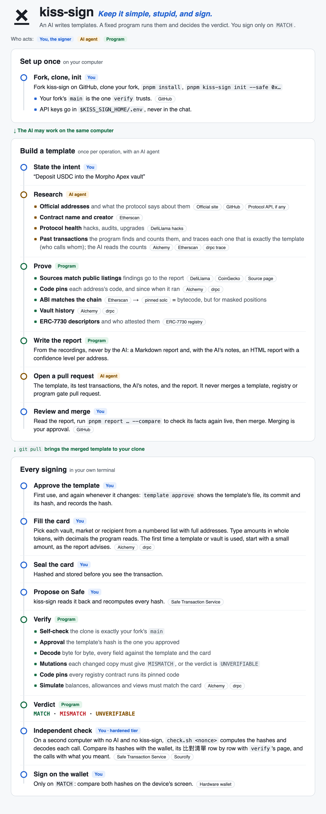

<p align="center">
  <picture>
    <source media="(prefers-color-scheme: dark)" srcset="docs/logo-dark.svg">
    
  </picture>
</p>

<h1 align="center">kiss-sign</h1>

<p align="center"><b><i>Keep it simple, stupid, and sign.</i></b></p>

kiss-sign checks a Safe transaction against what you meant to do, before you sign it on a hardware wallet.

> Status: early development. Nothing here is ready to use yet.

## Why kiss-sign

I sign Safe multisig transactions often, and every signature makes me responsible for the exact data I approve. Today the order is always the same: the transaction is built first, and the signer checks it last. That last check is like the terms on an insurance form. Everyone means to read it, and most people just click sign.

Checking the data properly is also slow: today's tools work only if you rebuild the transaction yourself and know how it is encoded.

Clear signing (ERC-7730) makes the final screen readable, but you still have to read it at the end and notice what's wrong. It also doesn't handle batched calls well yet and doesn't work for Safe transactions.

## How it works

kiss-sign turns the order around: you say what you want first, and the transaction is checked against it.

1. **An AI writes a template** the first time you do an operation, and you review and merge it as a pull request with its evidence.
2. **You fill a short card** at a prompt in your own terminal, picking each vault or recipient from a list with its full address, and confirm it before you see any transaction.
3. **A fixed program checks** the transaction against the template and your card, then prints a verdict:
   - `MATCH`: it does exactly what the card says. Compare the two hashes on your hardware wallet and sign.
   - `MISMATCH`: something differs. Do not sign.
   - `UNVERIFIABLE`: it could not be proven either way. Do not sign.



## Setup

0. Fork this repository on GitHub.
1. On your computer, with Node 22 and pnpm, clone your fork:

```sh
git clone https://github.com/<you>/kiss-sign.git && cd kiss-sign
pnpm install
pnpm kiss-sign init --safe 0x…
```

Reports and `verify`'s page are in English. For Traditional Chinese, add `--language zh-TW`; run `init` again with `--language` to change it later.

Your fork's `main` is what `verify` trusts, and merging a pull request into it is your confirmation, whether it changes a template or the program. This repository is only a source of updates; pull them when you want them, then push them to your fork's `main` (through a pull request, if you protect `main`):

```sh
git remote add upstream https://github.com/ipromise2324/kiss-sign.git
git pull upstream main
git push origin main
```

Every signer runs the same `verify` program; templates and the registry are data it reads. A change to the program (`src/`, `scripts/`, `docs/design.md`) that you merge into your fork works for you at once, since your `verify` trusts your fork's `main`, the `repo` that `init` wrote into `~/.kiss-sign/config.json`. Also open it as a pull request to this repository, so other signers can review it and every fork keeps running the same program.

`init` creates `~/.kiss-sign/.env`, readable by you only, and prints the command that opens it. Paste `ALCHEMY_API_KEY`, a free key from Alchemy, after its `=` sign; `verify` and `card new` need it.

```sh
open -e ~/.kiss-sign/.env            # macOS, in TextEdit
${EDITOR:-nano} ~/.kiss-sign/.env    # elsewhere
```

Or enter the key with `pnpm kiss-sign key add alchemy`; what you type is not shown on screen. Run every command from the clone as `pnpm kiss-sign <command>`, such as `pnpm kiss-sign card new morpho/vault-deposit`. After a `git pull` that changes `package.json`, pnpm installs the new dependencies itself before it runs the command.

To build templates or run the tests, `pnpm test` and the research scripts download the pinned compilers and lists they need on first use, and refuse any file whose sha256 differs from its pin.

## Two tiers

kiss-sign does not try to stop a prompt-injected AI. Pick how much else you trust.

**Basic: kiss-sign only.** Everything runs on one computer, and your AI may run there too.

| Step | Where | Who |
|---|---|---|
| 1. Research, write the template, open a pull request | Your computer | The AI. It never merges. |
| 2. Read the report and the template, run `pnpm report … --compare`, approve and merge | GitHub, and your computer | You |
| 3. `git pull`, approve the template, fill the card with `pnpm kiss-sign card new`, seal, verify | Your computer, in your own terminal | You |
| 4. The first time a template or a vault is used, send a small amount first | Safe | The signers |
| 5. Sign, comparing the full hashes | Hardware wallet | You |

As long as nothing on your computer rewrites kiss-sign or your cards, it stops attacks from outside kiss-sign: a tampered Safe web app, as in the Bybit hack, a transaction that differs from your card, and balance changes the template does not explain. It does not stop kiss-sign itself being wrong or changed: a bug, an AI that edits the program or your cards on the same computer, a merge made with your own GitHub credentials, or a harmful pull request you merged.

**Hardened: add an independent computer.** That computer runs no AI and no kiss-sign, only Foundry's `cast`, `curl`, `jq` and one short script from a separate repository, `ipromise2324/kiss-sign-check`. Before you sign, you type `check.sh <nonce>` there. It fetches the transaction from the Safe Transaction Service, computes its hashes itself, splits a MultiSend, checks each function name against its selector, decodes each call, and labels every address from your own hand-made `known-addresses.txt`. Both `verify` and `check.sh` write an HTML page, and after `MATCH` both pages show the same 比對清單: the hashes and every call, argument by argument, one numbered row each (`C1-to`, `C3.2-a2`), long values folded to their length and keccak256. You compare its hashes with the hardware wallet and the two pages' rows one by one; any row that differs means stop. kiss-sign then cannot make you sign something other than what that computer decodes. Whether an address is the protocol's real contract still rests on kiss-sign's checks, the report and your own address list, and only kiss-sign compares the transaction with your card. See [The independent check](docs/design.md#the-independent-check-hardened-tier).

- **Branch protection on `main`.** Still recommended, since `verify` trusts `main`. Once you turn it on, only your approval merges a pull request, and the AI pushes from an account that cannot approve or merge. That holds only while the AI cannot use your own GitHub credentials. Both are GitHub settings you make; on a private repository GitHub offers branch protection only with a paid plan.
- **A small amount first.** It catches honest mistakes and crude attacks. It does not catch a contract that behaves differently for large amounts, or one that turns hostile later.
- **A permission or parameter change** moves no value, so a small amount cannot test it. It relies on the program's checks and on the template's review.

## Keep it simple, stupid, and sign

Every part is small enough to check by hand.

- **Your job is small.** One sentence, one card, two hashes. The long review happens once per operation.
- **The judge is simple.** A fixed program decides. Templates are data, not code.
- **Trust is written down.** kiss-sign recomputes every hash, compiles every ABI, and asks two providers.
- **Doubt fails closed.** If it cannot prove a transaction, the answer is `UNVERIFIABLE`.
- **No more than needed.** Free services, Ethereum mainnet, Safe, and a hardware wallet.

## What each check stops

The diagram shows the flow. This is what each step actually does, and what it is there to stop.

**When a template is built** (once per operation, such as "deposit into a Morpho vault"):

- **Addresses are checked against more than one source.** The AI finds each address on the protocol's own site or GitHub and reads its Etherscan contract name and creator; the program proves on chain that the address has code, which implementation a proxy points to, and which factory created a vault. `pnpm check-sources` compares each source page's domain or GitHub org with DefiLlama's listing of the protocol, and checks that CoinGecko lists the named coin at each token's and vault share's address. It prints every disagreement as a finding for the signer to judge; it decides nothing, and agreeing listings are supporting evidence, not proof. *Stops:* an address copied from a look-alike site or a wrong coin's address, when a listing disagrees or the signer catches it in the report.
- **The ABI is proven by compiling it.** kiss-sign fetches the verified source from Sourcify, compiles it locally with a pinned `solc`, and matches the bytecode on chain, following proxies to their implementation. *Stops:* an ABI that labels a field as something it is not.
- **Rules come from evidence.** Past transactions show what each field normally holds, for example "`receiver` was the depositing Safe in all 42 past deposits". That count is the evidence behind the rule "`receiver` equals the Safe". *Stops:* a field the template forgot to bind.
- **The protocol's health is checked.** Past hacks, audits, recent upgrades, admin changes, and paused contracts go in the report. *Stops:* using a protocol that is unsafe right now.

**At every signing:**

- **The program checks itself first.** Before anything else, `verify` requires the local checkout to equal the merged `main` exactly. *Stops:* a template or the program being changed in the clone after you approved it. It cannot stop a change that rewrites the self-check too; the hardened tier's independent check does not depend on it.
- **The card is sealed before you see the transaction.** You fill and confirm the card yourself first, and kiss-sign stores it under its hash. *Stops:* the transaction shaping what you think you asked for.
- **Every hash is recomputed.** kiss-sign trusts no hash from the Safe web app or its API. *Stops:* a tampered interface showing one transaction while you sign another, as in the Bybit hack.
- **Decode, then re-encode byte for byte.** The re-encoded transaction must equal the original exactly. *Stops:* extra bytes hidden in the calldata.
- **Mutation check.** kiss-sign changes each bound field, and every changed copy must give `MISMATCH`. *Stops:* a template that looks strict but binds nothing.
- **Floor rules apply to every template:**
  - no unlimited approval;
  - no `delegatecall` except to the official MultiSend, and the rules apply again to every call inside it, at every level;
  - no owner, module, guard, threshold, fallback handler or implementation change;
  - the Safe's own fee fields are all zero, so a correctly hashed transaction cannot pay a refund to someone else.

  *Stops:* the attacks that take over the Safe itself, such as the upgrades behind the Bybit and WazirX hacks.
- **Simulation on two providers.** The transaction runs through the Safe's `execTransaction` with `eth_simulateV1` on Alchemy and drpc. Every change to the Safe's balances and allowances must be one the card explains, and both providers must agree. *Stops:* hidden side effects and a lying provider.
- **Hashes on the hardware wallet.** On `MATCH`, kiss-sign's verify page shows the domain hash and message hash, and you compare them on the wallet's screen. *Stops:* a tampered Safe web app or browser swapping the transaction at the last step.
- **In the hardened tier, an independent check.** A second computer with no AI and no kiss-sign fetches the transaction, computes its hashes and decodes it. *Stops:* kiss-sign itself, wrong or changed, showing you one transaction while the hash commits to another.

## What you confirm each time

The template is reviewed once. At each signing you confirm only the values that change, for example:

- a vault deposit: which vault and how much;
- a swap: what you sell and how much, what you buy, and the minimum you accept;
- a transfer: the token, the amount, and the recipient, which must already be in your address book.

Everything else is bound once: the receiver is the Safe, contracts come from the reviewed registry, the Safe and chain come from your config, and the program reads the nonce from the Safe. See [Intent card](docs/design.md#intent-card) for every operation.

## Threat model

TODO: the attacks kiss-sign is meant to stop, and the ones it cannot.

## More

[docs/design.md](docs/design.md) has the full design: data shapes, engine checks, chain access, known limits, and later security upgrades.

## Scope

Safe multisig transactions on Ethereum mainnet, signed with a hardware wallet that shows the Safe transaction's domain hash and message hash. EOA signing, off-chain EIP-712 signatures, and other chains are out of scope.
