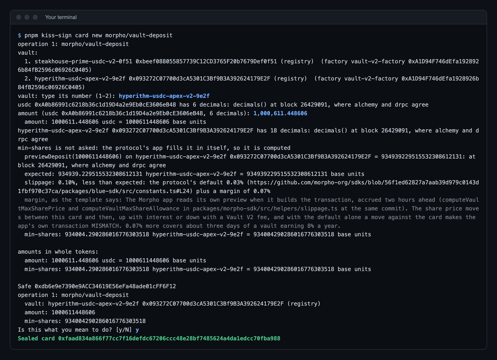
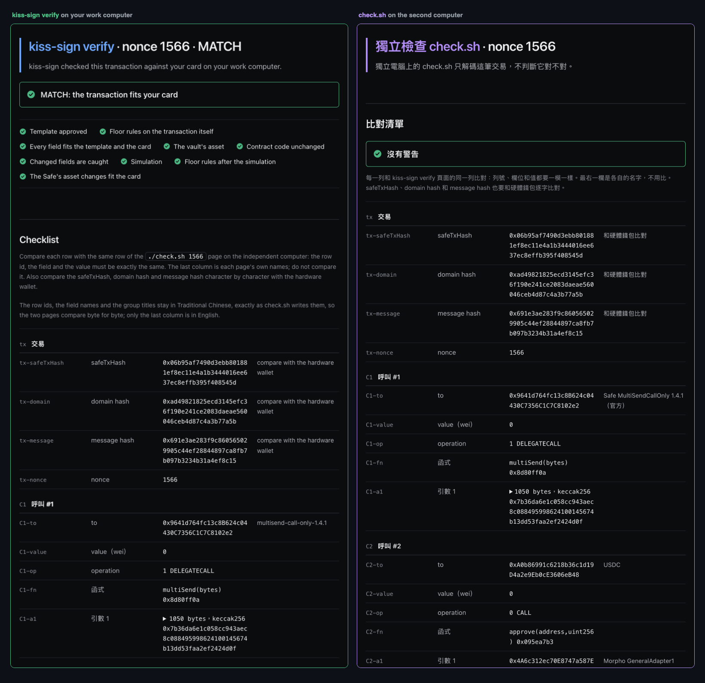

<p align="center">
  <picture>
    <source media="(prefers-color-scheme: dark)" srcset="docs/logo-dark.svg">
    
  </picture>
</p>

<h1 align="center">kiss-sign</h1>

<p align="center"><b><i>Keep it simple, stupid, and sign.</i></b></p>

Signing tools today show you a transaction and ask whether it looks right. Your intent is checked last, by you, at the moment you are most likely to click through. kiss-sign turns that around: you say what you want first, your AI researches the protocol once, and every Safe transaction is checked against what you said before you sign on a hardware wallet.

<picture>
  <source media="(prefers-color-scheme: dark)" srcset="docs/readme/overview-dark.png">
  
</picture>

## Contents

- [Why](#why)
- [How it works](#how-it-works)
  - [1. Tell your AI what you want](#1-tell-your-ai-what-you-want)
  - [2. Review the report and merge](#2-review-the-report-and-merge)
  - [3. Fill a card](#3-fill-a-card)
  - [4. Verify on your computer, and check on a second one](#4-verify-on-your-computer-and-check-on-a-second-one)
  - [5. Sign](#5-sign)
  - [Add your own operation](#add-your-own-operation)
- [If something is compromised](#if-something-is-compromised)
- [What kiss-sign checks](#what-kiss-sign-checks)
- [Scope](#scope)
- [Contributing](#contributing)
- [Disclaimer](#disclaimer)
- [Donate](#donate)
- [License](#license)

## Why

- **You are responsible for the exact bytes you sign.** Today the transaction is built first and checked last. That last check is like the terms on an insurance form: everyone means to read it, and most people click sign. At Bybit in 2025, the signers saw a normal transfer in a tampered Safe web app and signed a change to the Safe itself.
- **Checking by hand is slow and needs expertise.** Tools such as [safe-tx-hashes](https://github.com/pcaversaccio/safe-tx-hashes-util) compute the hashes your wallet should show, and tell you to decode the transaction's data yourself before you sign. To do that you need to know which function each call runs, what its parameters mean, and whether every address in it is the contract you meant. Decoding one real Morpho vault deposit yourself (another Safe's, not the one pictured below) looks like this:

  

  Then the real questions start. Is `0x4A6c…0aE0` Morpho's GeneralAdapter1 or a look-alike? Is `0x7777…7777` the vault you meant? Is `1.054e15` a sane maximum share price, scaled by 1e27, for 10,001 USDC? What are the 8 extra bytes after the approve? And you do all of this again for the next transaction.

- **[Clear signing (ERC-7730)](https://eips.ethereum.org/EIPS/eip-7730) shows only what someone has described.** A wallet with clear signing shows a call as readable fields, using a descriptor: a JSON file in the [ERC-7730 registry](https://github.com/ethereum/clear-signing-erc7730-registry) that says how to show one contract's functions. Here is the part of Bundler3's descriptor that shows the multicall in the deposit above ([`calldata-MorphoBundlerV3.json`](https://github.com/ethereum/clear-signing-erc7730-registry/blob/3bebbd05cbc2d2d2bf9c41a8edbf5e5cc88e4eb4/registry/morpho/calldata-MorphoBundlerV3.json), registry commit `3bebbd0`):

  ```json
  "multicall((address to, bytes data, uint256 value, bool skipRevert, bytes32 callbackHash)[] bundle)": {
    "intent": "Bundler3 Multicall",
    "fields": [{ "path": "#.bundle.[].data", "label": "Action", "format": "calldata",
                 "params": { "calleePath": "#.bundle.[].to", "amountPath": "#.bundle.[].value" } }]
  }
  ```

  It names the call "Bundler3 Multicall" and hands each action to the descriptor of the contract that action calls. Both actions here, `erc20TransferFrom` and `erc4626Deposit`, call GeneralAdapter1, which has no descriptor, so the two steps that move your USDC into the vault have nothing to show them by. MultiSend, which wraps the whole batch, has none either. The screen can look reasonable while the parts that move your money are not shown. kiss-sign needs no descriptor: your wallet only has to show the hashes.

## How it works

> [!CAUTION]
> kiss-sign is provided as is, with no warranty. It can be wrong, and you alone are responsible for what you sign. See [Disclaimer](#disclaimer).

The pictures below come from one real run: another Safe's deposit of 1,000,611.448606 USDC into a Morpho vault, the Hyperithm USDC Apex vault. One address crop is from another vault's report, as marked.

**Set up once.** Fork this repository and clone your fork. Your fork's `main` is the program `verify` trusts. You merge each template and registry pull request into it, and merging is your confirmation; program changes your AI merges itself, behind a gate (see [Add your own operation](#add-your-own-operation)).

```sh
git clone https://github.com/<you>/kiss-sign.git && cd kiss-sign
pnpm install
pnpm kiss-sign init --safe 0x… --language en   # or zh-TW for Traditional Chinese; see Language
pnpm kiss-sign key add alchemy
pnpm kiss-sign key add etherscan   # to build or review templates
pnpm kiss-sign key add github      # optional: raises GitHub's hourly limit to build or review templates
```

You need:

- Node 22.21 or later and pnpm.
- Free [Alchemy](https://dashboard.alchemy.com/) and [Etherscan](https://etherscan.io/myapikey) keys. A GitHub token is optional: a fine-grained, read-only one for public repositories raises GitHub's hourly limit when you build or review templates.
- A hardware wallet that shows a Safe transaction's domain hash and message hash, or its safeTxHash.
- For the hardened tier, a second computer with [kiss-sign-check](https://github.com/ipromise2324/kiss-sign-check), its `LANGUAGE` set to the language you gave `init`. It runs no AI and no kiss-sign, so malware or an AI on your computer cannot also change what you compare. Without it you are on the basic tier, kiss-sign alone. See [Two tiers](docs/design.md#two-tiers).

**Language.** English (`en`, the default) or Traditional Chinese (`zh-TW`). Change it later with `pnpm kiss-sign init --language zh-TW`. It sets the terminal text, `verify`'s page and `pnpm history`; addresses, hashes and verdict words stay the same, and so do verdicts. Set `LANGUAGE` in `check.sh`'s `config` to the same language, or the comparison rows differ.

### 1. Tell your AI what you want

In Claude Code, from the clone, say it in one sentence: "deposit 1,000,611.448606 USDC into Morpho's Hyperithm USDC Apex vault". If no template covers it yet, the AI builds one with the [kiss-sign skill](.claude/skills/kiss-sign/SKILL.md) and opens a pull request with a generated report.

### 2. Review the report and merge

The report shows what the transaction will do and where every fact came from. Text the AI wrote is marked `AI`; everything else the program read or checked.

**The call flow.** Which contract the Safe calls, in which order, and what comes back.


**Every field.** Each argument is fixed by the template, filled from your card, or, like a deadline or a route, left to the protocol's app within limits the template states.


**Every address.** Where it was found, whether that site belongs to the protocol, and whether CoinGecko and the factory agree. This crop is from the Steakhouse vault's report.


Weak evidence is shown, not hidden. The Hyperithm vault was confirmed only by its factory, so the report flags it and lists it under To review (待確認 in the Traditional Chinese report), with the AI's suggestion: open the vault from the Morpho app's list, compare the address, and send a small amount first.


This review happens once per operation, and once per vault. Merging is your confirmation. Then approve the template on your own computer, which records its hash so `verify` refuses any other version:

```sh
git pull
pnpm kiss-sign template approve morpho/vault-deposit
```

Approval records the template's hash, so a new vault for an approved template needs only its report reviewed and merged.

### 3. Fill a card

In your own terminal, pick the vault from a list with full addresses and type the amount. Values the protocol's app fills in by itself, such as the minimum shares, are computed from an on-chain read, the app's default slippage and a small margin the template states (0.10% in all for a Morpho deposit). The card is sealed under its hash before you see any transaction.



### 4. Verify on your computer, and check on a second one

Propose the transaction in the Safe web app as usual. Then, on your computer:

```sh
pnpm kiss-sign verify --card <card hash> --safe-tx-hash <safeTxHash>
```

On the second computer, run the command `verify` prints after `MATCH`:

```sh
./check.sh <nonce> --hints '…'   # --hints only when the template reads bytes no ABI describes
```

`check.sh` fetches the same transaction from Safe's API, recomputes its hashes, and decodes each call with Foundry's `cast`, using the ABI [Sourcify](https://sourcify.dev) has for the contract. It talks only to Safe's API and Sourcify, with no API key.

On `MATCH`, both pages show the same comparison list (Checklist, or 比對清單 in Traditional Chinese). Every row must be equal, except the last column, where each side writes its own names. If any other row differs, stop. `check.sh` does not judge the transaction: read its warnings, which say what it could not decode, and read its calls against what you meant to do.

`--hints` tell `check.sh` how to read bytes that hold data rather than a call, such as a Vault V2 cap id. They carry positions and types only and never change a row, so a wrong hint cannot make the rows match. See [Hints from kiss-sign](https://github.com/ipromise2324/kiss-sign-check#hints-from-kiss-sign).



### 5. Sign

Compare the hashes on `verify`'s page with your hardware wallet's screen, character by character: the domain hash and message hash, or the safeTxHash if that is what your wallet shows. Then sign. The first time you use a template or a vault, send a small amount first.

### Add your own operation

The templates in [`templates/`](templates/) are examples an AI wrote; read each one's report before you approve it. To sign something new, tell your AI, as in step 1. It opens a pull request with a template and its report, and you review and merge it.

A template is data: it picks from checks the program already has and gives a reason for each. It cannot loosen the [checks every transaction gets](docs/design.md#engine-checks-that-every-template-gets).

When no check fits, the AI first adds one to the program in a pull request of its own. It merges that one itself, once the program's tests pass and a second AI finds no security problem; you do not read program code. A change to those tests comes to you, like a template. What this leaves open is in [Who owns the program](docs/design.md#who-owns-the-program).

The report in a pull request was made on the AI's computer, so you cannot tell from it alone that its facts are true. Before you merge, read them again live with your own `main`'s code, which the pull request cannot change; any fact that differs from the report is printed (this needs the Alchemy and Etherscan keys):

```sh
git pull
git fetch origin <branch>
pnpm report <protocol>/<operation> [--vault-of <vault>] --compare --data origin/<branch>
```

## If something is compromised

kiss-sign does not try to stop a prompt-injected AI. Instead, no single part is trusted alone. To make you sign something you did not mean, an attacker has to beat several of these at once.

| If this is compromised | Where it is stopped | If that also fails |
|---|---|---|
| **The Safe web app or your browser**, as at Bybit | `verify` recomputes the hashes and checks the transaction against your card. `check.sh` decodes it on its own. | You compare the hashes on the hardware wallet. |
| **The Safe Transaction Service** | Both programs recompute every hash from the transaction's fields. | A different transaction gives a different hash on your device. |
| **One RPC provider** | Alchemy and drpc must agree, or the verdict is `UNVERIFIABLE`. | Two providers that collude could hide a side effect. `check.sh` does not simulate and still shows the calls. |
| **The AI writing a template** (prompt injection) | Every address check is PASS or FINDING in the report, AI text is marked, and `--compare` reads the facts again before you merge. | If you merge a wrong template, `verify` can say `MATCH`. `check.sh` labels addresses missing from your own list, and a small first amount limits the damage. |
| **An AI or malware on your work computer** | `verify` refuses a clone that differs from your fork's `main`, but code that also rewrites that check gets past it. | The second computer runs no kiss-sign and still decodes what you sign. Without it, nothing stops this. |
| **A program change the AI merges** | The [program gate](docs/design.md#the-program-gate), run with `main`'s code, and a second AI's review. | The gate proves only what its tests cover, and an AI that skips it is stopped only by its skill. See [Who owns the program](docs/design.md#who-owns-the-program). |
| **Your GitHub account** | Branch protection, if you turned it on. It does not stop your AI, which holds merge rights. | The second computer, as above. |
| **A registry contract upgraded** | Code pins: a contract whose code changed since your review gets `MISMATCH`. | Contracts outside the registry, such as the markets and oracles behind a vault, and admin settings are not pinned. |
| **The second computer** | It only decodes. `verify` still checks the transaction against your card. | You are back to the basic tier. |
| **An ERC-7730 descriptor** | Never used for the verdict, only listed in the report. | Nothing depends on it. |

An owner or threshold change moves no asset, so no small amount can test it. It rests on the template's review, the owners you confirm on the card, and the second computer.

Whether an address is the protocol's real contract rests in the end on the report and your review. Your fork of this public repository is public too: the vaults you add are visible, though your Safe's address is not. Every other limit is in [Known limits](docs/design.md#known-limits).

## What kiss-sign checks

**When a template is built**

- **Each address must show up in at least two places**, such as the protocol's official pages, its API, CoinGecko, the factory that created it, its bug bounty or its SDK. A page must be on the protocol's own site. Anything weaker is flagged in the report for you to judge.
- **The ABI is proven by compiling.** Etherscan's verified source, compiled with a pinned `solc`, must give the code on chain.
- **The protocol's facts are read.** Its TVL, listing date and past hacks, and for a vault its size over a year and its holders today.
- **The code is recorded.** Each registry contract's code is pinned, so an upgrade after your review is caught at signing.
- **Past transactions show what is normal.** The CoW app sets an order to expire in 30 minutes, and in the past year almost every real order expired within a day, so the template can refuse an order that expires a year from now. The same history shows how much rounding a balance needs.
- **Open fields are tested.** The fields the template leaves open are changed to a few other values each and simulated. Each change must revert or do nothing the template does not allow.

**At every signing**

- **kiss-sign checks itself.** It refuses a clone that is not exactly your fork's `main`.
- **Every hash is recomputed.** Nothing from the Safe web app or its API is trusted.
- **The call is decoded and encoded again.** The bytes must be identical, apart from a short trailer the template allows, so nothing is hidden.
- **Dangerous calls are refused.** An unlimited approval (unless the registry allows one, as for Permit2), a `delegatecall` to anything but the official MultiSend, and any change to the Safe's modules, guard or implementation.
- **The code is compared with the recorded code.** A contract upgraded since your review gets `MISMATCH`.
- **The transaction is simulated on two providers.** Every balance change must match your card, apart from a rounding of at most 10 base units the template states.
- **A minimum of 0 is refused.** It would protect nothing.
- **`MATCH` only when every check reports a pass.**

The exceptions are in [Known limits](docs/design.md#known-limits).

Your Safe's address stays in `~/.kiss-sign/` and never enters the repository; a pre-push hook refuses a push that contains it or an API key. [docs/design.md](docs/design.md) is the source of truth for every check.

## Scope

Safe multisig transactions on Ethereum mainnet. Not EOAs, Safe off-chain messages or other chains. A Vault V2 curator's cap change covers one cap id per transaction: one market, one collateral or one adapter.

## Contributing

There is no maintainer: no one upstream reviews or merges a pull request, and this repository is only a source of updates you may pull into your fork. Change your own fork as above, and open an issue for a bug you find. `pnpm test` downloads the pinned `solc` compilers and the Public Suffix List once, then runs offline. For a program change, change `docs/design.md` first.

Report security problems as an issue too.

## Disclaimer

kiss-sign is provided as is, without warranty of any kind. It can be wrong: a bug, a wrong template or registry entry, a compromised service or a compromised computer can make it print `MATCH` for a transaction you did not mean. `MATCH` says only that the transaction matches the template you approved and the card you sealed. It does not say that a protocol, a contract or a transaction is safe, and nothing here is financial, legal or security advice.

You alone are responsible for every transaction you sign. The authors and contributors are not liable for any loss, however it arises, including through the use of kiss-sign or `kiss-sign-check`.

## Donate

If kiss-sign is useful to you, you can support it with ETH on Ethereum mainnet:

```
TODO: donation address
```

Copy the address from this page on GitHub, and compare it in full before you send.

## License

[MIT](LICENSE). Anyone may use, copy, change, publish and sell kiss-sign, provided the license notice stays with it. The diagram font in `docs/diagrams/fonts/` is Excalifont, under the SIL Open Font License, and the logos in `docs/diagrams/logos/`, also drawn into `docs/readme/overview.png` and `overview-dark.png`, belong to their owners and are not under MIT.
