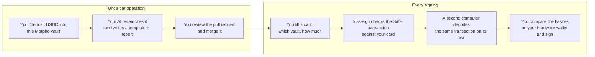
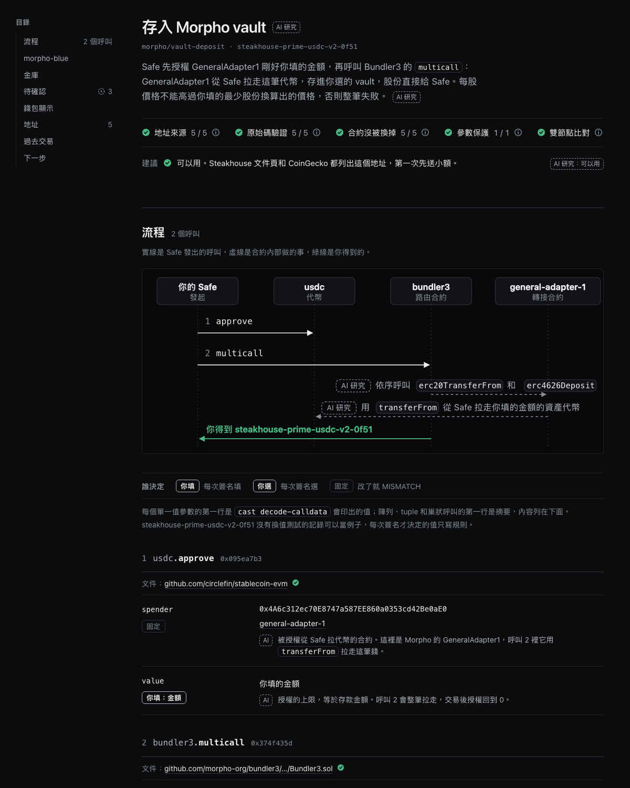

<p align="center">
  <picture>
    <source media="(prefers-color-scheme: dark)" srcset="docs/logo-dark.svg">
    
  </picture>
</p>

<h1 align="center">kiss-sign</h1>

<p align="center"><b><i>Keep it simple, stupid, and sign.</i></b></p>

Signing tools today show you a transaction and ask whether it looks right. Your intent is checked last, by you, at the moment you are most likely to click through. kiss-sign turns that around: you say what you want first, and a program checks the transaction against it before you sign on a hardware wallet.



## Why

- **You are responsible for the exact bytes you sign.** Today the transaction is built first and checked last. That last check is like the terms on an insurance form: everyone means to read it, and most people click sign. At Bybit in 2025, the signers saw a normal transfer in a tampered Safe web app and signed a change to the Safe itself.
- **Checking by hand is slow and needs expertise.** Tools such as [safe-tx-hashes](https://github.com/pcaversaccio/safe-tx-hashes-util) compute the hashes your wallet should show, but the decoded method and parameters they print come from the Safe Transaction Service, and the tool itself warns: *"Always independently decode the transaction Data yourself before you sign!"* Decoding one ordinary Morpho vault deposit yourself looks like this:

  <details>
  <summary>Decoding a real Morpho deposit by hand (another Safe's nonce 20)</summary>

  ```sh
  # 1. The Safe calls MultiSend. Its one argument is packed bytes, not ABI.
  $ cast 4byte-calldata $DATA
  1) "multiSend(bytes)"

  # 2. Split the packed bytes yourself: 1 byte operation, 20 bytes to, 32 value, 32 length, data.
  call 1  op=00  to=0xa0b86991c6218b36c1d19d4a2e9eb0ce3606eb48  76 bytes  selector 0x095ea7b3
  call 2  op=00  to=0x6566194141eefa99af43bb5aa71460ca2dc90245  812 bytes selector 0x374f435d

  # 3. Call 1: an approve. 76 bytes is 8 more than approve needs; cast does not say so.
  $ cast decode-calldata "approve(address,uint256)" $CALL1
  0x4A6c312ec70E8747a587EE860a0353cd42Be0aE0
  10001000000 [1e10]

  # 4. Call 2: a Bundler3 multicall, whose bundle holds more calls.
  $ cast decode-calldata "multicall((address,bytes,uint256,bool,bytes32)[])" $CALL2
  [(0x4A6c…0aE0, 0xd96ca0b9…, 0, false, 0x00…), (0x4A6c…0aE0, 0x6ef5eeae…, 0, false, 0x00…)]

  # 5. Decode each inner call.
  $ cast decode-calldata "erc20TransferFrom(address,address,uint256)" 0xd96ca0b9…
  0xA0b86991c6218b36c1d19D4a2e9Eb0cE3606eB48
  0x4A6c312ec70E8747a587EE860a0353cd42Be0aE0
  10001000000 [1e10]
  $ cast decode-calldata "erc4626Deposit(address,uint256,uint256,address)" 0x6ef5eeae…
  0x777791C4d6DC2CE140D00D2828a7C93503c67777
  10001000000 [1e10]
  1054633213541066 [1.054e15]
  0x4F6981AD898c3296C0FFC5afd44Af4281f7ebF9B
  ```

  Then the real questions start. Is `0x4A6c…0aE0` Morpho's GeneralAdapter1 or a look-alike? Is `0x7777…7777` the vault you meant? Is `1.054e15` a sane minimum of shares for 10,001 USDC? What are the 8 extra bytes after the approve? And you do all of this again for the next transaction.
  </details>

- **Clear signing (ERC-7730) does not decode batched calls well yet.** It turns a call into readable fields, but only for contracts with a descriptor. For the deposit above, at registry commit `3bebbd0`, only Bundler3 has one. It names the call "Bundler3 Multicall" and passes each inner action to the descriptor of its target. MultiSend, GeneralAdapter1 and the vault have none. The screen can look reasonable while the parts that move your money are not shown.

## How it works

**Set up once.** Fork this repository and clone your fork. Your fork's `main` is the program `verify` trusts, so merging a pull request into it is your confirmation.

```sh
git clone https://github.com/<you>/kiss-sign.git && cd kiss-sign
pnpm install
pnpm kiss-sign init --safe 0x…
pnpm kiss-sign key add alchemy
```

You need Node 22.21 or later, pnpm, a free [Alchemy](https://dashboard.alchemy.com/) key, and a hardware wallet that shows a Safe transaction's domain hash and message hash. For the second computer, see [kiss-sign-check](https://github.com/ipromise2324/kiss-sign-check).

**1. Tell your AI what you want.** In Claude Code, from the clone, say it in one sentence, such as "deposit 10,000 USDC into the Steakhouse Prime USDC vault". If there is no template for the operation yet, the AI builds one with the [kiss-sign skill](.claude/skills/kiss-sign/SKILL.md). It researches the contracts, reads the operation's transaction history, and opens a pull request with a generated report of its evidence.

> 📸 *Screenshot: telling the AI the intent.*

**2. Review the report and merge.** The report says where every address came from, which checks passed, and what the AI wrote, marked as AI text. You read it and merge. The AI never merges. This happens once per operation, or once per vault.



**3. Fill a card.** In your own terminal, `pnpm kiss-sign card new morpho/vault-deposit` lists the vaults with their full addresses. You pick one and type the amount. The card is sealed under its hash before you see any transaction.

> 📸 *Screenshot: `card new` in the terminal.*

**4. Propose in the Safe web app, then verify.** `pnpm kiss-sign verify --card <hash> --safe-tx-hash <hash>` prints `MATCH`, `MISMATCH` or `UNVERIFIABLE`, and writes a page with the card, the expected balance changes and a comparison list of every call.

> 📸 *Screenshot: the verify page after `MATCH`.*

**5. Check on a second computer.** There, `check.sh <nonce>` fetches the same transaction, computes its hashes and decodes it with Foundry's `cast` alone. Its page shows the same comparison list. Compare the two pages row by row.

> 📸 *Screenshot: the two pages side by side.*

**6. Sign.** Compare the domain hash and message hash with your hardware wallet's screen, then sign.

The signer-facing pages are in Traditional Chinese. The terminal, the code and the docs are in English.

### Add your own operation

The templates in `templates/` are examples: ETH and ERC-20 transfers, and Morpho and Fluid vault deposits. kiss-sign is meant to grow with what you sign. For anything else, tell your AI what you want to do, as in step 1. It builds the template, and you review its pull request. Before merging, rerun every fact in the report yourself:

```sh
pnpm report <protocol>/<operation> --compare --data origin/<branch>
```

## What it protects against

No single check is trusted alone. To make you sign something you did not mean, an attacker has to beat several independent views of the same transaction at once:

| View | Runs on | Shows |
|---|---|---|
| kiss-sign `verify` | Your work computer | Whether the transaction matches your card, simulated on two providers |
| `kiss-sign-check` | A second computer with no AI and no kiss-sign | The hashes and every decoded call, labelled from an address list you wrote by hand |
| The Safe web app's own simulation | Safe's servers | What the transaction does, as Safe sees it |
| Your hardware wallet | The device | The two hashes you actually sign |

### What kiss-sign checks

When a template is built:

- **Addresses come from more than one source.** The protocol's own site or GitHub, cross-checked against DefiLlama and CoinGecko, and the factory that created each vault is asked on chain.
- **ABIs are proven by compiling.** The verified source from Sourcify is compiled locally with a pinned `solc` and must match the code on chain.
- **Rules come from history.** "`receiver` was the sender in every past deposit" becomes the rule "`receiver` equals the Safe".
- **Every field the template leaves free is changed and simulated.** It must revert or change nothing.

At every signing:

- **The program checks itself first.** Your clone must equal your fork's `main` byte for byte.
- **Every hash is recomputed.** Nothing from the Safe web app or its API is trusted.
- **Decode, then re-encode byte for byte.** No hidden bytes.
- **Floor rules for every template.** No unlimited approval, no `delegatecall` except the official MultiSend, no change to the Safe's owners, modules, guard, threshold or implementation, and no gas refund.
- **Two RPC providers.** The transaction is simulated on Alchemy and drpc, and every change to the Safe's balances and allowances must be one your card explains. The two must agree.
- **Code pins.** Every contract the transaction touches must run the code its review pinned. An upgraded contract is `MISMATCH` until it is reviewed again.

Your Safe's address stays in `~/.kiss-sign/` and never enters the repository. A pre-push hook refuses any push that contains it or an API key.

### What it does not protect against

- **A prompt-injected AI.** The AI that writes templates reads the web, and nobody yet knows how to stop it from editing code it may edit. An AI on your work computer can rewrite kiss-sign, its self-check and your cards together. The second computer is the answer: it never runs kiss-sign, so it still decodes what you actually sign.
- **A template that was wrong when you merged it.** No check catches it later. Your review and a small first amount are the defense.
- **Which address is the real contract.** That rests on the report, your review, and your own address list.
- **A contract that turns hostile without an upgrade**, through settings an admin can change or code that behaves differently for large amounts.
- **Two RPC providers that collude** or share a backend.
- **What your fork shows.** Your fork is public. The vaults and protocols you add to it are visible, even though your Safe's address is not.

The full list is in [Known limits](docs/design.md#known-limits). [docs/design.md](docs/design.md) is the source of truth for every check.

## Scope

Safe multisig transactions on Ethereum mainnet. Not EOAs, off-chain signatures or other chains.

## Contributing

Open an issue or a pull request. Tests run offline with `pnpm test`. For a program change, change `docs/design.md` first.

Report security problems as an issue too.

## License

TODO
