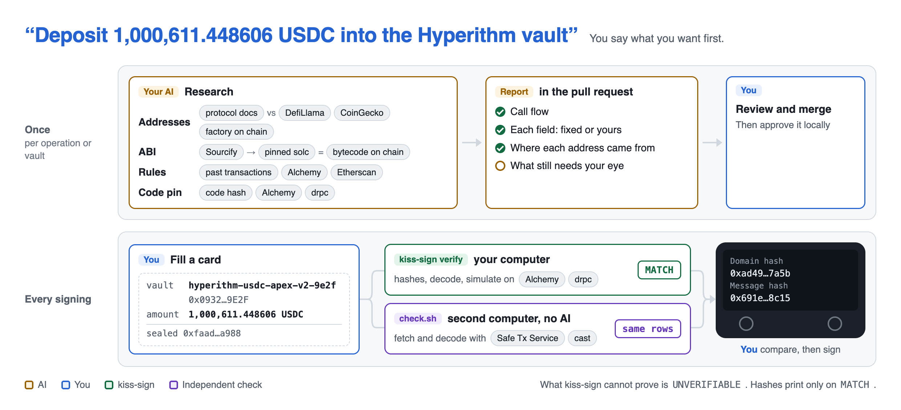
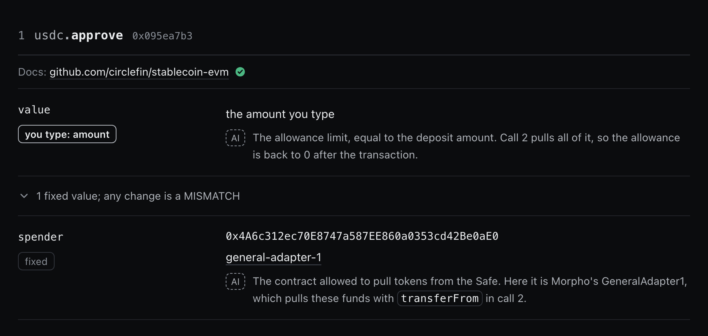
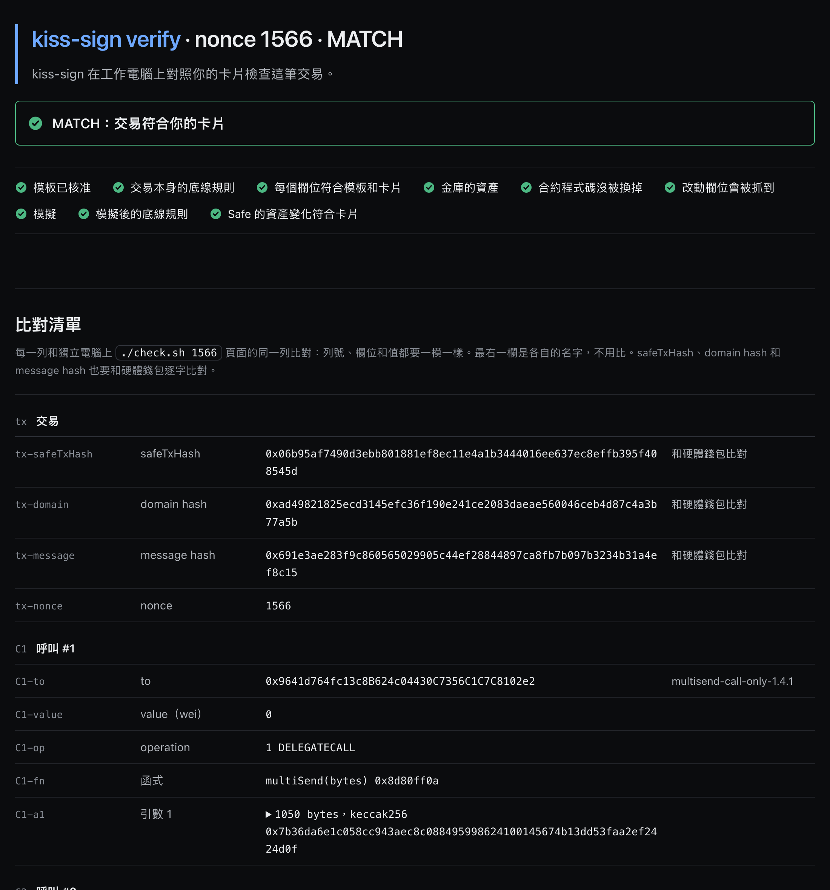

<p align="center">
  <picture>
    <source media="(prefers-color-scheme: dark)" srcset="docs/logo-dark.svg">
    
  </picture>
</p>

<h1 align="center">kiss-sign</h1>

<p align="center"><b><i>Keep it simple, stupid, and sign.</i></b></p>

Signing tools today show you a transaction and ask whether it looks right. Your intent is checked last, by you, at the moment you are most likely to click through. kiss-sign turns that around: you say what you want first, and a program checks the Safe transaction against it before you sign on a hardware wallet.

<picture>
  <source media="(prefers-color-scheme: dark)" srcset="docs/readme/overview-dark.png">
  
</picture>

## Why

- **You are responsible for the exact bytes you sign.** Today the transaction is built first and checked last. That last check is like the terms on an insurance form: everyone means to read it, and most people click sign. At Bybit in 2025, the signers saw a normal transfer in a tampered Safe web app and signed a change to the Safe itself.
- **Checking by hand is slow and needs expertise.** Tools such as [safe-tx-hashes](https://github.com/pcaversaccio/safe-tx-hashes-util) compute the hashes your wallet should show, but the decoded method and parameters they print come from the Safe Transaction Service, and the tool itself warns: *"Always independently decode the transaction Data yourself before you sign!"* Decoding one ordinary Morpho vault deposit yourself looks like this:

  <details>
  <summary>Decoding a real Morpho vault deposit by hand</summary>

  ```sh
  # 1. The Safe calls MultiSend. Its one argument is packed bytes, not ABI.
  $ cast 4byte-calldata $DATA
  1) "multiSend(bytes)"

  # 2. Split the packed bytes yourself: 1 byte operation, 20 bytes to, 32 value, 32 length, data.
  call 1  op=00  to=0xa0b86991c6218b36c1d19d4a2e9eb0ce3606eb48  76 bytes  selector 0x095ea7b3
  call 2  op=00  to=0x6566194141eefa99af43bb5aa71460ca2dc90245  812 bytes selector 0x374f435d

  # 3. Call 1: an approve. 76 bytes is 8 more than approve needs; cast does not say so.
  $ cast decode-calldata "approve(address,uint256)" $CALL1
  0x4A6c312ec70E8747a587EE860a0353cd42Be0aE0
  10001000000 [1e10]

  # 4. Call 2: a Bundler3 multicall, whose bundle holds more calls.
  $ cast decode-calldata "multicall((address,bytes,uint256,bool,bytes32)[])" $CALL2
  [(0x4A6c…0aE0, 0xd96ca0b9…, 0, false, 0x00…), (0x4A6c…0aE0, 0x6ef5eeae…, 0, false, 0x00…)]

  # 5. Decode each inner call.
  $ cast decode-calldata "erc20TransferFrom(address,address,uint256)" 0xd96ca0b9…
  0xA0b86991c6218b36c1d19D4a2e9Eb0cE3606eB48
  0x4A6c312ec70E8747a587EE860a0353cd42Be0aE0
  10001000000 [1e10]
  $ cast decode-calldata "erc4626Deposit(address,uint256,uint256,address)" 0x6ef5eeae…
  0x777791C4d6DC2CE140D00D2828a7C93503c67777
  10001000000 [1e10]
  1054633213541066 [1.054e15]
  0x4F6981AD898c3296C0FFC5afd44Af4281f7ebF9B
  ```

  Then the real questions start. Is `0x4A6c…0aE0` Morpho's GeneralAdapter1 or a look-alike? Is `0x7777…7777` the vault you meant? Is `1.054e15` a sane minimum of shares for 10,001 USDC? What are the 8 extra bytes after the approve? And you do all of this again for the next transaction.
  </details>

- **Clear signing (ERC-7730) does not decode batched calls well yet.** It turns a call into readable fields, but only for contracts with a descriptor. For the deposit above, at registry commit `3bebbd0`, only Bundler3 has one. It names the call "Bundler3 Multicall" and passes each inner action to the descriptor of its target. MultiSend, GeneralAdapter1 and the vault have none. The screen can look reasonable while the parts that move your money are not shown.

## How it works

The pictures below come from one real run: another Safe's deposit of 1,000,611.448606 USDC into a Morpho vault, the Hyperithm USDC Apex vault. One address crop is from another vault's report, as marked.

**Set up once.** Fork this repository and clone your fork. Your fork's `main` is the program `verify` trusts, so merging a pull request into it is your confirmation.

```sh
git clone https://github.com/<you>/kiss-sign.git && cd kiss-sign
pnpm install
pnpm kiss-sign init --safe 0x…
pnpm kiss-sign key add alchemy
pnpm kiss-sign key add etherscan   # only to build templates
```

You need Node 22.21 or later, pnpm, free [Alchemy](https://dashboard.alchemy.com/) and [Etherscan](https://etherscan.io/myapikey) keys, and a hardware wallet that shows a Safe transaction's domain hash and message hash. The second computer needs [kiss-sign-check](https://github.com/ipromise2324/kiss-sign-check).

Turn on branch protection for your fork's `main`, so that a pull request needs your approval, and let your AI push from a GitHub account that cannot approve or merge. Until you do, nothing on GitHub stops an AI that can push from merging. On a private repository, GitHub offers branch protection only on a paid plan.

### 1. Tell your AI what you want

In Claude Code, from the clone, say it in one sentence: "deposit 1,000,611.448606 USDC into the Hyperithm USDC vault on Morpho". If no template covers it yet, the AI builds one with the [kiss-sign skill](.claude/skills/kiss-sign/SKILL.md) and opens a pull request with a generated report.

### 2. Review the report and merge

The report shows what the transaction will do and where every fact came from. Text the AI wrote is marked `AI`; everything else the program checked.

**The call flow.** Which contract the Safe calls, in which order, and what comes back.


**Every field.** Each argument is either fixed by the template or filled from your card.



**Every address.** Where it was found, whether that site belongs to the protocol, and whether CoinGecko and the factory agree. This crop is from the Steakhouse vault's report.


Weak evidence is shown, not hidden. The Hyperithm vault was confirmed only by its factory, so the report flags it and lists it under 待確認 (to confirm), with the AI's suggestion: open the vault from the Morpho app's list, compare the address, and send a small amount first.


Merging is your confirmation. Then approve the template on your own computer, which records its hash so `verify` refuses any other version:

```sh
git pull
pnpm kiss-sign template approve morpho/vault-deposit
```

This happens once per operation, or once per vault.

### 3. Fill a card

In your own terminal, pick the vault from a list with full addresses and type the amount. Values the protocol's app fills in by itself, such as the minimum shares, are read on chain. The card is sealed under its hash before you see any transaction.


### 4. Propose in the Safe web app, then verify

```sh
pnpm kiss-sign verify --card <card hash> --safe-tx-hash <safeTxHash>
```



### 5. Check on a second computer

`check.sh <nonce>` fetches the same transaction, computes its hashes and decodes it with Foundry's `cast` alone. Its comparison list must equal `verify`'s row by row, except the name column, where each side names addresses from its own list. If any other row differs, stop. `check.sh` only decodes: it does not compare the transaction with your card, and a call nested in bytes it has no signature for stays undecoded, so read its calls against what you meant to do.


### 6. Sign

Compare the domain hash and message hash with your hardware wallet's screen, character by character, then sign.

The report and both pages are in Traditional Chinese. The terminal, the code and the docs are in English.

### Add your own operation

The templates in [`templates/`](templates/) are examples, from ETH transfers to Morpho deposits and Uniswap swaps, and were written by an AI. Read each one's report before you approve it, as you would your own AI's. kiss-sign is meant to grow with what you sign: tell your AI what you want, as in step 1, and review its pull request. Before merging, read the report's facts again live:

```sh
pnpm report <protocol>/<operation> [--vault-of <vault>] --compare --data origin/<branch>
```

## If something is compromised

kiss-sign does not try to stop a prompt-injected AI. Instead, no single part is trusted alone. To make you sign something you did not mean, an attacker has to beat several of these at once.

| If this is compromised | Where it is stopped | If that also fails |
|---|---|---|
| **The Safe web app or your browser**, as at Bybit | `verify` recomputes the hashes and checks the transaction against your card. `check.sh` decodes it on its own. | You compare the hashes on the hardware wallet, which signs only that hash. |
| **The Safe Transaction Service** | Both programs recompute every hash from the transaction's fields, though both fetch it there. | A different transaction gives a different hash than the one on your device. |
| **One RPC provider** | Simulations and reads run on Alchemy and drpc, and they must agree, or the verdict is `UNVERIFIABLE`. | Two providers that collude or share a backend could hide a side effect; drpc's independence from Alchemy is not proven. `check.sh` reads no simulation and still shows the calls it can decode. |
| **The AI writing a template** (prompt injection) | The report prints every address check as PASS or FINDING: the source site against DefiLlama, the coin against CoinGecko, the vault against its factory, the ABI against the code on chain. AI text is marked, and `--compare` reads the facts again before you merge. | A FINDING does not block a merge, and DefiLlama and CoinGecko take listing requests. If you merge a wrong template, `verify` can say `MATCH`. `check.sh` labels any address missing from your own list, and a small first amount limits the damage. |
| **An AI or malware on your work computer** | `verify` refuses a clone that differs from your fork's `main`. That catches an edit by mistake, not code that rewrites the check too, your cards, your config or the repository it trusts. It can also read your API keys. | The second computer runs no kiss-sign and still decodes what you actually sign. Without it, nothing stops this. |
| **Your GitHub account, or a merged program change** | Branch protection, if you turned it on and the AI cannot use your credentials. `--compare` prints `PROGRAM CHANGE` for every file a branch changes outside `templates/`, `registry/` and `testdata/`. | The second computer, as above. |
| **A registry contract upgraded since it was pinned** | Code pins: each registry contract a transaction touches must run the code pinned for it, or the verdict is `MISMATCH`. | Contracts outside the registry, such as the Morpho Blue markets and oracles behind a vault, are not pinned. Nor are settings an admin changes without an upgrade. The report shows the protocol's facts, and a small first amount limits the damage. |
| **The second computer** | It only decodes. `verify` still checks the transaction against your card. | You lose the independent view and are back to the basic tier. |
| **An ERC-7730 descriptor** | kiss-sign never uses one for the verdict. The report lists it as evidence only. | The verdict does not depend on it. |

The Safe web app can also simulate the transaction, but it runs in the same browser, so a tampered app can fake that too.

Two things stay with you. Whether an address is the protocol's real contract rests on the report, your review and your own address list. And your fork is public: the vaults and protocols you add to it are visible, even though your Safe's address is not.

Some changes move no balance kiss-sign measures, such as an NFT `setApprovalForAll` or an Aave credit delegation. These and every other limit are in [Known limits](docs/design.md#known-limits).

## What kiss-sign checks

When a template is built:

- **Addresses come from the protocol's own site.** `check-sources` reads each source page without scripts and looks for the address next to its label. It compares the page's domain, found with the Public Suffix List, with the protocol's website on DefiLlama, or a GitHub source's organization with the protocol's GitHub organizations, and checks that a GitHub source is pinned to a commit on the default branch. For tokens and vaults, it checks that CoinGecko lists the coin at that address. A vault's factory is asked on chain whether it created the vault. Each check prints PASS or FINDING in the report for you to judge; none blocks a merge.
- **ABIs are proven by compiling.** The verified source from Sourcify is compiled locally with a pinned `solc` and must match the code on chain.
- **Rules are measured against history.** The AI writes a rule such as "`receiver` equals the Safe", and `past-txs` counts how many past deposits, by Safes and other senders, held it.
- **Free fields are perturbed.** Each field the template leaves free is changed to a few other values and simulated. Each change must revert, be refused, or change nothing the template does not allow.

At every signing:

- **The program checks itself first.** Your clone must equal your fork's `main` byte for byte.
- **Every hash is recomputed.** Nothing from the Safe web app or its API is trusted.
- **Decode, then re-encode byte for byte.** No hidden bytes beyond what the template allows and explains.
- **Floor rules for every template.** No unlimited approval, except where a reviewed registry entry declares a standing allowance, as Uniswap's Permit2 does. No `delegatecall` except to the official MultiSend. No change to the Safe's owners, modules, guard, threshold, fallback handler or implementation, and no gas refund.
- **Simulation on two providers.** Every change to the Safe's balances and allowances must be one the template and your card explain.
- **Code pins.** Every registry contract the transaction touches must run the code pinned for it.

Your Safe's address stays in `~/.kiss-sign/` and never enters the repository. A pre-push hook refuses any push that contains it or an API key.

[docs/design.md](docs/design.md) is the source of truth for every check.

## Scope

Safe multisig transactions on Ethereum mainnet. Not EOAs, off-chain signatures or other chains.

## Contributing

Open an issue or a pull request. Tests run offline with `pnpm test`. For a program change, change `docs/design.md` first.

Report security problems as an issue too.

## License

TODO
