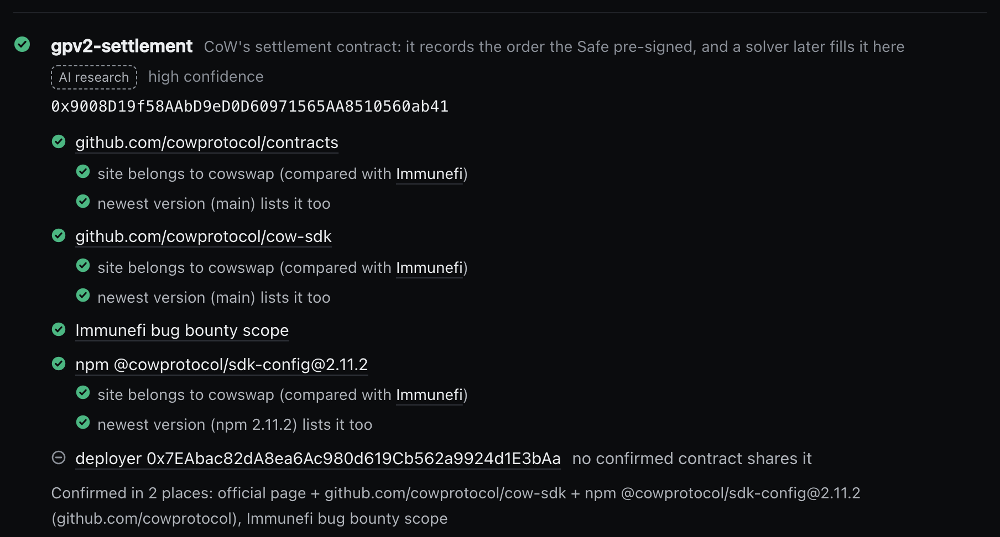
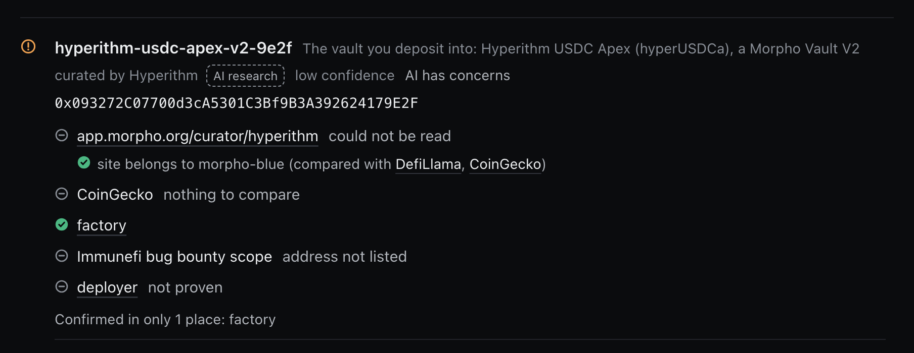

<p align="center">
  <picture>
    <source media="(prefers-color-scheme: dark)" srcset="docs/logo-dark.svg">
    
  </picture>
</p>

<h1 align="center">kiss-sign</h1>

<p align="center"><b><i>Keep it simple, stupid, and sign.</i></b></p>

Signing tools today show you a transaction and ask whether it looks right. Your intent is checked last, by you, at the moment you are most likely to click through. kiss-sign turns that around: you say what you want first, and a program checks the Safe transaction against it before you sign on a hardware wallet.

<picture>
  <source media="(prefers-color-scheme: dark)" srcset="docs/readme/overview-dark.png">
  
</picture>

## Contents

- [Why](#why)
- [How it works](#how-it-works)
  - [1. Tell your AI what you want](#1-tell-your-ai-what-you-want)
  - [2. Review the report and merge](#2-review-the-report-and-merge)
  - [3. Fill a card](#3-fill-a-card)
  - [4. Verify on your computer, and check on a second one](#4-verify-on-your-computer-and-check-on-a-second-one)
  - [5. Sign](#5-sign)
  - [Add your own operation](#add-your-own-operation)
- [If something is compromised](#if-something-is-compromised)
- [What kiss-sign checks](#what-kiss-sign-checks)
- [Scope](#scope)
- [Contributing](#contributing)
- [Disclaimer](#disclaimer)
- [Donate](#donate)
- [License](#license)

## Why

- **You are responsible for the exact bytes you sign.** Today the transaction is built first and checked last. That last check is like the terms on an insurance form: everyone means to read it, and most people click sign. At Bybit in 2025, the signers saw a normal transfer in a tampered Safe web app and signed a change to the Safe itself.
- **Checking by hand is slow and needs expertise.** Tools such as [safe-tx-hashes](https://github.com/pcaversaccio/safe-tx-hashes-util) compute the hashes your wallet should show, but the decoded method and parameters they print come from the Safe Transaction Service, and the tool itself warns: *"Always independently decode the transaction "Data" yourself before you sign!"* Decoding one real Morpho vault deposit yourself (another Safe's, not the one pictured below) looks like this:

  

  Then the real questions start. Is `0x4A6c…0aE0` Morpho's GeneralAdapter1 or a look-alike? Is `0x7777…7777` the vault you meant? Is `1.054e15` a sane maximum share price, scaled by 1e27, for 10,001 USDC? What are the 8 extra bytes after the approve? And you do all of this again for the next transaction.

- **[Clear signing (ERC-7730)](https://eips.ethereum.org/EIPS/eip-7730) does not decode batched calls well yet.** It turns a call into readable fields, but only for contracts with a descriptor. For the deposit above, at [registry](https://github.com/ethereum/clear-signing-erc7730-registry) commit [`3bebbd0`](https://github.com/ethereum/clear-signing-erc7730-registry/tree/3bebbd05cbc2d2d2bf9c41a8edbf5e5cc88e4eb4), only Bundler3 has one. It names the call "Bundler3 Multicall" and passes each inner action to the descriptor of its target. MultiSend, USDC, GeneralAdapter1 and the vault have no calldata descriptor. The screen can look reasonable while the parts that move your money are not shown.

## How it works

> [!CAUTION]
> kiss-sign is provided as is, with no warranty. It can be wrong, and you alone are responsible for what you sign. See [Disclaimer](#disclaimer).

The pictures below come from one real run: another Safe's deposit of 1,000,611.448606 USDC into a Morpho vault, the Hyperithm USDC Apex vault. One address crop is from another vault's report, as marked.

**Set up once.** Fork this repository and clone your fork. Your fork's `main` is the program `verify` trusts, so merging a pull request into it is your confirmation.

```sh
git clone https://github.com/<you>/kiss-sign.git && cd kiss-sign
pnpm install
pnpm kiss-sign init --safe 0x…
pnpm kiss-sign key add alchemy
pnpm kiss-sign key add etherscan   # to build or review templates
pnpm kiss-sign key add github      # optional: raises GitHub's hourly limit to build or review templates
```

You need Node 22.21 or later, pnpm, free [Alchemy](https://dashboard.alchemy.com/) and [Etherscan](https://etherscan.io/myapikey) keys, and a hardware wallet that shows a Safe transaction's domain hash and message hash, or its safeTxHash. A GitHub token is optional: it raises GitHub's API limit from 60 requests an hour to 5,000, which building or reviewing a template can reach. Make a fine-grained, read-only one with access to public repositories only. kiss-sign's signing commands never read it. The second computer needs [kiss-sign-check](https://github.com/ipromise2324/kiss-sign-check), with `LANGUAGE` in its `config` set to the language you give `init` (`en` unless you chose `zh-TW`).

kiss-sign has two tiers. The basic tier is kiss-sign alone, on your computer. The hardened tier adds `check.sh` on a second computer that runs no AI and no kiss-sign, so malware or an AI on your computer cannot also change what you compare. See [Two tiers](docs/design.md#two-tiers).

Turn on branch protection for your fork's `main`, so that a pull request needs your approval, and let your AI push from a GitHub account that cannot approve or merge. Until you do, nothing on GitHub stops an AI that can push from merging.

### 1. Tell your AI what you want

In Claude Code, from the clone, say it in one sentence: "deposit 1,000,611.448606 USDC into the Hyperithm USDC vault on Morpho". If no template covers it yet, the AI builds one with the [kiss-sign skill](.claude/skills/kiss-sign/SKILL.md) and opens a pull request with a generated report.

### 2. Review the report and merge

The report shows what the transaction will do and where every fact came from. Text the AI wrote is marked `AI`; everything else the program read or checked.

**The call flow.** Which contract the Safe calls, in which order, and what comes back.


**Every field.** Each argument is fixed by the template, filled from your card, or, like a deadline or a route, left to the protocol's app within limits the template states.


**Every address.** Where it was found, whether that site belongs to the protocol, and whether CoinGecko and the factory agree. This crop is from the Steakhouse vault's report.



Weak evidence is shown, not hidden. The Hyperithm vault was confirmed only by its factory, so the report flags it and lists it under To review (待確認 in the Traditional Chinese report), with the AI's suggestion: open the vault from the Morpho app's list, compare the address, and send a small amount first.



This review happens once per operation, and once per vault. Merging is your confirmation. Then approve the template on your own computer, which records its hash so `verify` refuses any other version:

```sh
git pull
pnpm kiss-sign template approve morpho/vault-deposit
```

Approval records the template's hash, so a new vault for an approved template needs only its report reviewed and merged.

### 3. Fill a card

In your own terminal, pick the vault from a list with full addresses and type the amount. Values the protocol's app fills in by itself, such as the minimum shares, are computed from an on-chain read, the app's default slippage and a small margin the template states (0.10% in all for a Morpho deposit). The card is sealed under its hash before you see any transaction.


### 4. Verify on your computer, and check on a second one

Propose the transaction in the Safe web app as usual. Then, on your computer:

```sh
pnpm kiss-sign verify --card <card hash> --safe-tx-hash <safeTxHash>
```

On the second computer, `check.sh <nonce>` fetches the same transaction, computes its hashes and decodes it with Foundry's `cast` and `jq`, nothing else. On `MATCH`, both pages show the same comparison list, headed Checklist in English and 比對清單 in Traditional Chinese. Compare them row by row: every row must be equal, except the last column, where each side writes its own names and notes. If any other row differs, stop. `check.sh` only decodes: it does not compare the transaction with your card, and a call nested in bytes it has no signature for stays undecoded, so read its calls against what you meant to do. Some bytes inside a call are data, not a call, such as a Morpho Vault V2 cap's id, a CoW order's UID or a Uniswap swap's inputs. `check.sh` reads the shapes its hand-written `known-layouts.txt` describes and shows their parts in its full decode, only when they encode back to exactly the same bytes; other such bytes usually get a warning. Either way the parts are not comparison-list rows (the bytes stay one row, as hex), so the rows still match, and whether the parts are what you meant rests on you and on `verify`.


### 5. Sign

Compare the hashes on `verify`'s page with your hardware wallet's screen, character by character: the domain hash and message hash, or the safeTxHash if that is what your wallet shows. Then sign. The first time you use a template or a vault, send a small amount first.

kiss-sign is in English, or in Traditional Chinese after `pnpm kiss-sign init --language zh-TW`: the signing commands' terminal text, a check's details and the template's reasons included (a detail of a shape the program does not know, such as a provider's error, stays in English), `verify`'s page, its comparison list, and the HTML report. A report, and a template's reasons, come in the languages the AI wrote them in, and show in another of those when yours is missing; every shipped template and report has both, and one your AI writes has yours. `check.sh` follows the `LANGUAGE` in its own `config`. Give both computers the same language: the comparison list's words then match, and every row except the last column compares byte for byte. With two languages the rows differ and you stop. Verdicts and card hashes are the same in either language. The code and the docs are in English.

### Add your own operation

The templates in [`templates/`](templates/) are examples, from ETH transfers, Morpho deposits and Uniswap swaps to Safe owner changes and a Morpho Vault V2 curator's cap changes and reallocations, and were written by an AI. Read each one's report before you approve it, as you would your own AI's. kiss-sign is meant to grow with what you sign: tell your AI what you want, as in step 1, and review its pull request. A template is data: the AI picks from checks the program already has, such as field rules, effects and view reads, and cites a reason for each choice; it never writes code that becomes a check. No template can loosen the [checks every transaction gets](docs/design.md#engine-checks-that-every-template-gets), such as no address left free and no `delegatecall` except to the official MultiSend. A template can bind a recipient that a bridge holds as a 32-byte word, such as CCTP's `mintRecipient`, to an address, and one that leaves such a word free or a non-zero constant is refused when its name says it is a recipient (`to`, or ending in `recipient`, `receiver` or `beneficiary`); a recipient named otherwise rests on your review. When the checks cannot express an operation, the program gains a new generic one, through a pull request that changes `docs/design.md` first. Before merging, read the report's facts again live, from a clone of your `main`, so the pull request cannot change the check that reads it (this needs the Alchemy and Etherscan keys):

```sh
git fetch origin <branch>
pnpm report <protocol>/<operation> [--vault-of <vault>] --compare --data origin/<branch>
```

## If something is compromised

kiss-sign does not try to stop a prompt-injected AI. Instead, no single part is trusted alone. To make you sign something you did not mean, an attacker has to beat several of these at once.

| If this is compromised | Where it is stopped | If that also fails |
|---|---|---|
| **The Safe web app or your browser**, as at Bybit | `verify` recomputes the hashes and checks the transaction against your card. `check.sh` decodes it on its own. | You compare the hashes on the hardware wallet, which signs only that hash. |
| **The Safe Transaction Service** | Both programs recompute every hash from the transaction's fields, though both fetch it there. | A different transaction gives a different hash than the one on your device. |
| **One RPC provider** | Simulations and reads run on Alchemy and drpc, and they must agree, or the verdict is `UNVERIFIABLE`. | Two providers that collude or share a backend could hide a side effect; drpc's independence from Alchemy is not proven. `check.sh` reads no simulation and still shows the calls it can decode. |
| **The AI writing a template** (prompt injection) | The report prints every address check as PASS or FINDING: the source site against the protocol's sites as DefiLlama, CoinGecko, Immunefi and GitHub's verified domains show them, the address in at least two places, the ABI against the code on chain. AI text is marked, and `--compare` reads the facts again before you merge. | A FINDING does not block a merge, and these listings take a protocol's word for its sites, so one wrong listing can make a look-alike site pass. If you merge a wrong template, `verify` can say `MATCH`. `check.sh` labels any address missing from your own list, and a small first amount limits the damage. |
| **An AI or malware on your work computer** | `verify` refuses a clone that differs from your fork's `main`. That catches an edit by mistake, not code that rewrites the check too, your cards, your config or the repository it trusts. It can also read your API keys. | The second computer runs no kiss-sign and still decodes what you actually sign. Without it, nothing stops this. |
| **Your GitHub account, or a merged program change** | Branch protection, if you turned it on and the AI cannot use your credentials. `--compare` prints `PROGRAM CHANGE` for every file a branch changes outside `templates/`, `registry/` and `testdata/`. | The second computer, as above. |
| **A registry contract upgraded since it was pinned** | Code pins: each registry contract a transaction touches must run the code pinned for it, or the verdict is `MISMATCH`. | Contracts outside the registry, such as the Morpho Blue markets and oracles behind a vault, are not pinned. Nor are settings an admin changes without an upgrade. The report shows the protocol's facts, and a small first amount limits the damage. |
| **The second computer** | It only decodes. `verify` still checks the transaction against your card. | You lose the independent view and are back to the basic tier. |
| **An ERC-7730 descriptor** | kiss-sign never uses one for the verdict. The report lists it as evidence only. | The verdict does not depend on it. |

An owner or threshold change moves no asset, so no small amount can test it, and once signed it can hand over the Safe. It rests on the template's review, the owner addresses you confirm on the card, and the second computer's decode.

The Safe web app can also simulate the transaction, but it runs in the same browser, so a tampered app can fake that too.

Two things stay with you. Whether an address is the protocol's real contract rests on the report, your review and your own address list. And a GitHub fork of this public repository is public too: the vaults and protocols you add to it are visible, even though your Safe's address is not.

Some changes move no balance kiss-sign measures, such as an NFT `setApprovalForAll` or an Aave credit delegation. These and every other limit are in [Known limits](docs/design.md#known-limits).

## What kiss-sign checks

When a template is built:

- **Each address is checked against the protocol's own site.** `check-sources` reads each source page without scripts and looks for the address next to its label, and checks that a GitHub source is pinned to a commit on the default branch. The page's domain, found with the Public Suffix List, or a GitHub page's organization, must be one of the protocol's sites: those DefiLlama lists for it or its parent protocol, the homepages and repositories CoinGecko lists for its coin, and its Immunefi bug bounty's, when that program names a site already listed. A GitHub organization also counts when GitHub verified that it controls one of those websites. Every address must then show up in at least two places: the official pages, the protocol's own API, CoinGecko's listing of the coin, the vault's factory asked on chain (for a vault's adapter, the adapter's factory and the vault itself, which together count as one place), the bug bounty's scope, the protocol's SDK package on npm (pinned by hash, built from the protocol's GitHub), or a deployer it shares with another confirmed entry. Each check prints PASS or FINDING in the report for you to judge; none blocks a merge.
- **ABIs are proven by compiling.** The verified source from Sourcify is compiled locally with a pinned `solc` and must match the code on chain. A contract reached only through another, or one that routes calls by selector, is not proved this way; the report says so and checks its code pin instead.
- **The protocol's facts are read.** DefiLlama's TVL, listing date and past hacks, and for a vault its size over a year and its share holders, read through both providers.
- **Code is pinned.** Each registry contract's code, and behind a proxy its implementation, is read through both providers at one block and recorded, with each earlier version of that code the search finds.
- **Rules are measured against history.** The AI writes a rule such as "`receiver` equals the Safe", and `past-txs` counts how many past deposits, by Safes and other senders, held it.
- **Free fields are perturbed.** Fields the template leaves free are changed to a few other values each and simulated on a past transaction. Each change must revert, be refused, or change nothing the template does not allow. Empty bytes and arrays, and the members of a signed order, are not perturbed.

At every signing:

- **The program checks itself first.** Your clone must be exactly your fork's `main`: that commit, every file of it unchanged, and no other file except ignored ones such as `node_modules/` and `vendor/`.
- **No card with a 0 that bounds nothing.** `card seal` and `verify` refuse a card holding 0 in a computed field, or in an amount field a share-price bound or a minimum compares with, such as the minimum shares: 0 there bounds nothing, or nothing can meet it.
- **Every hash is recomputed.** Nothing from the Safe web app or its API is trusted.
- **Decode, then re-encode byte for byte.** No hidden bytes beyond what the template allows and explains.
- **Floor rules for every template.** No unlimited (max-value) approval, except where a reviewed registry entry declares a standing allowance, as Uniswap's Permit2 does. No `delegatecall` except to the official MultiSend. No change to the Safe's modules, guard, fallback handler or implementation. An owner or threshold change passes only exactly as the card declares it, one per transaction. No gas refund.
- **Simulation on two providers.** Every change to the Safe's balances and allowances must be one the template and your card explain, and each view the template reads before and after, such as a vault's cap, must change as it states. Balances must match to the base unit: a token nothing names must not change by a single unit, and the only slack is a rounding tolerance the template declares on a token, at most 10 base units each in a direction it names, with a reason the report prints; `verify`'s page shows the range it allows.
- **Code pins.** Every registry contract the transaction touches must run the code pinned for it.
- **`MATCH` only on an explicit pass.** Each check must report its own pass; a check that fails without saying why, or a simulation that did not finish, is never `MATCH`.

Your Safe's address stays in `~/.kiss-sign/` and never enters the repository. A pre-push hook refuses any push that contains it, an API key from your `~/.kiss-sign/.env`, or a string you list in `~/.kiss-sign/push-deny`.

[docs/design.md](docs/design.md) is the source of truth for every check.

## Scope

Safe multisig transactions on Ethereum mainnet. Not EOAs, Safe off-chain messages (`signMessage`) or other chains. A CoW order, which the transaction names by its digest, is read and checked. A Vault V2 curator's change covers one cap id per transaction, one market, one collateral or one adapter: a batch of several gets `MISMATCH`, so split it into one transaction per id. For a collateral's caps the templates cover only submitting, and for an adapter's only submitting and accepting; other changes to them have no template yet. Submitting and accepting a cap in one transaction, on a vault with no timelock, gets `MISMATCH` too.

## Contributing

Open an issue or a pull request. `pnpm test` downloads the pinned `solc` compilers and the Public Suffix List once, then runs offline. For a program change, change `docs/design.md` first.

Report security problems as an issue too.

## Disclaimer

kiss-sign is provided as is, without warranty of any kind. It can be wrong: a bug, a wrong template or registry entry, a compromised service or a compromised computer can make it print `MATCH` for a transaction you did not mean. `MATCH` says only that the transaction matches the template you approved and the card you sealed. It does not say that a protocol, a contract or a transaction is safe, and nothing here is financial, legal or security advice.

You alone are responsible for every transaction you sign. The authors and contributors are not liable for any loss, however it arises, including through the use of kiss-sign or `kiss-sign-check`.

## Donate

If kiss-sign is useful to you, you can support it with ETH on Ethereum mainnet:

```
TODO: donation address
```

Copy the address from this page on GitHub, and compare it in full before you send.

## License

[MIT](LICENSE). Anyone may use, copy, change, publish and sell kiss-sign, provided the license notice stays with it. The diagram font in `docs/diagrams/fonts/` is Excalifont, under the SIL Open Font License, and the logos in `docs/diagrams/logos/`, also drawn into `docs/readme/overview.png` and `overview-dark.png`, belong to their owners and are not under MIT.
