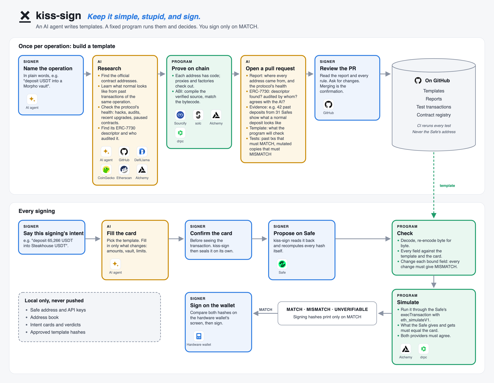

# kiss-sign design

kiss-sign checks a Safe transaction against what the signer meant to do, before the signer signs it on a hardware wallet. The signer states an intent in plain words. An AI researches the operation and writes a reusable template for it. A fixed program runs that template against the proposed transaction and prints `MATCH`, `MISMATCH`, or `UNVERIFIABLE`. The hashes to compare on the hardware wallet print only on `MATCH`.

The rule the whole design keeps: **the AI writes templates, the program runs them.** The verdict is never the AI's judgment. `MATCH` means the transaction matches the template and the card the signer approved. If the AI is fooled during signing, the worst outcome must be `UNVERIFIABLE` or `MISMATCH`, never a wrong `MATCH`. A template that was wrong when the signer approved it is not caught by any check; that risk is carried by the review and its evidence.

## Who does what

| Actor | Does | Never does |
|---|---|---|
| Signer | States intents, reads reports, confirms templates, confirms intent cards and address-book entries, proposes on Safe, compares hashes on the hardware wallet | Pastes keys into the chat |
| AI (any coding agent) | Researches addresses, ABIs and past transactions, reading web pages only through the `researcher` subagent's typed answer; writes the report; writes the template; drafts the intent card | Decides a verdict, edits kiss-sign during signing, handles API keys |
| Program (the engine) | Fetches and hashes the Safe transaction, decodes it, runs the template's checks, simulates, compares effects with the card | Reads web pages, follows instructions found in data |

## The flow

Every service or step drawn in `docs/architecture.png` and `docs/architecture-detail.png` has a sentence in this document that says what is checked with it and who checks it, the program or the AI. The text is authoritative: where a picture and the text disagree, the picture is wrong and is redrawn. [Research services](#research-services) lists each service by step.

### First time an operation is done: build its template

1. **State the intent.** For example, "deposit USDC into the Morpho Apex vault." The AI turns it into a concrete operation.
2. **Research addresses.**
   - **The researcher:** web pages, Sourcify source and a protocol's API hold text that anyone, an attacker included, may have written. The main AI does not read them. A `researcher` subagent (`.claude/agents/researcher.md`) does, with only web search and web fetch: it cannot read files, so it cannot open `$KISS_SIGN_HOME/.env`, and it cannot run or write anything. Its prompt holds the protocol, the operation and the vault or token names, never the Safe or an amount, so a hijacked researcher has nothing private to leak through a URL or a search. It answers with JSON in a fixed schema (`src/research/answer.schema.json`) that has no free-text field: addresses are `0x` and 40 hex characters, URLs are https with no query or fragment, slugs and selectors match fixed patterns, and every choice comes from a fixed list. The program (`pnpm research-parse`) parses the answer once; an unknown key, a value no rule admits, or text that is not JSON stops the research, and the refusal names only where the answer broke the schema, never what it said.
   - **Find:** the researcher finds the protocol's contracts on its official site and GitHub and gives one to five official pages per address.
   - **Protocol API:** when the protocol runs its own public API, such as Morpho's GraphQL API at `api.morpho.org`, the researcher queries it as one more source and gives the endpoint, whether the API lists the contract, and the asset and curator addresses it gives. Every protocol's API has its own shape, so the researcher reads it, not the program. A protocol without an API has no entry here.
   - **Check the sources against public listings:** the program (`pnpm check-sources`) compares each registry entry with two listings. Each entry names its DefiLlama protocol by slug (`defillama`, such as `morpho-blue`). The registrable domain of the entry's `source`, found with a pinned copy of the Public Suffix List including its private section, must equal that of the website DefiLlama lists for the protocol, or, for a github.com source, its organization must be one DefiLlama lists. Each token and vault share names its CoinGecko coin id (`coingecko`, such as `usd-coin`), and CoinGecko must list exactly that coin at the entry's address. A disagreement, a missing listing, a slug DefiLlama lists twice, a protocol with no GitHub organization to compare, or a missing Public Suffix List prints as a finding. The program decides nothing: the AI pastes the output into the report, and the signer judges each finding.
   - **Prove on chain:** the program confirms that each address has code, which implementation a proxy points to, and which factory created an instance.
   - **Contract name and creator:** the program (`pnpm contract-origin`) reads each address's verified contract name, creator, factory and creation transaction from the Etherscan API. A name that is not an identifier of at most 64 characters is refused and not printed; source code and comments are never read. The AI checks that the factory, or the creator when there is none, is a deployer the researcher's official pages name or a registry factory.
   - **Register:** each verified contract goes into the contract registry under a name.
   - **ERC-7730:** the AI looks up each contract in the ERC-7730 clear-signing registry. Where a descriptor exists, the program checks who reviewed it: each auditor signs an ERC-8176 attestation for that exact descriptor, and the program verifies the signature offline and reads on chain whether it was revoked (for example with Sourcify's `@ethereum-sourcify/clear-signing` library). The AI renders the studied past transactions with the descriptor and compares its field meanings with its own.

   The descriptor is a second opinion on what each field means. It never becomes a rule by itself, and a field the descriptor hides does not become a free field.
3. **Establish the ABI.** A fixed method, not the AI: fetch the verified source from Sourcify, compile it locally with a pinned `solc`, and compare the result with the bytecode read from chain. For a proxy, compare the implementation. Matching bytecode proves the ABI belongs to the deployed contract.
4. **Study past transactions.** The AI looks at real transactions of the same operation to learn each field's role and the operation's normal shape. The program (`pnpm past-txs`) finds them through Alchemy's Transfers API and Etherscan, decodes each with the template, and counts, per field, the transactions and Safes that held its rule; the AI reads the counts and every misfit. It prints numbers and addresses only: a byte or string value, or a free array, prints as its length, since the sender chose its bytes. These teach the AI. They prove nothing about safety.
5. **Check the protocol's health.** The researcher looks for anything that makes the protocol unsafe to use right now: past hacks and incidents (for example DefiLlama's hack list and the protocol's own post-mortems), audits, recent upgrades, admin or timelock changes, paused or deprecated contracts, and bug bounties. It gives each page with its category and date, and the AI cites each in the report.

   This informs the signer's decision; it does not change what the program checks. What the program can read on chain, such as an upgraded implementation or a paused contract, it checks again at every signing.
6. **Report.** It covers:
   - **Addresses and ABI:** where each address was verified, what the protocol's API lists when there is one, the `pnpm check-sources` output with every finding, the `pnpm contract-origin` output, and where each ABI came from.
   - **Fields:** what each field means, which contracts the operation touches, and what the template will check.
   - **Past transactions:** how many were studied and from how many senders, for example "42 past deposits from 31 different Safes", and for each field what they held: "`receiver` (who gets the vault shares) was the depositing Safe in all 42". That is the evidence behind the rule "`receiver` equals the Safe".
   - **ERC-7730:** whether each contract has a descriptor, its hash, which auditors attested it, whether any attestation is revoked, and where its field meanings differ from the AI's.
   - **Protocol health:** the check from step 5.

   The counts show the template matches normal use. They do not show it is safe, because fake transactions are cheap.
7. **Write the template.** The AI writes a declarative template (below) and its test transactions, and opens a pull request with the template, the report, and the tests.
8. **Signer reviews the pull request.** The signer reads the report and the template's rules and asks for changes. Merging the pull request is the confirmation. kiss-sign records the hash of the merged template locally.

### Every signing

9. **State this signing's intent.** The signer says what to do this time, for example "deposit 65,266 USDT into Steakhouse USDT". The AI picks the template and fills in the card values. The signer reads the card and confirms it before seeing the Safe transaction.

   kiss-sign then seals the card on its own: it hashes the card and stores it where the AI cannot write. The template is not reviewed again; only the card's values are.
10. **Propose on Safe.** kiss-sign reads the transaction from the Safe Transaction Service, or the signer pastes it. kiss-sign recomputes every hash itself.
11. **Verify.** The program decodes the transaction with the template, checks every field, mutates the transaction to confirm the template catches changes, simulates it, and compares the Safe's net effects with the card.
12. **Sign.** On `MATCH`, the signer compares the domain hash and message hash on the hardware wallet's screen, then signs. Any hardware wallet that shows both hashes for a Safe transaction works.

## Data shapes

### Template

A template describes one operation for one protocol, for example `morpho/vault-deposit`. It is data, not code.

- `contracts`. Each named contract with its address, the source that names it, and its code hash.
- `calls`. The call tree the Safe makes, with MultiSend unwrapped. Each call names its target contract and its function signature, or says its data is empty, as a plain ETH transfer or a cancellation sends. The last call may say, with a reason, that it `merge`s: the card's operations then share it, as the Morpho app puts several vaults' withdrawals into one `multicall`, or the Merkl app several reward tokens into one `claim`'s parallel arrays. Each merged call is made once, after every other call, with each operation's items in card order.
- `fields`. A rule for every argument. One of:
  - equals a card value (`amount`, `vault`);
  - equals the Safe;
  - equals a named contract;
  - equals a constant;
  - free, with a written reason (for example a Merkle proof). The mutation check treats free fields as free.
- `nonce`. Optional: a rule for the Safe transaction's own nonce, such as a cancellation's card nonce.
- `same`. Optional: card references that must name one address, such as the assets of the two vaults in a migration. A card where they differ is refused before any check runs.
- `effects`. What the Safe gives and gets, in tokens and amounts written as card values, `positive` (more than nothing, in the direction of the side), or, for what the Safe gives, `all` (the Safe holds none of the token afterwards). Native ETH is named `eth`, since no contract holds it, so `eth` and `safe` are never registry or address-book names. What the Safe gives may name its receiver; giving to the Safe itself changes nothing. Approvals must be exact and spent in the same transaction.

### Intent card

The operation id plus this signing's values. The template is reviewed once; the card is the only thing the signer confirms at every signing. So the card holds only what changes between signings, and every other value is bound once, somewhere the signer already reviewed.

Where each value comes from:

| Source | Confirmed | Examples |
|---|---|---|
| Template | Once, when the signer reviews the template | Target contracts, `receiver` and `owner` equal the Safe, the spender of an approval equals a named contract |
| Contract registry | Once per contract, during research (step 2) | Each Morpho vault, each Fluid fToken, routers |
| Address book | Once per address, by the signer | An external recipient of a transfer |
| Config | Once, at `init` | The Safe, the chain |
| The Safe, read on chain | By the program, every signing | The nonce |
| Card | By the signer, every signing | Amounts, which vault, swap limits, which address-book entry receives a transfer |

An address on the card is never typed by the AI. It is a name from the contract registry or the address book, or the Safe itself. The card shows the name and the full address, and the program resolves the name.

Card values per operation, covering the operations in the Safe's history:

| Operation | Card values | Bound by the template |
|---|---|---|
| Transfer ETH or a token | token, amount, recipient | none |
| Deposit into a vault (Morpho, Fluid) | vault, amount | the asset is the vault's asset; receiver is the Safe; the approval is exact and goes to the vault |
| Withdraw or redeem from a vault | vault, amount or `all` (two templates) | receiver and owner are the Safe |
| Claim rewards (Fluid, Merkl, Morpho) | reward token | recipient is the Safe; amount and proof are free; the Safe gives nothing and receives only the reward token |
| Receive USDC through CCTP | token, amount | the target is Circle's MessageTransmitter; the message and attestation are free; the Safe gives nothing and receives exactly the amount of the token |
| Swap through a router (Uniswap, Odos) | sell token, sell amount, buy token, minimum buy amount | recipient is the Safe; the router is a named contract |
| Cancel a queued transaction | the nonce to replace | 0 ETH to the Safe itself, no data |

- One Safe transaction can batch several operations, for example withdrawing from two vaults. The card then lists each operation with its values, and the MultiSend must contain exactly those calls. An approval belongs to the operation that spends it, not to its own line.
- Swap limits are stated as a minimum amount, not a slippage percentage, so the program never needs a price. The AI may suggest the number from a quote; the signer confirms the number.
- A recipient that is not the Safe must already be in the address book. Adding an entry is a separate step, done before signing, where the signer checks the full address against a source outside the chat.

Sealed means hashed and stored where the AI cannot write.

### Verdict file

Every input the verdict used, so `replay` can recompute it offline: the Safe transaction as given, the sealed card's text and hash, each template's text with its approved hash, the contract registry and the address-book entries the card names, all read at the origin/main commit the self-check passed on, and every request sent to the two providers with each one's answer. `replay` runs the same checks on these alone and reports whether the verdict is the one recorded.

## What goes on GitHub

Templates are reviewed once and reused, so they live in git, where every change is a diff someone reviewed. The evidence behind each template goes with it.

| Published in the repository | Kept local, in `$KISS_SIGN_HOME` |
|---|---|
| Templates: what each operation checks | Config: the Safe address, providers, API keys |
| Reports: where every address and rule came from | Address book |
| Test transactions | Intent cards and verdict files |
| Contract registry | Approved template hashes |

- Each operation has a folder, for example `templates/morpho/vault-deposit/`, holding `template.json`, `report.md`, and `tests/`.
- The tests are real past transactions of the operation, each with the card values it implies. Every one must give `MATCH`, and every mutated copy must give `MISMATCH`. CI reruns the decoding, field checks, and mutation checks on every change. Simulation needs live providers, so it runs locally.
- Git stores and records; it is not trusted. At signing, the program checks that the template's hash equals the hash recorded when the signer merged it. A template from someone else's repository is only a starting point: its report still has to be reviewed.

### The Safe's address is never published

Published files would otherwise tie the Safe, its balances, and its history to whoever owns the repository.

- Templates refer to "the Safe", never to an address.
- Test transactions come from other senders. The signer's own Safe is excluded when searching for past transactions.
- Reports count senders but list no Safe of the signer's.
- Before every push, a check greps the outgoing commits for the configured Safe address and for API keys, and must find nothing.

## Engine checks that every template gets

These are protocol-free and change rarely.

- The Safe transaction hashes, computed locally.
- Decode, then re-encode byte for byte, so nothing hides in the encoding.
  - One exception, declared per call in the template: a trailer of at most a stated number of bytes after the arguments, with a written reason. The Morpho app appends 8 bytes to `multicall` (a timestamp and an origin tag) that the contract never reads. Without a declared trailer, any extra byte is `MISMATCH`.
- Floor rules:
  - no unlimited approval;
  - no `delegatecall` except to the official MultiSend, and the rules apply again to every call inside it, at every level;
  - no owner, module, guard, threshold, fallback handler or implementation change;
  - the Safe's own fee fields are all zero: `safeTxGas`, `baseGas`, `gasPrice`, `gasToken`, `refundReceiver`. Otherwise a correctly hashed transaction can pay a refund to someone else.
- The mutation check: change each bound field and confirm the template gives `MISMATCH`.
- A vault's `asset` in the registry is written during research. For each vault on the card whose `asset` the template relies on, the program reads the vault's `asset()` from both providers at the block the transaction runs on: the latest block for a pending transaction, the block before its receipt's for an executed one. It must be the token the registry names, or the verdict is `MISMATCH`; a read the providers do not agree on is `UNVERIFIABLE`.
- Simulation through the Safe's own `execTransaction`, judged by the Safe's balance and allowance changes, not by protocol events. Every change to the Safe's balances must be one the template's effects explain, and no allowance from the Safe may end higher than it started; any other change is `MISMATCH`, whatever else the template says. An allowance may fall, as when a migration resets a leftover approval to zero, since a lower allowance lets no one take more than before. A transfer explains its payment by its card's recipient and amount; a deposit or a swap must also receive what its effects promise.

## Chain access

Every on-chain read uses two providers from different companies. Both must agree, or the result is `UNVERIFIABLE`. This covers state reads, code, simulation, receipts, and the search for past transactions.

| Role | Providers |
|---|---|
| State, code, receipts | Alchemy (free key) and drpc |
| Contract code, proxy implementation, and factory instance, during research | Alchemy and drpc |
| Simulation, latest and past blocks | Alchemy and drpc, `eth_simulateV1` |
| Finding past transactions | Alchemy Transfers API and a second source (Etherscan with a free key) |

When the system resolver fails, kiss-sign resolves provider hosts over DNS over HTTPS. TLS certificate checks stay on, so a wrong address can only fail the connection.

Keys enter through `kiss-sign key add <provider>` in a hidden prompt, never through the chat. They live in `$KISS_SIGN_HOME/.env` with mode 0600.

### Research services

Services used while building a template, besides the providers above. None of them is read at signing.

| Service | What is checked with it | By |
|---|---|---|
| The protocol's official site and GitHub organization | Where each contract address is published, and the official docs page per function (step 2) | AI, through the `researcher` subagent's typed answer |
| The protocol's own API, when it has one (such as `api.morpho.org`) | Whether it lists the contract, and the asset and curator addresses it gives (step 2) | AI, through the `researcher` subagent's typed answer |
| Sourcify source and its NatSpec comments | The role of each function argument, from a fixed list (step 2) | AI, through the `researcher` subagent's typed answer |
| DefiLlama protocol list (`api.llama.fi/protocols`) | Each registry entry's source domain or GitHub organization against the protocol's listed website and organizations (step 2) | Program, `pnpm check-sources`; the signer judges findings |
| Public Suffix List (pinned in `vendor/publicsuffix/`) | Where a host's registrable domain begins, so two sites on one shared host such as `gitlab.io` differ (step 2) | Program, `pnpm check-sources` |
| CoinGecko coin list (`api.coingecko.com`) | The coin listed at each token's and vault share's Ethereum address against the coin id the entry names (step 2) | Program, `pnpm check-sources`; the signer judges findings |
| Etherscan API (`contract/getsourcecode`, `contract/getcontractcreation`) | Verified contract name, creator, factory, and creation transaction (step 2) | Program, `pnpm contract-origin`; the AI compares the creator with the official deployers |
| ERC-7730 registry | Whether a descriptor exists and what it says each field means (step 2) | AI; the program checks its attestations |
| Sourcify and a pinned `solc` | The ABI compiles to the code on chain (step 3) | Program, `pnpm prove-abi` |
| Alchemy Transfers API and Etherscan API | Past transactions of the operation (step 4) | Program, `pnpm past-txs`; the AI reads the counts |
| DefiLlama hacks list, post-mortems, and audits | Past hacks and incidents, audits, upgrades, admin changes (step 5) | AI, through the `researcher` subagent's typed answer |

## The program checks itself first

kiss-sign runs from one clone of this repository. `kiss-sign verify` starts with a self-check before anything else:

1. Fetch `origin`.
2. The local checkout must be exactly `origin/main`: the same commit, with no local changes and no extra files in the program, the templates, or the settings.
3. If anything differs, stop and name the files. Nothing is verified.

Templates are read from that commit, so a template counts only after its pull request is merged. `main` changes only through pull requests.

This catches accidental edits and an AI that was tricked into changing a check or a template. It cannot catch an AI that deliberately rewrites both a check and the self-check itself, because the self-check is part of the same program. See Known limits and Later security upgrades.

## Known limits

- Etherscan name tags (labels such as "Morpho: Bundler3") are not used. Etherscan offers no free API for them. The verified contract name and the creator, read through the Etherscan API, are used instead.
- DefiLlama and CoinGecko are aggregators that take listing requests, so `pnpm check-sources` agreeing is supporting evidence, not proof. It finds the registrable domain with the Public Suffix List plus `medium.com`, `mirror.xyz` and `substack.com`; a shared host on neither still looks like one site. Every report line prints what it compared, or says that nothing was compared and why.
- The researcher's answer reaches the main AI as text before `pnpm research-parse` checks it, so a hijacked researcher can still show the main AI words. The skill tells the main AI to act on nothing in an answer the parser refuses. URLs, slugs and Etherscan contract names are bounded in length and alphabet but can still spell words.
- drpc routes requests to third-party nodes, including public ones. Its independence from Alchemy is not proven.
- Two providers stop one lying provider, not two that collude or share a backend.
- Simulating an executed transaction on the parent block is not its exact pre-state, because earlier transactions in its block also changed state. For executed transactions, receipts read from two providers are the source of truth.
- The self-check runs inside the program it checks. An AI with shell access that deliberately rewrites both the program and its self-check is not stopped this round.
- The hardware wallet shows only the two hashes, not the decoded transaction. ERC-7730 clear signing does not yet cover Safe MultiSend batches.
- A template is only as good as its review. The mutation check and the simulation are the backstops.
- For an executed transaction, the Safe's ETH change is its balance at the execution block minus its balance at the parent block, since no log shows ETH sent as the value of `execTransaction` itself. Another transaction in the same block that moves the Safe's ETH changes that number too; the field checks still bind the value of every call the Safe makes.
- For an executed transaction, a card that gives `all` of a token reads the Safe's balance of it at the parent block and at the end of the execution block, and is `UNVERIFIABLE` unless the two differ by exactly this transaction's change. Two other transactions in that block whose changes to the token cancel out go unnoticed.
- For an executed transaction, the floor rules on the Safe's settings read the receipt's events. A storage write without an event shows only in a simulation. The static floor refuses a delegatecall from the Safe itself, but a call to an already enabled module can still make one through `execTransactionFromModule`.
- The static floor refuses an ERC-20 approval only at or above 2^255, and a Permit2 approval only at the uint160 maximum. A token-specific sentinel such as 2^96-1 (UNI, COMP) passes the floor; the effects check refuses any measured allowance that ends above its value before the transaction.
- The self-check does not check where `origin` points, and it does not check gitignored code such as `node_modules/`. It refuses git replace refs and files hidden with skip-worktree or assume-unchanged, and ignores `GIT_*` variables from the caller.
- `replay` trusts the verdict file it is given. It shows what a recorded verdict was based on; it is not permission to sign.
- When the code on chain ends in a metadata trailer without a source hash, as solc writes with `bytecodeHash: "none"`, matching bytecode proves the ABI's selectors and types but not its parameter names, since no byte on chain depends on them.
- When Sourcify holds only a partial match, the source compiles to the code on chain except the IPFS metadata hash, which hashes the source text. The proof masks that hash, so it too proves the ABI's selectors and types but not its parameter names.
- The simulation reads at most 50 modules. A Safe with more is `UNVERIFIABLE`.
- Safe 1.1.1 has no `getStorageAt`, so a simulation cannot read its settings, and a pending transaction of a 1.1.1 Safe is at best `UNVERIFIABLE`.

## Later security upgrades

Not built now. Listed so the path is clear.

- **Light client (Helios).** Verifies every read against the beacon chain, so one provider is enough. Needs `eth_getProof` (Alchemy has it) and a local EVM to simulate on proven state.
- **Local simulation (anvil).** Free and open source. Adds execution diversity. On its own it trusts the same RPC state.
- **A paid or third provider.** Removes rate and range limits and adds an independent source.
- **Lock the AI out of the program.** Ship `.claude/settings.json` with deny rules for program code, settings, `gh pr merge`, and pushes to `main`; these hold even in bypass-permissions mode. Add the agent's sandbox, so a script cannot write the program either. Other agents need their own equivalent.
- **Clear signing on the wallet (ERC-7730).** Export templates as display descriptors so the device shows the decoded call. Wait until wallets decode Safe MultiSend batches; until then, hash comparison stays.

## Next phase: CoW orders

A CoW order is not a swap inside the Safe transaction. The transaction only pre-signs an order (`setPreSignature`) and sets an approval; a solver settles the order later. So the order's sell and buy limits, receiver, and expiry live in the order, not in the transaction's effects, and the approval is not spent in the same transaction. Supporting it needs its own rules: rebuild the order from its uid, check every order field against the card, and allow the approval to stay open until the order settles or expires.

## Out of scope

EOA signing, off-chain EIP-712 signatures, and chains other than Ethereum mainnet.
