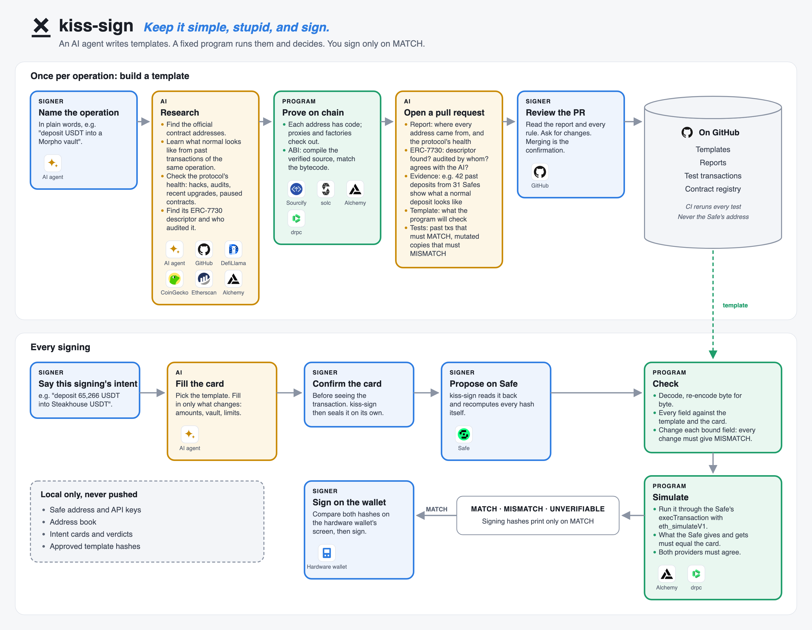

Part of [the kiss-sign design](../design.md).

## The flow

Every service or step drawn in `docs/architecture.png` and `docs/architecture-detail.png` has a sentence in the design that says what is checked with it and who checks it, the program or the AI.
The text is authoritative: where a picture and the text disagree, the picture is wrong and is redrawn.
Each picture is drawn from an HTML source in `docs/diagrams/`, and `sh docs/diagrams/render.sh` renders both with headless Chrome.
[Research services](engine-and-chain.md#research-services) lists each service by step.

### First time an operation is done: build its template

1. **State the intent.**
   For example, "deposit USDC into the Morpho Apex vault."
   The AI turns it into a concrete operation.
   It researches before it asks the signer anything: the route, such as a direct call or the protocol's bundler, follows from the contracts, the protocol's own app and past transactions (step 4), and the card values mirror what the protocol's own app asks a user to enter for the operation, plus only what safety strictly needs, each explained in the report.
   Chain facts such as a price are read on chain, never guessed.
   The AI asks the signer only for a preference no evidence can settle, once, with the report.
   An operation this design does not cover gets its design change proposed with the design changed first, in the same pull request when it changes only research code, and in a pull request of its own, merged before the template's, when it changes the [verdict core](program-ownership.md#the-verdict-core).
2. **Research addresses.**
   - **Find:** the AI always looks on the protocol's official site, GitHub and API, then searches further (deployment files, SDKs, audits, explorers, forums) and cross-checks them across sources; only the places in How the places count confirm an address, and anything else is a lead the AI follows back to one of them.
   - **Protocol API:** when the protocol runs its own public API, such as Morpho's GraphQL API at `api.morpho.org`, the AI queries it as one more source: the contract's address and what the protocol says about it, such as a vault's curator and asset.
     The AI reads the rest of the answer, not the program, because every protocol's API has its own shape; the report quotes the query and the answer.
     A protocol without an API has no entry here.
     When an entry's `source` page shows its address only with JavaScript and the API answers that exact address, the entry also names the request as data, `apiSource`, which the program asks (below).
   - **Check the sources against public listings:** the program (`pnpm check-sources`) compares each registry entry with the places that list a protocol's own sites.
     Each entry names its DefiLlama protocol by slug (`defillama`, such as `morpho-blue`); an entry created by a factory, such as a curated vault, names the protocol whose site lists it, such as its curator's, and belongs to its factory's protocol (see [Intent card](data-shapes.md#intent-card)).
     The protocol's sites are its registrable domains, found with a pinned copy of the Public Suffix List including its private section, and its GitHub organizations, as these list them.
     The list's private section already splits hosts that give each owner a subdomain, such as `gitbook.io`, `github.io`, `notion.site` and `vercel.app`, into one registrable domain per owner.
     It leaves out three such hosts, `medium.com`, `mirror.xyz` and `substack.com`, which the program adds as public suffixes, so `<name>.medium.com` is its own site.
     It cannot name platforms that give each owner a path: `github.com`, `gitlab.com`, `linktr.ee`, `x.com`, `twitter.com`, `t.me`, `discord.gg`, `discord.com`, `youtube.com`, `notion.so`, `google.com` (Docs, Sites, the Play and Chrome stores), `apple.com` (the App Store), `snapshot.org` and `immunefi.com`.
     The program counts each of these platforms and every subdomain of it, such as `www.youtube.com` or `apps.apple.com`, as a public suffix, so a URL there, such as a CoinGecko homepage `https://linktr.ee/<protocol>`, gives no registrable domain and is no site of the protocol, and a page or a bounty program on the same platform is not tied to it by that platform.
     They are the platforms Immunefi's scopes and DefiLlama's protocols name in place of a website: in Immunefi's list, 19 programs list a `github.com` URL as a website in scope, 13 `immunefi.com` and 6 an app store page, and DefiLlama lists protocols at `snapshot.org`.
     A platform not on the list still looks like one site (see [Known limits](known-limits.md#known-limits)).
     A GitHub organization is compared by its name, not as a website (below):
     - **DefiLlama:** the website and GitHub organizations DefiLlama lists for the protocol (`api.llama.fi/protocols`), and those of its parent protocol, such as Fluid for `fluid-lending` (`api.llama.fi/lite/protocols2`).
     - **CoinGecko's coin:** the protocol's coin, the `gecko_id` DefiLlama gives the protocol or else its parent (such as `cow-protocol`), read on CoinGecko (`/api/v3/coins/<id>`): its homepages and the organization of each GitHub repository it lists.
     - **Immunefi:** the bug bounty program the entry names (`immunefi`, such as `cowprotocol`), read from Immunefi's public list of programs (`immunefi.com/public-api/bounties.json`): its website and its GitHub organization, only when the program is tied to the protocol, since the entry could name another protocol's program.
       A program is tied when its website, its GitHub organization, or a website or app its scope lists as an asset (type `websites_and_applications`, such as `https://www.ether.fi/` in the `etherfi` program, which names no website of its own) is already a site DefiLlama or the protocol's coin lists.
       A website in scope only ties the program: a scope lists what the program pays to have attacked, not what it owns, so a program tied only by its scope adds neither its website nor its GitHub organization to the protocol's sites.
       A program the entry names that is not tied is a disagreement.
     - **GitHub's verified domain:** a GitHub organization the entry's pages, or its SDK's build, are on is the protocol's when GitHub verified that the organization controls a domain (the "Verified" badge, which an organization earns through DNS) and that domain's registrable domain is a website one of the three above lists.
       GitHub's API without a token says only whether an organization is verified (`api.github.com/orgs/<org>`, `is_verified`), not which domain, so the program reads GitHub's page for it, `github.com/<org>` as served without scripts, takes the domains from the first run of the badge's text, which sits in the page's header above anything the organization wrote, such as its profile README, and keeps them only when the API says the organization is verified, asking it only for a page that shows such a run.

     The registrable domain of the entry's `source` must be one of the protocol's sites, or, for a github.com source, its organization must be.
     The result names every place that lists it.
     Each token and vault share names its CoinGecko coin id (`coingecko`, such as `usd-coin`), and CoinGecko must list exactly that coin at the entry's address.
     DefiLlama lists a protocol's website and organizations as its own, while CoinGecko, Immunefi and GitHub name only a homepage or some repositories, so they can add a site and never make one differ: a site none of these lists is a disagreement when DefiLlama lists a site of that kind (a website, or a GitHub organization), and has nothing to compare when it lists none.
     A disagreement, a missing listing, a slug DefiLlama lists twice, or a missing Public Suffix List prints as a finding.
     These places confirm a site, never an address: none of them lists the entry's address.
     The program decides nothing: `pnpm report` puts each check's PASS or FINDING into the generated report (step 6), and the signer judges each finding.
   - **Check each source page:** the same command reads each entry's `source` page as served, without running its scripts, and requires the address next to the text that names the contract or its role on that page, which the entry records as `sourceLabel` (such as `Bundler3`).
     The address and the label must share one block of the page (a table row, a list item, a paragraph, a line of a text file, or one JSON object's own values with their keys), or the label may stand alone in the block just before, with nothing but punctuation beside it; they must be at most 100 characters apart with no other address between them; in a block that holds other addresses, a label binds to the address after it when the block opens with text (`Name: 0x…, Name: 0x…`) and to the address before it when the block opens with an address (`0x… (Name), 0x… (Name)`); and the address counts only in lowercase or in its EIP-55 checksum.
     The page counts as a browser shows it with scripts off: scripts, styles, the title, text areas, SVG, templates, comments, an element hidden by its own `hidden`, `aria-hidden="true"` or inline `display:none` or `visibility:hidden` with everything inside it, and every attribute value, even one holding `>`, are left out.
     An entry may also name `sourceHeading`, text the nearest heading above the address must hold, for a page whose rows name only a chain, such as Circle's `MessageTransmitter` table.
     An address found only in such hidden text, an attribute or a link target, a page that answers with a redirect, and an entry with no `sourceLabel` are findings.
     When the address is not next to its label, the program also finds every address the label binds on the page by the same rule (any address, in lowercase or its own EIP-55 checksum, under the same heading); a label that binds only other addresses is its own finding, which prints each of them in full, since the page names another contract for the role, while an address merely away from its label, with the label next to no address, only fails to confirm.
     A `source` URL that itself holds the address, in any letter case, plain or percent-encoded, is a finding and its page is not read, since a page such as `app.morpho.org/ethereum/vault/<address>/…` echoes its own URL.
     A github.com source must name a file at a commit, `github.com/<org>/<repo>/blob/<40-hex commit>/<path>`; the program reads that file raw at that commit and asks GitHub's compare API whether the commit is behind or identical to the default branch, since GitHub also serves a fork's commit under the official repository's path.
     An unpinned source and a commit off the default branch are findings.
     An entry may also name `moreSources`, more official pages that list its address, each `{ "url", "label", "heading"? }`: each is read and checked exactly as `source` is, with `label` as its `sourceLabel` and `heading` as its `sourceHeading`, a github.com one pinned to a commit on the default branch, and its site compared with the protocol's as the source's is; the parser refuses one whose URL holds the address, in any letter case, plain or percent-encoded, since its page would only echo it, and one naming a page the entry already names, since one page is one confirmation: two URLs name the same page when the URLs the program reads for them agree with the host in lowercase, no fragment and the path percent-decoded, a github.com file read as its raw.githubusercontent.com copy at that commit, and a GitHub owner and repository in any letter case.
     A read that gets no answer, from a dropped or refused connection, a timeout, DNS that cannot answer now, a server error, or a rate limit such as GitHub's 60 requests an hour without a token, is no disagreement (a host name DNS says does not exist and a bad certificate are answers, and stay findings): the program asks again after each of a few pauses, and a read still without an answer prints as `UNVERIFIABLE`, never as a finding.
     The output ends with the sites each protocol's sources use, its registrable domains and GitHub organizations, for the signer to check each is the protocol's own.
   - **Check the protocol API:** an entry may name `apiSource`, `{ "url", "method": "GET" | "POST", "body"?, "path" }`: an https URL in the same RFC 3986 characters as a `source`, on a DNS name with no port and no user, a GET, or a POST of a JSON `body` of at most 4,096 bytes, and the `path`, 1 to 16 object keys of letters, digits and `_` or array indexes, that walks the JSON answer to the address.
     No other header is sent, so the request carries no key.
     The parser refuses a request whose URL, as written or percent-decoded, or body holds 8 or more hex digits of the entry's address in a row, in any letter case, since an API may echo what it is asked, as a page echoes its own URL, and a prefix is enough to ask for it.
     It also refuses any escape a server would decode, which could spell the address out of sight: a backslash or a character outside printable ASCII, tab and newline in the body's keys and strings, and `%25` or `%5C` in the URL.
     This catches the plain echo, not every way to ask for an address in pieces, which is one more reason the API's answer is evidence and never a vouch; the request names what the address belongs to, such as a Morpho market id.
     It refuses a host on `github.com` or `githubusercontent.com`, which serve JSON of any fork's commit under the parent repository's path.
     The program sends the request, follows no redirect, reads at most 1 MiB, and requires status 200 and a JSON content type.
     The value at the path must be an address equal to the entry's, compared in any letter case and printed in its EIP-55 checksum; another address, nothing at the path, a value that is not an address, and any other answer are findings.
     The API URL's registrable domain is compared with the entry's DefiLlama protocol as the source's is, as its own result.
     A read with no answer follows the rule above: it is asked again and stays `UNVERIFIABLE`.
     Before connecting, the program refuses a URL host, for a source page, a documentation page or an API alike, that is an IP literal or resolves to any address no public server has (loopback, private, link-local, shared, documentation, benchmark, multicast, reserved, and IPv4-mapped IPv6), so a URL in the registry cannot reach the signer's machine or network; for IPv6 only global unicast (`2000::/3`) counts, less Teredo, 6to4, benchmarking and documentation ranges, and NAT64 addresses are judged by the IPv4 address they embed.
     DNS that cannot answer now, with no resolver answering, is no answer and stays `UNVERIFIABLE`; only a resolver's answer makes a name not exist.
     `pnpm check-sources` prints each request with its body.
   - **Check the bug bounty scope:** the program, not the AI, decides which bounty programs are read: for every entry it reads Immunefi's whole public list and takes as the protocol's each program whose website, GitHub organization or website in scope is a site DefiLlama or the protocol's coin lists, as the Immunefi site listing above ties a program, and the program the entry names in `immunefi` when that one is tied the same way.
     It requires the entry's address among the assets in scope of one of them, as an Ethereum address, an `etherscan.io/address/<address>` link in an asset's URL or in the program's text on its assets, in any letter case.
     A protocol puts into its bounty's scope the contracts it pays to have attacked, so a listed address is one more place that names the contract as the protocol's; the label beside it is not checked, since a program may list addresses alone.
     The result names the programs: one of the protocol's holding the address confirms it; the protocol's programs not holding it, or no program on Immunefi tied to the protocol, is said plainly and is no confirmation and nothing for the signer; a program not tied to the protocol that holds the address, such as a lending protocol listing USDT among its markets, is named and confirms nothing; a program the entry names that Immunefi does not list stays no confirmation, and one not tied to the protocol stays a disagreement.
     Only the entry's own address is looked for: a scope names its contracts by free text or not at all (CoW Protocol's lists bare addresses; ether.fi's lists `weETH` on four chains by explorer link), so another address in it is never tied to the entry's role, and the program never says a program lists another address for the contract.
   - **Check the official SDK package:** an entry may name `sdk`, `{ "package", "version", "sha256", "file", "label" }`: an npm package of the protocol pinned to one version, the sha256 of that version's tarball, a file in it, and the text next to the address in that file.
     The program reads the version's metadata from `registry.npmjs.org`, refuses a tarball outside `registry.npmjs.org`, downloads the tarball, at most 32 MiB, and requires its sha256 to be the pinned one and its sha512 the `dist.integrity` npm gives.
     It unpacks only the named file, reads it as data and runs nothing, and requires the address next to the label as on a source page (a line of the file is a block, one JSON object a block for a `.json` file).
     The publisher must be the protocol: npm's provenance attestation for that version (`registry.npmjs.org/-/npm/v1/attestations/<package>@<version>`), which npm checks against the package's signed build when it is published, must name a build from a GitHub repository whose organization is one of the protocol's sites above, for the same tarball (its sha512).
     A package's `maintainers` are npm user names that no listing ties to the protocol, so they are not read; a version without provenance is no confirmation.
     A tarball whose hash differs from the pin, a build from another organization, and a label that binds only other addresses in the file, as on a page, are disagreements; an address away from its label, with the label next to no address, is no confirmation.
     The package is one more place: a protocol publishes it through npm, a channel apart from its pages, and the tarball cannot change under its pin.
   - **Check the newest version of each pinned place:** a github.com page is pinned to a commit and an SDK to a version, and the protocol may list another address there since.
     For each pinned github.com page of an entry (its `source` and each of `moreSources`) whose commit is on the default branch, the program also reads the same file raw at the tip of that branch (`raw.githubusercontent.com/<owner>/<repo>/refs/heads/<branch>/<path>`); for an entry with `sdk`, it also reads the version npm's `latest` tag names (`registry.npmjs.org/<package>/latest`), with its sha512 against npm's integrity and its provenance, and the same file in it.
     A newest version npm's provenance ties to none of the protocol's sites, or that has no provenance, is not compared, as for the pinned version.
     In the newest version the program finds every address the file binds to the same label, under the same heading, by the rule that binds a page's label to its address (any address, not only the entry's, in lowercase or its own EIP-55 checksum).
     The result is one of: the label binds the entry's address there too (it agrees); the label binds only other addresses (a finding that prints each of them in full with the file and the branch or version, since the protocol now lists another address under the same name in the same file); the label binds no address, or the file is gone (said plainly, no finding); or a read without an answer (`UNVERIFIABLE`, read again).
     The newest version is the same place as the pinned one, so it never counts as a place: its agreeing adds nothing, its finding stays for the signer, and a newest version that lists nothing takes nothing away.
     The pinned version stays the one the report counts, since a branch tip and a `latest` tag change without a pull request the signer reviewed.
   - **Places the program does not search:** the program searches a place only when it can find the contract's listing there without the AI naming it and can tell that the listing means the same contract on Ethereum mainnet.
     Each of these fails one of the two, so none is read for this: GitHub's code search over the protocol's organizations (it finds every file holding an address, more than 3,000 for Fluid's Liquidity, tests and other chains included, misses what it has not indexed, finding no file in `morpho-org` for `Bundler3`'s address that `morpho-org/sdks` lists, needs a token, and finds no file by role, since an entry's label is often a key such as `mainnet`, `canonical` or `Ethereum`); an Immunefi asset's or an ERC-7730 descriptor's name, for another address of the same contract (free text, shared by a proxy and its implementation, by every instance a factory creates, and by each chain's deployment); DefiLlama's protocol `address` (the protocol's governance token, not the entry, written bare for Ethereum only by convention: 281 protocols with a bare address list no Ethereum chain); npm packages by organization (no file or label to read in them); and the protocol's API (each has its own shape, so only the AI can name a request, as `apiSource`).
     CoinGecko is already read for every token and vault at its address, whatever coin the entry names.
   - **Check who deployed it:** the program reads each entry's creation: Etherscan's contract-creation API (`getcontractcreation`, with `ETHERSCAN_API_KEY`) names the transaction, and the program proves it through both providers.
     The transaction succeeded, and the address has no code at the block before and has code at its block.
     Then one of three proofs ties the address to the transaction: the receipt's `contractAddress` is the address (the sender deployed it); the transaction calls a public CREATE2 deployer (`0x4e59b44847b379578588920cA78FbF26c0B4956C`, or the Safe singleton factory `0x914d7Fec6aaC8cd542e72Bca78B30650d45643d7`) whose input, a 32-byte salt and the init code, gives the address by CREATE2 from that deployer; or the contract Etherscan names as the creator, which the transaction calls or itself deploys by one of the first two proofs, gives the address by CREATE at one of its nonces between the block before and the block.
     The deployer is the transaction's sender, the account whose key signed it: a public deployer, or a factory anyone may call, proves nothing by itself, since anyone can send it the same call, so it is never the deployer.
     A creation the program cannot prove this way, such as a CREATE2 from a factory that takes its salt from its arguments, is no confirmation.
     An entry deployed by the same sender as another entry of the same DefiLlama protocol that the same run checks gains one confirmation, naming the other entry, only when that other entry is confirmed in at least two places without counting its own deployer, so two entries can never confirm each other through their deployer alone.
     Etherscan's answer only names where to look; every fact the proof uses is read through both providers.
   - **How the places count:** an address is confirmed by each place that shows that exact address for the role, and the report needs two.
     The table lists every place the checks above read.
     Places count by owner, as far as the program can tell, so one compromised owner cannot make two.
     A page's or the API's site is compared with the protocol's sites as a result of its own; only the SDK's publisher decides whether its place counts.
     Red is a real disagreement, for the signer to judge.

     | Place | Who owns it | What the program checks | Red | Counts as a place |
     |---|---|---|---|---|
     | Official page: the `source` and each of `moreSources` | Its registrable domain, or its host name when it has none; a github.com page, its organization `github.com/<org>`. Its site passes when that domain is a website, or that organization a GitHub organization, a site listing (last row) names for the protocol. | The address next to its label, under its heading when one is named, on the page as served without scripts; a github.com page names a file at a commit on the default branch | Its site is not the protocol's while DefiLlama lists a site of that kind; the label binds only other addresses | Yes, when the address is next to its label, a github.com page's commit is on the default branch, and the `source` URL does not hold the address |
     | The newest version of a pinned github.com page or SDK | The pinned place's | What the same label binds in the file at the tip of the default branch, or in npm's `latest` version | The label binds only other addresses; npm's `latest` tarball does not match npm's integrity | Never: it is the same place |
     | Protocol API (`apiSource`) | Its URL's registrable domain, or its host name when it has none, tied to the protocol as a page's is | The value at `path` in the JSON answer to the request | Another address, nothing at the path, or any other answer; its site is not the protocol's while DefiLlama lists a website | Yes, when the value is the entry's address |
     | CoinGecko, for `token` and `vault` entries | CoinGecko, a place of its own | CoinGecko lists exactly the coin `coingecko` names at the address | Another coin than the one `coingecko` names, or more than one; a coin at an entry that names none is amber, not red | Yes, when it lists the named coin |
     | Registry factory (`factory` attribute) | The chain, through the factory's answers: one place of its own for all its views | Every view of the factory's `instanceCheck` answers as declared, through both providers | The factory answers that it did not create the entry; a view answers false, another address, or neither | Yes, when every view passes |
     | Bug bounty scope (Immunefi) | Immunefi, a place of its own. A program is the protocol's when its website, its GitHub organization or a website in its scope is a site DefiLlama or the protocol's coin lists. | The address among the assets in scope of a program tied to the protocol | The program `immunefi` names is not tied to the protocol while the protocol's sites are known; grey, not red, when they are unknown or Immunefi lists no such program | Yes, when a tied program holds the address and the program `immunefi` names, if any, is tied; an untied program confirms nothing |
     | SDK package (`sdk`) | The GitHub organization npm's provenance names for its tarball, which must be one of the protocol's sites | The tarball's sha256 is the pin and its sha512 npm's integrity; the address next to `label` in `file` | A tarball hash that differs; a build from another organization; the label binds only other addresses | Yes, when the file shows the address next to its label and the tarball and the publisher pass; never without provenance |
     | Deployer | The chain's record of who signed the creation: a place of its own | The creation, proved through both providers from the transaction Etherscan names, and its sender | None | Only when the same sender deployed another entry of the same DefiLlama protocol in the run that is confirmed in at least two places without counting its own deployer |
     | Site listings: DefiLlama, CoinGecko's coin links, Immunefi's website and organization fields, GitHub's verified domain | None | The protocol's websites and GitHub organizations | Only DefiLlama's can make a site differ | Never: they make a page's, the API's or the SDK's site pass, and list no address |

     A place that does not list the address never counts.
     Pages and the protocol API on one registrable domain count once, since whoever controls the domain's DNS serves all of them, so a page on `docs.morpho.org` and the API on `api.morpho.org` are one place, and CoinGecko listing the coin at the address makes two.
     A GitHub page stays its own place even when GitHub verified the organization for the protocol's domain, since GitHub is not the protocol's web host, and one compromised site or CDN changes no commit there.
     The SDK counts as its organization, since whoever controls that organization's CI can publish it.
     The report names the domain or organization of a place that holds several sources.
     An entry's instance-check answers are one place, never several: for a Vault V2 market adapter the factory's view says only that the adapter is an official one, for some vault; the vault's `isAdapter` says only that it uses that address, and VaultV2's `addAdapter` does not check an adapter's `parentVault`, so a curator could add another vault's official adapter, which both of those answers pass; the adapter's own `parentVault()` names the vault the factory made it for, which its code fixed at creation.
     No one of them alone confirms the role "this vault's market adapter", and all come from the same channel, the chain through the same two providers; together they show that the factory made the adapter for this vault and that the vault uses it.
     A `factory` place any of whose views asks or expects an entry other than the factory and the instance, such as the adapter's, is never what makes the entry confirmed elsewhere for a shared deployer, since it rests on that other entry's own answer.
   - **Prove on chain:** the program confirms that each address has code, which implementation a proxy points to, which factory created an instance, and which vault allocates through an adapter.
   - **Vault history:** a vault factory such as MetaMorpho's or VaultV2's lets anyone create a vault, and a CREATE2 salt can give it an address that looks like a known vault's.
     The same holds for any instance a report is made per (see One report, one operation), such as a pool a factory creates.
     For each such instance the program (`pnpm instance-evidence <name>`) first asks the views of its registry factory's `instanceCheck`, as `pnpm prove-instance` does, printing one `admitted` line per answer, and reads nothing from an instance the factory does not admit, since the evidence comes from the instance's own code; one that names no factory is read with a note that no factory vouches for it.
     What it reads is the `size` the entry, or else its factory, declares (see [Registry attributes and instance checks](data-shapes.md#registry-attributes-and-instance-checks)); it refuses an entry with none.
     A vault factory declares ERC-4626's: `totalAssets()` in the token `asset()` answers, which must be the vault's `asset` attribute (the evidence names both when they differ, and `verify` gives `MISMATCH` then), and its share holders.
     It reads the size view every 216,000 blocks (about 30 days) over the last 12 months through both providers; a month they disagree on is `UNVERIFIABLE` and the rest still print.
     When the size declares `holders`, for an instance that is itself an ERC-20 share token, it also counts the holders at the latest block: every address the Alchemy Transfers API shows receiving shares is a candidate, Multicall3 reads every candidate's `balanceOf` in batches through both providers, and the balances must add up to `totalSupply()`, or the count is `UNVERIFIABLE` because the list is incomplete.
     It prints the holder count and the share of the ten largest holders, never a holder's address.
     The program decides nothing: `pnpm report` puts the output into the generated report (step 6), and the AI judges in its own section whether the assets grew suddenly or were held long, and flags a young or concentrated vault.
   - **Contract name and creator:** the AI reads each address's Etherscan page: the verified contract name, the creator, and the creation transaction.
     The creator must be the deployer or factory the official source names.
   - **Register:** each verified contract goes into the contract registry under a name.
     A Morpho Blue market goes into the markets table under a name, after its contracts (see [Markets](data-shapes.md#markets)).
   - **Pin the code:** the program (`pnpm pin-code`) reads, through both providers at one block they agree on, the code at each registry address and writes its keccak256 into the entry's `code`.
     Behind a proxy it also writes the implementation the proxy delegates to and that implementation's code hash, and, for an implementation with an extension (see Establish the ABI), the extension's address and code hash under the implementation's `extension`, as `{ "address", "hash", "extension": { "address", "hash" } }`; the parser refuses any other key there.
     The proxy is found the way `pnpm prove-abi` finds it, so the pin names the same code the ABI proof compiled: its `hash` is the proof's `proxyCodeHash` for a proxy and its `codeHash` otherwise, the implementation's `hash` is the proof's `codeHash`, and the extension's is the `codeHash` of the proof's extension.
     An extension added, gone or at another address, or another extension code hash, makes another pin, so `pnpm pin-code` walks its history into spans like the implementation's.
     Immutables are part of the deployed code, so two vaults from one factory can have different pins.
     The pin goes into the same pull request as the entry, and every signing compares it again (see [Engine checks that every template gets](engine-and-chain.md#engine-checks-that-every-template-gets)).
     The pin also records when each code ran.
     For an entry with no pin, a pin written before ranges, or a pin whose code changed, `pnpm pin-code` walks back from the head block: for the code there it halves the blocks from 0 to the latest block known to run it until it finds the first block of that run, reads the block before, and repeats with the code it finds there until a block holds no code (the deployment) or code it cannot pin.
     Every read goes through both providers at a block hash they agree on, and one they disagree on refuses the entry.
     The pin's `from` is the first block of today's code, and `earlier` lists each older pin with its own `from`, oldest first; each holds until the block before the next one's `from`.
     The registry parser refuses an `earlier` list whose `from` blocks are not strictly increasing up to the current pin's.
     A pin that `CHANGED` is therefore kept as an earlier pin, since the walk reads it again; `pnpm pin-code` prints a `FINDING` for a recorded pin the walk did not find.
     The walk is a search, not a log: code that changed and changed back between two blocks it reads can be placed in the wrong span.
     That can only turn a past transaction into `MISMATCH`, never into `MATCH`, because every signing still reads the code at its block and compares it with the pin that span names.
   - **Pin the routes:** some proxies keep no one implementation.
     Fluid's Liquidity layer, an Instadapp InfiniteProxy, sends each 4-byte function selector to an implementation it looks up per selector; its EIP-1967 slot names only a placeholder for explorers, and `pnpm prove-abi` refuses it.
     Such an entry declares `routes`, such as `{ "implementationOf": "getSigsImplementation(bytes4)", "selectorsOf": "getImplementationSigs(address)", "seeds": ["0xad967e15", "0x69b48e4e", "0x3ff8b31d", "0xeae2c8f1"] }`: the proxy's view that answers the implementation one selector goes to, taking exactly one `bytes4` and answering one address word; the view that lists the selectors one implementation serves, taking exactly one `address` and answering a `bytes4[]`; and 1 to 16 distinct seeds, lowercase selectors the AI chose in research so that every implementation is reached.
     Each report that covers the entry requires `entries.<name>` in its `notes.json`, with a `role` and at least one source, where the AI lists the proxy's `LogSetImplementation` and `LogRemoveImplementation` history on Etherscan and shows that a seed reaches every implementation still set; no program reads that history.
     The proxy has no view that lists its implementations, so the reading starts from the seeds.
     At one block, through Multicall3's `aggregate` and both providers, the program asks `implementationOf` for every seed, where the zero address means the seed routes nowhere and reaches nothing; then for each implementation reached, its selector list, accepted only when its canonical encoding gives back the same bytes, and its code hash; then `implementationOf` again for every selector listed, which must answer the implementation that lists it, as each seed's implementation must list the seed.
     An implementation with no code, a revert, a malformed answer, a selector listed twice, and an answer that breaks either rule refuse the read.
     The pin then holds `routes` beside its code hash and any implementation: each implementation reached, sorted by address, with its code hash and its selectors in the order `selectorsOf` gave them.
     A selector added or removed, an implementation added, removed or replaced, or another code hash makes another pin, so `pnpm pin-code` walks the history of the routes into spans like any other code.
     It refuses a current pin in which a seed routes nowhere, since the seeds then need new research.
     The registry parser refuses `routes` in a span of an entry that declares none, a span without them of an entry that does, an implementation listed twice in one span, an implementation at the zero address, a selector in two routes of one span, and a current pin in which no route lists a seed or a route lists none, since the program reaches an implementation only through a seed.
   - **Declare the implementation read:** a proxy that keeps its implementation in none of the places the program knows (EIP-1167, the Safe proxy, the EIP-1967 and ZeppelinOS slots) is refused as an unknown delegator, as Lido's stETH, an Aragon `AppProxyUpgradeable`, and a Compound `CErc20Delegator` are.
     Such an entry may declare `implementationRead`, the views that answer its implementation: a list of 1 to 3 steps, each `{ "function", "args" }`, the first called on the entry and each next on the address the one before answered, such as `[{ "function": "implementation()" }]` for stETH, or `[{ "function": "kernel()" }, { "function": "getApp(bytes32,bytes32)", "args": ["0xf1f3eb40f5bc1ad1344716ced8b8a0431d840b5783aea1fd01786bc26f35ac0f", "0x3ca7c3e38968823ccb4c78ea688df41356f182ae1d159e4ee608d30d68cef320"] }]` for the same proxy read through its Aragon kernel.
     A view takes only `address`, `bytes32` and `uint256` parameters, each argument written as its 32-byte word, and must answer exactly one nonzero address word that is not the proxy's own.
     The declaration is the AI's, so the program does not trust it.
     It takes the last answer as the implementation only on two pieces of evidence, read through both providers at the same block as the views.
     First, the walk of a call that matches no function of the proxy's code (see Establish the ABI) must find exactly one place where it hands such a call by DELEGATECALL or CALLCODE to anything but the proxy's own address or a word of the call's data, so every other way out of the fallback is ruled out as for any proxy, and code that hands it nowhere is refused, since it runs the call itself.
     Second, a probe: the program calls the proxy, with `eth_call`, with only that selector, while the code at the declared implementation is replaced, for that call alone, by code that returns a 32-byte word when its `ADDRESS` is the proxy and reverts otherwise, and the proxy must answer exactly that word.
     The word is the keccak256 of the block's hash, the proxy's address and the implementation's, so no code deployed before that block holds it.
     The replaced code runs as the proxy only when a DELEGATECALL or CALLCODE made in the proxy's context hands it the call, so the word shows that the one place the walk found leads to the declared address's code and that the proxy hands back its answer.
     A view that names code the proxy does not run gets no word back, and an address the proxy only calls, as it calls the kernel, reverts.
     The pin then names the implementation and its code as for any proxy, and `pnpm prove-abi`, `pnpm pin-code` with its search back through the blocks, `verify` and the report find the implementation of such an entry this way and no other.
     The registry parser refuses `implementationRead` beside `routes`, and a span of its pin with no implementation.
     An ABI case recorded for such an entry holds its `implementationRead`, so it proves the same again from the recording.
   - **Depend on another entry:** a contract the operation reaches only from inside another contract, which no call of the Safe targets, such as the Liquidity layer that holds every Fluid fToken deposit, is pinned through the entry that reaches it: that entry names it in `dependsOn`, a list of 1 to 8 distinct registry names.
     Whenever an entry is touched, at signing or in a report, the entries it depends on are touched too.
     The parser refuses an unknown name, the entry's own name, and the name of an entry that itself declares `dependsOn`, so a dependency is one step deep.
   - **ERC-7730:** the program (`pnpm erc7730`) finds each registry entry's descriptors in the ERC-7730 clear-signing registry, `github.com/ethereum/clear-signing-erc7730-registry` (formerly `LedgerHQ/clear-signing-erc7730-registry`, which redirects there).
     It reads codeload's archive of one pinned commit, refused unless its sha256 is the pinned one and its pax header names that commit; `pnpm fetch-erc7730` also asks GitHub's compare API that the commit is on the default branch, as for a pinned GitHub source, since GitHub serves a fork's commit under the parent's path.
     It scans every calldata descriptor in it rather than trusting the registry's `index.calldata.json`, which it only compares.
     A descriptor applies to an entry when its `context.contract.deployments` lists the entry's address on chain 1, or when its `context.contract.factory` names the factory of the entry's registry `factory` attribute; the second prints loudly, because ERC-7730 then applies it to any contract that factory deploys, an attacker's included.
     It scans every EIP-712 descriptor the same way: one applies to an entry when its `context.eip712.deployments` lists the entry's address on chain 1 and its `context.eip712.domain` binds nothing but the chain id and the verifying contract.
     The only EIP-712 message a Safe owner signs is the Safe's own `SafeTx`, whose domain holds only those two, so a descriptor bound to a domain `name` or `version`, such as a token's `Permit`, never applies to it and is not listed.
     ERC-7730 binds a descriptor for many proxies of one implementation, such as every Safe, to the implementation, and requires a wallet to accept a contract or `verifyingContract` that is a proxy to a listed address; the Safe descriptors list only the singletons.
     - **What it prints:** the file's path, the sha256 of its bytes, the files it includes, its ERC-8176 `descriptorHash` (keccak256 of the RFC 8785 JSON of the descriptor with its includes merged by the registry's own rules), and per function the selector and canonical types, each field's path, format name and visibility, and any parameter no field names; per EIP-712 message its primary type and the keccak256 of the format's type string, which is the type hash the message is signed under, then its fields, and whether `index.eip712.json` names the file.
       It never prints a label, an intent, a name or any other prose a descriptor's author wrote.
       Parameter names and field paths the author chose do print, limited to letters, digits and `_.#@[]$-`, so they carry no spaces or sentences.
     - **Attestations (ERC-8176):** an auditor signs an EAS offchain attestation of one `descriptorHash`, and the registry keeps it in a `sigs/` folder.
       For every attestation file that names the descriptor or attests its hash, the program checks the ERC-8176 schema, the EIP-712 domain, that the signed data is this `descriptorHash`, and that the uid is the one the fields give.
       It then recovers the signer with the `ecrecover` precompile, reads expiry against the latest block's time, and reads `getRevokeOffchain(signer, uid)` on the EAS contract, each through both providers.
       It prints each attestation as `VALID`, `REVOKED`, `EXPIRED`, `INVALID` with the check that failed, or `UNVERIFIABLE`, with the signer's address and whether the registry's `auditors/` folder lists it.
       Which auditors to trust is the signer's judgment.
     - **What the AI does with it:** reads the output in the generated report and compares each field's format and visibility, and each parameter the descriptor leaves out, with its own field meanings.

   The descriptor is a second opinion on what each field means.
   It never becomes a rule by itself, and a field the descriptor hides does not become a free field.
3. **Establish the ABI.**
   A fixed method, not the AI: fetch the verified source and its compiler settings from Etherscan's API (`getsourcecode`, with `ETHERSCAN_API_KEY`; one file, a map of files, or the standard JSON input), compile it locally with a pinned `solc`, and compare the result with the bytecode read from chain.
   Etherscan's own ABI is never read; the ABI is the one `solc` gives.
   The independent check of the hardened tier reads Sourcify, so the two tiers take their function definitions from different third parties.
   Every function the template calls or reads on a registry entry, by canonical signature, must be in that entry's compiled ABI, a function nested in `bytes` on the contract its `docs.json` names: the report prints FINDING for one that is not, and `pnpm test` fails on it.
   For a proxy, compare the implementation.
   Matching bytecode proves the ABI belongs to the deployed contract.
   A call that matches none of the code's functions must run that code itself or the implementation the program found the proxy by.
   Code that hands it to anything else, as the FLUID token's delegator does with the implementation in its slot 0, is refused (`unknown-delegator`): the source would prove the delegator's few functions, not the code a call such as `transfer` runs.
   The program walks every path such a call can take: it sets the call's first four bytes to a selector the code never pushes, follows the comparisons solc's dispatcher makes on them, and keeps for each stack word only a constant value, or that it is the contract's own address, a word of the call's data, the value of a storage slot at a constant key, or something else state chose (another contract's answer, the block).
   For memory it keeps, on each path, every 32-byte word at a constant offset that an MSTORE of a constant or a CODECOPY of 32 bytes of the code wrote whole, until a write that may reach any of its bytes, which is every write whose offset or size is not a constant; an MLOAD of such a word gives its constant, and bytes a copy reads past the end of the code are zero.
   So a proxy whose compiler copies its slot out of its own code before it reads it, as solc 0.8.15 does in the OpenZeppelin TransparentUpgradeableProxy of Compound III's markets, delegates through that slot.
   For every other word of memory it keeps only whether a word state chose was ever written to it.
   A DELEGATECALL or CALLCODE on such a path whose target is a constant, a slot, or anything else state chose is the refusal; only the contract's own address, a word of the call's data, for an EIP-1967 or ZeppelinOS proxy the value of the slot it was found by, and, for an entry that declares `implementationRead`, the one place its probe shows reaches the declared implementation pass (see Declare the implementation read).
   An implementation behind a proxy may also hand such a call to one constant address, its extension, as Compound III's Comet hands every call its own functions do not take to the `CometExt` it keeps as an immutable.
   The implementation's code hash fixes that address, so the extension is read, proven and pinned with the implementation; the ABI proof masks immutables, so the program takes the address from the code the walk reads, never from the source.
   The extension must have code, and the walk of its own code must find no delegation but to itself or the call's data, so a call goes no further; a minimal proxy, a Safe proxy, an EIP-7702 delegation or any other proxy there is refused, and so is an implementation that is itself a minimal or Safe proxy, at signing as in `pnpm pin-code` and `pnpm prove-abi`.
   Delegations to two different constant addresses, to a constant wider than an address, from a proxy's own code, and from a contract that is no proxy stay refused: the shape Compound III needs is one extension behind a proxy, and a pin names one.
   `pnpm prove-abi` compiles the extension's verified source and compares it with the extension's code as it does the implementation's, and the extension's functions join the proven ABI after the implementation's.
   A call whose selector the implementation's own functions hold runs the implementation's function, so an extension function with the same canonical signature, such as the storage getters both of Comet's contracts inherit, is not listed again, and one with another signature under the same selector is refused (`selector-clash`).
   A jump to a target that is not a constant, an opcode the walk does not know, or more than 200,000 states are refused too (`fallback-unfollowable`), since what that path runs is then unknown.
   The walk enters no named function, so a `multicall` that delegates to the contract itself passes.
   An implementation behind a proxy, and its extension, are walked the same way, by `pnpm prove-abi`, `pnpm pin-code` and every signing.
   A compiler is added to the pins only by `pnpm pin-solc <version>`, which writes the pin when the sha256 soliditylang's `bin/list.json` gives equals the sha256 of the `soljson.js` asset of the same GitHub release, downloaded and hashed on its own, and, from 0.6.2 on, the one `wasm/list.json` gives; it refuses any other answer.
   A new pin is a program change, so the pull request that needs it says so to the signer.
   The pin is what keeps a hostile compiler out.
   Each compile still runs the build in a Node process of its own, under Node's permission model with no file it may read but its own runner, no file it may write, no child process and no worker, with an empty environment, so it holds no key; the build and the input enter on its standard input, the output leaves on its standard output, and a compile that runs past 5 minutes is killed and refused.
4. **Study past transactions.**
   The AI looks at real transactions of the same operation to learn each field's role and the operation's normal shape.
   The program (`pnpm past-txs`) finds them through Alchemy's Transfers API and Etherscan, decodes each with the template, and counts, per field, the transactions and senders that held its rule; the AI reads the counts and every misfit.
   `--record` keeps of each search answer only what the search reads: of each list of transfers each one's transaction hash, block, `from` and `to` (and an Etherscan log's topics, and with no `--token` the contract that logged it), of each page of a range some source did not finish only how many it listed, the block of the last one, and whether more pages follow, and any other answer whole.
   `--record <name>` writes two files.
   The full recording, every answer the run read, goes to `.cache/past-txs/<name>.json` on the computer that ran it; git ignores it, so no clone holds the answers.
   The summary goes to `testdata/research/<name>.json` and is what the report prints: the query, the head block, the block range searched and why it stops there (for an older recording, the year and windows), how many transactions the search found and, when both sources searched, the hashes only one of them found, and each studied transaction's result, amounts and call trace check.
   It holds no hash of a found transaction the run did not study.
   The program writes the summary by studying the scrubbed full recording again, so it holds nothing the recording does not.
   It studies with the registry the report reads, which for a template reported per vault holds that vault alone of those its field accepts; the run `--record` prints is studied with that registry too, and a search no report could read, such as one anchored on no registry vault, is refused before any read.
   It also keeps what it was studied with, each as a keccak256: the template's `template.json` as `kiss-sign template approve` hashes it, the registry entries the study can read (each the template names, each a card field can name, each the query's `--token`, `--from` or `--to` is, each whose address occurs anywhere in the results, every market when a card field is one, the markets of those, and the rows of the attribute table those entries or the template name), and the files of the study code, listed in `STUDY_FILES` and checked by `pnpm test` against the imports of the code that studies a recording.
   `pnpm test` fails when any of the three differs from what the checkout gives, naming the summary and `pnpm past-txs --restudy <name>`, which studies `.cache/past-txs/<name>.json` again with the checkout's template, registry and code and rewrites the summary, reading nothing live.
   A change to the study code, a template, or a registry entry a summary reads is so committed with its summaries studied again; a computer without the recording runs the summary's command again, with `--same-windows-as`.
   A summary is text the report prints, so the program parses each once and refuses one holding a value `--record` never writes: a hash, address or number of another form, a reason outside its closed list, a leaf value that is not of its ABI type, text with a character a reason never holds, such as Markdown or HTML, an amount or trace of a transaction that did not fit, or more one-source hashes than the search found.
   A string the study decoded from the chain, a `string` value or what a field held or was expected to hold, may hold any character, so the summary keeps one a reason could not hold as `{"utf8": "0x…"}`, its UTF-8 bytes, which the parse decodes strictly; the report prints it as it prints that string from a live run, inside the Markdown text block and escaped in HTML.
   `--record` and `--restudy` parse each summary back before writing it, and write nothing when it does not read back as the same summary or holds the configured Safe's address.
   The configured Safe's address appears in no recording or summary; its transactions may appear in the recording.
   The run leaves out of the study every transaction the Safe sent or is named in: one whose search entry names it, and a sampled one it sent or whose input or receipt logs name it.
   In the search answers `--record` writes zeros in place of the Safe's address, so each transaction the search found keeps its place and hash, the Safe's own included, and it lists the transactions the run left out, those found and those sampled, so a replay leaves out the same and samples the same without the address.
   It cuts each block it read to its header, drops every other chain read, signed message and call trace that holds the address, mostly the reads that left a transaction out, and refuses a recording that still holds it.
   A studied transaction one of whose other reads names the Safe, such as a simulation log paying it a fee, loses that read, and its replay shows it as not measured.
   These teach the AI.
   They prove nothing about safety.
   - **Anchor:** an ERC-20 `Transfer` of one token marks each transaction: a mint for a vault deposit, a burn for a withdrawal, or any transfer.
     With any transfer, `--from` keeps only transfers out of an address, such as a rewards distributor paying a claim, and `--to` only transfers into one, such as Morpho Blue receiving a market's loan token on a supply.
     The two can be given together.
     An operation that moves no token, such as a CoW order a Safe signs on chain with `setPreSignature`, is found by another event instead: `--anchor event --event '<event signature>'` keeps each transaction in which the contract `--token` names logged that event, such as `PreSignature(address,bytes,bool)` of CoW's settlement.
     Only Etherscan searches an event: Alchemy's Transfers API lists only transfers, and its `eth_getLogs` reads at most 10 blocks at a time on the free plan, so the report says that Alchemy did not search and marks no transaction as found by one source only.
     An event each Safe logs about itself, such as `AddedOwner(address)` or `ChangedThreshold(uint256)`, has no one contract to name, so `--token` is left out: Etherscan searches every contract's logs of the event by its topic alone, and the search keeps the contract that logged each.
     Such a transaction is studied only when the Safe that sent it logged the event itself; one whose sender did not, such as a contract logging the same event, is counted on its own line and studied no further.
   - **Where it looks:** unless the AI gives a block range, the program reads every anchor transaction in one block range that ends 64 blocks below the head, newest first, and reaches back as far as its page cap lets it: to the first block of the last year, the 2,628,000 blocks that end there, or to the block where the cap stopped it.
     Each source is paged on its own, 1,000 a page, up to 10 pages for one block range, since Etherscan refuses a page beyond its first 10,000 results and lists logs from the oldest block up; Alchemy's next page is asked with the page key its last answer gave, Etherscan's by its page number.
     A range counts only when every source finished it: Alchemy answered with no page key, and Etherscan answered a page listing nothing, since a page in the middle of its listing can hold fewer than 1,000, as one of USDC moving into Uniswap's PoolManager held 999 with 270 more on the next page.
     The first range asked is the whole year, so an operation done a few thousand times a year, such as a busy vault's deposits, is read whole in it.
     A range that holds more is asked again shorter, ending on the same block and sized from the block where the sources' listing stopped, so that it holds about 5 pages, or 1 page after the whole year, whose listing reached only its oldest blocks; after a range every source finished, the program asks the range just below it, sized to hold about 5 pages from how many the last one held, at most 8 times as long, and fewer when fewer pages are left under the cap, one kept for Etherscan's empty last page.
     The ranges that count so join into one range with no gap, which every source searched whole.
     An error on a page is never read as more pages: it stops the run, unless another source did not finish that range, which is then asked again shorter.
     The search stops when it reaches the year's first block, or when its ranges have taken 50 pages, each range counted by the source that took the most and a range that did not finish counted too; a run in which no range finished within them stops with an error.
     The report says which: every transaction of the last year, or every transaction from the range's first block to its last, with each block's date and the range's length in blocks and days, and that the cap stopped the search, so the year's older transactions were not searched.
     A busy anchor so reaches back hours or days, not the year: in November 2026 USDC moving into Uniswap's PoolManager, about 18,000 transfers a day, was read back 1.4 days within the 50 pages, in a run of under 4 minutes with the party reads and the study of 240 transactions.
     The program then checks each anchor party for a Safe: the address minted to for a mint, the address burned from for a burn, the side `--from` or `--to` leaves open for any transfer (the sender when neither is given), and the contract that logged an event searched with no `--token`.
     When an adapter or bundler moves the token, such as a contract that receives the shares before passing them on, the party checked is that contract, so no Safe is found and the transactions are taken at even steps, as with no party checked.
     With `--from` and `--to` both given, or an event of a named contract, whose topics have no fixed meaning, no party is checked, and the report says why.
     Each distinct party, other than the zero address, is read once at the last block of the range the search read: its slot 0 first, and its code only when slot 0 names an official Safe singleton; it is a Safe by the same two checks a sender is (see Who sent it, by type), and a party either read fails is unreadable and counted.
     These reads only choose which transactions to study: each studied transaction's sender is still proven at the block before it.
     The other transactions keep `Math.ceil(--max-txs / 4)` places, or as many as they are when fewer, and the transactions with a Safe party take the rest of `--max-txs`, every one when they fit; each kind is taken at even steps through it in block order, and the other transactions, unreadable parties' included, fill every place the Safes leave.
     `--record` keeps in its query the head block and the page cap (`maxPages`), and the summary keeps the head too, as `head`; `--same-windows-as <name>` places the search by the head that `testdata/research/<name>.json` keeps instead of today's, so a run again, such as one to read again a transaction the first run could not, asks the same ranges.
     No one types a head block: it is read from the chain or taken from a summary that kept it, and a block range given with it is refused.
     Until every summary is recorded again with this search, a recording made before it replays the search it made, and `--same-windows-as` its summary searches the same way: the year in up to 10 pages per source (`yearPages`), or in one page with no party check (`wholeYear`), Etherscan finished at a page holding fewer than 1,000, and when the year held more, 12 windows of up to 7,200 blocks (about a day), one every 219,000 blocks (a month), the newest ending on the last multiple of 7,200 blocks at least 64 blocks below the head; a window holding more transfers than one page of either source was halved, keeping its newer half, and the report names the blocks left out.
     A recording made before the head was kept in its query still replays, with its head from the recorded head read, and its summary keeps that head; a summary of a block range, which has none, is refused.
     `--from-block` and `--to-block`, given together with the first no later than the second, replace the search with one range given by hand, for debugging the search; a template's research never passes them, since a range the AI picks could pick its evidence, and the newest-first search already reads a young instance whole; the range is not halved, and one holding more transfers than one page of either source is refused, to be narrowed.
     It studies at most the number `--max-txs` gives, 240 unless given and never fewer than 12 without a block range, and from an older recording's windows the same number from each window, spread evenly within it.
   - **Who sent it, by type:** a *proven Safe* is a contract whose whole code, at the block before the transaction, is the Safe proxy one of the official mainnet proxy factories (1.0.0, 1.1.1, 1.3.0, 1.4.1, 1.5.0) deploys, and whose slot 0 names an official Safe singleton (both lists from `safe-global/safe-deployments`).
     Accepting `execTransaction` and emitting `ExecutionSuccess` proves nothing, since any contract can.
     A contract called through `execTransaction` that fails either check counts as *a contract, not a proven Safe*, and is not studied further.
     An *EOA* makes each of the template's calls as its own transaction: a transaction calling the function of one template call, on the contract the call names when it names one, is checked against that call alone, with the sender in the Safe's place.
     Everything else, such as a call through a router, a 4337 bundle, or an EIP-7702 account batching calls through its own code, is counted with the function it called.
     A transaction *has the template's calls and arguments* when its calls and argument positions are the template's and every rule the transaction itself shows held: the sender, the Safe or an EOA making one template call, where the template puts the Safe; each constant; the same value at every place bound to one card value; and at a place bound to equal another, that place's value.
     No card is known, so a card value, and a share-price bound, which needs the price `card new` reads, are never judged.
     Such a transaction is *exactly the template* when every address the template binds to registry entries, a call's target or an argument such as a spender, holds one of them: the entry a `contract` rule names, or one the card field can name, in a per-instance report only that instance and the entries its attributes name; and the parts of a card market, its lltv included, are those of one market of `registry/markets.json`.
     It has *the template's shape outside the registry* when such an address holds none of them, but only where nothing the recording holds says it is another kind of contract, and it is named by what the recording shows: a card market's parts that are no market of the registry are another market, which the template's own contract took; an address that is the anchor token is a token, or for a vault field under a mint or burn anchor a vault, since the transaction minted or burned its shares; any other address is only an address outside the registry, never claimed as a vault or a token.
     The rest are misfits.
     An address a `contract` rule binds that holds another contract is one, and so is an address a card field binds that holds another contract than the anchor token when that field can name the anchor token and the transaction binds the anchor token nowhere, such as a wrapper called with the vault's `deposit` in a search anchored on that vault's shares: each is named by that contract, and a call's target that is one is named so whatever else differs.
     The report gives counts per type, the transactions outside the registry apart from those exactly the template, and the field counts, over both, separately for Safes and for EOAs per call.
     A Safe's transaction that makes none of the template's top-level calls is another operation: the report counts it on its own line and leaves it out of the Safes' fits and misfits, as the HTML report leaves it out of its Safe block.
   - **Amounts against balances:** for each transaction that fits the template's shape, from a Safe or an EOA, the program compares each amount the transaction states with what the balances did.
     An effect is measured when it is an exact card amount of a token, not `eth`, and the card amount field is bound to an argument of the calls the sender made, which states the amount; the token is the address the transaction binds to the effect's token field, or a registry token by name; an `effects.touches` token is measured as a stated amount of none.
     The program runs the transaction alone, as sent, from its own sender, on its parent block through both providers (`eth_simulateV1`, at the execution block's number and time), with `balanceOf` of the sender and, for what it gives to a card receiver, of that receiver, read just before and just after it in the same simulated block.
     It is measured only when the run succeeds and every log the token emitted equals the receipt's, so the run moved the token as the chain did; another transaction earlier in the block, such as a stETH rebase, that changed how it moved leaves it unmeasured, and so does a transaction that sends ETH.
     Reading balances at the parent block and at the execution block would count every other transaction in that block, and an interest-bearing balance's growth between the two blocks; the token's `Transfer` logs alone would not show the difference, since a share-based token such as stETH logs the amount asked, not the balance it moved.
     Each party's difference is its balance change less the change the transaction states (the sender gives the amount, gets it, or neither for a touched token; the receiver gets it; giving to the sender itself is not measured, as `verify` does not judge it), in signed base units: below zero the balance ended lower than stated.
     `pnpm past-txs` prints each measured effect with its declared tolerance, how many transactions differed by each number of base units, for the sender and the receiver, the largest difference each way, how many transactions came from Safes and from EOAs, and the transactions it could not measure, with why.
     An effect with no tolerance allows 0.
     The program prints `FINDING` when a sender's difference is beyond the effect's tolerance, since such a transaction to sign would be `MISMATCH`, and when the effect declares a tolerance and no sender's measured difference is other than 0, none measured included, a tolerance with no evidence.
     A receiver's difference is only shown: `verify` judges the Safe's balances.
     Only a token the card can name, a registry entry, gives a `FINDING`; a token outside the registry, as the anchor of a study of a token the registry does not hold, such as stETH, is shown with that said, since no card can name it.
     An effect whose every difference is 0 and that declares no tolerance is not printed, so a report gains nothing where the amounts held exactly.
     The AI reads the distribution to choose a tolerance (see `effects` under [Template](data-shapes.md#template)).
     `--record` keeps every read the measurement made, so the report computes it again offline.
   - **Signed messages:** a template that names a message by its digest, such as a CoW order, is studied with the message.
     For each transaction with the template's calls, the program reads the message from the template's `lookup`, as `verify` does, and studies each member of the message as a field, with the same rules, only when the message hashes to the digest the transaction holds.
     A transaction whose message no answer holds is counted as unreadable, with why.
     `--record` keeps, per `lookup` URL, the message cut to its struct's members, or why it was not read, under `messages`; a recording made before it kept them reads every such transaction as unreadable.
   - **Free numbers:** for each free `uint` or `int` field, and each `withinSeconds` field, the program prints, for proven Safes and for EOAs making each call, how many fitting transactions set it and the smallest value, the 50th, 90th and 99th percentile, and the largest, each percentile by nearest rank (the value at position ⌈p × n / 100⌉ of the n values in order).
     For a field the template declares a time (`{"free": {"time": "<why>"}}` or `withinSeconds`, see [Template](data-shapes.md#template)), each value is first less the timestamp of the block the transaction ran in, so an order that expires a day after it was signed reads 86400 whatever the date.
     For a template that declares a time, the program reads each fitting transaction's block for its timestamp, and `--record` keeps those reads; a transaction whose block time a recording does not hold, such as one made before it kept them, is counted as not recorded.
     The report prints the same in its Past transactions section.
     The AI reads the spread to learn what values normal use sets, such as how far ahead real orders expire; it is evidence for a reason or a bound the AI proposes, never a rule by itself.
     A transaction whose `withinSeconds` field is more than its seconds after its block's time is a misfit, `<field>: more than <seconds> seconds after its block's time`, and one whose block time was not read is unreadable, so the counts show how many real transactions the bound would refuse.
   - **Call traces:** for each transaction exactly the template, from a proven Safe or from an EOA making one of its calls, the program also reads the path the transaction took inside its calls, and `--record` keeps it.
     It asks drpc alone, `debug_traceTransaction` with `callTracer`, since Alchemy's free plan refuses it, one transaction at a time.
     Every such transaction is traced, so a line is tested on every transaction the counts rest on; the study's limit, `--max-txs`, bounds them.
     Of each call the trace keeps only what the comparison reads: its depth, its type (`CALL`, `STATICCALL`, `DELEGATECALL`, `CALLCODE`, `CREATE`, `CREATE2` or `SELFDESTRUCT`), `from`, `to`, its selector, a value that is not zero, whether it reverted, and for a `transfer`, `transferFrom`, `approve` or `permit` its address arguments; never the rest of its input, its output or its gas.
     Cut down so and written as recordings are, a call takes about 230 bytes: a Morpho deposit through Bundler3 of 43 to 50 calls about 10 to 11.5 kB of the 27 to 34 kB drpc answers, and a Fluid deposit of 18 calls about 4 kB of 13 kB, so 240 traced transactions of the larger kind add under 3 MB to a recording.
     The recording keeps them under `traces`, each with the transaction's hash; the raw answer is never kept.
     A trace counts only when its top call is the transaction as both providers give it: the same sender, target, selector and value.
     The steps of a trace that move tokens are checked against the receipt both providers agree on, both ways: each `transfer`, `transferFrom` or `approve` that did not revert must have its `Transfer` or `Approval` log, by token, from and to, each `Transfer` of a registry token between two addresses other than zero must have its call, and each `Approval` of a registry token must have the `approve` that logged it, or else the `transferFrom` that spent the allowance or the `permit` that set it, since many tokens log an `Approval` for those too; so the trace also keeps a `permit`'s owner and spender.
     A transaction whose trace fails either check is UNVERIFIABLE for its trace, as any read the providers disagree on is, and is counted apart with why; it confirms no line and gives no finding.
     A trace read with no answer stops `--record` as any read does; an answer that is no trace the program reads, such as a call that names no address or calls nested deeper than the 1,024 the EVM allows, is kept as unreadable, with why, and is UNVERIFIABLE for that transaction alone, and so is a trace that does not hold the template's calls in order (see Flow lines against the traces).
     A recording made before traces holds none, and `--same-windows-as` its summary searches the same blocks again to add them.
     A call that reverted is left out with every call under it, since the chain undid it.
     A call made inside a `DELEGATECALL`, or the older `CALLCODE`, which the comparison counts as one, names, as `callTracer` gives it, the contract whose code delegated as its `from`, so a proxy's calls read as the proxy's and its call to its implementation is no step of the path.
     A trace shows the path past transactions took; a contract may take another path on other state, so the effects check at signing, not a trace, is what protects the signer.
     The report compares each AI `flow` line with these traces (see Flow lines against the traces under Report).
5. **Check the protocol's health.**
   The AI looks for anything that makes the protocol unsafe to use right now: past hacks and incidents (for example DefiLlama's hack list and the protocol's own post-mortems), audits, recent upgrades, admin or timelock changes, paused or deprecated contracts.
   Every claim cites its source.

   This informs the signer's decision; it does not change what the program checks.
   What the program can read on chain about the code, a changed contract or an upgraded implementation, it checks again at every signing through the registry's code pins.
   Whether a contract is paused is not read.
6. **Report.**
   Each template folder holds the report the program writes, the AI's `notes.json`, and an HTML report for the signer, which the program writes from both.
   - **Generated:** `report.generated.md`, written by `pnpm report <protocol>/<operation> --record`, or from the recordings alone by `--render`, never by the AI.
     It holds the card's choices, each computed field with its read, its bound, its slippage with the default's source and the margin's reason, with every registry entry a contract field can name and its attributes, and every market a market field can name with its id, its lltv and each part's registry name and full address; each call, argument and trailer with its rule; the effects, with each view the template reads; each function's official page with PASS or FINDING for its site, its GitHub commit, and whether the function's name appears on the page; for every registry entry the operation can touch (the entries the template names, those a card field can name, their attributes, the entries each of those markets names, the contracts of `docs.json`, and the entries any of these depends on), PASS or FINDING per `pnpm check-sources` check, with each entry's `apiSource` in its own table, `Official APIs`, under the entries' table, only when some entry has one, and in a table of its own, `Factory answers`, only when there is one, for each such entry that names a registry `factory` and is not one whose instance evidence the report holds, such as a Vault V2's market adapter, what each view of that factory's `instanceCheck` answered (see [Registry attributes and instance checks](data-shapes.md#registry-attributes-and-instance-checks)), each read through both providers at the report's latest block, every span of its code pin with its first block, code hash and implementation, and for an entry with `routes` each implementation they reach with its code hash and how many selectors it serves, and PASS or FINDING for whether, through both providers, the code at that block is the span's pin and the code at the block before is the previous span's pin, or for the first span code `pnpm pin-code` cannot pin (a lone pin from block 0, written before ranges, is not read); for an entry with `routes`, its seeds and, in each span, every selector each implementation serves, under the line that an implementation no seed reaches is not read; and the `pnpm prove-abi` result with PASS or FINDING for whether the code it proved is the current pin, PASS or FINDING for whether the compiled ABI holds every function the template calls or reads on the entry, and FINDING when the proof masked the metadata hash, except for two kinds of entry, whose rows say why: one whose ABI the program does not use is not proved, and one with `routes`, whose calls run in the implementations its routes reach, is not provable, since a proof of one contract cannot cover them.
     The program uses the ABI of each contract a call targets, a nested call's included, each contract a function's page in `docs.json` documents, each contract a view of the effects or a `facts` view reads, each token the effects move or an amount field counts, each contract a computed field's read calls, each token or vault whose `decimals()` the protocol facts read, each Safe singleton a call to the Safe itself runs, each instance the report holds evidence for, with its asset and its factory, whose `instanceCheck` it asks, and the factory of each entry in `Factory answers`, whose `instanceCheck` it asks too; any other entry the operation can touch is only an address the transaction carries or a contract another reaches, such as the Liquidity an fToken names in `dependsOn`, a vault's adapter whose address goes only into a cap id, or a market's oracle or interest rate model, so no call or answer is decoded with its ABI and a missing proof of it is no finding.
     No ABI proof compares such an entry's code with the chain, so the report reads, through both providers at its latest block, the code a call to it runs, its routes included, and prints PASS when that is its current pin, FINDING when it is not, and UNVERIFIABLE when the providers do not agree, while its code pin and spans are shown and checked like any other; `pnpm instance-evidence` for each instance the card can name; the protocol facts: for each protocol whose contract a call of the template targets, other than a token, the TVL and the date DefiLlama lists it from, each entry of DefiLlama's hacks list whose DefiLlama id is that protocol's or its parent's, as its date and amount, and whether each such contract, and each entry it names in `dependsOn`, such as the Liquidity behind an fToken, is a proxy, from its code pin, where a pin with an implementation or routes is one; for each value a card field can name, the reading of each `facts` view the template declares; each `pnpm past-txs` recording of the template; and `pnpm erc7730` for every such entry, the registry entry at each one's pinned implementation, and every registry singleton, since every Safe transaction is a `SafeTx` signed for a Safe proxy that runs one, naming of the descriptors scoped by a factory only those whose factory is the registry factory of an entry it checks.
     Every address prints as a registry name with its full address.
     A section with nothing to list says so in one line in place of an empty table, such as the registry entries of a template that calls only the Safe or a recipient, and no command is printed with an empty argument list.
   - **Finding grades:** every result of the ledger has one weight, from one table, `WEIGHT_OF` in `src/research/grades.ts`, by its finding kind, never by a condition elsewhere: pass, key, reference or neutral.
     A grade changes only how a result is shown and in what order; which results go to 待確認, which need a review in `notes.json`, a result's colour, an address's confidence, `card seal` and `verify` do not read it.
     **Key** is a finding that bears on whether an address or its code is the protocol's real one and does what the template assumes, and every result the HTML page colours red or amber is key unless named below: an address confirmed in fewer than two places, a site, coin, API answer, newest version or SDK package that differs, a pinned page or SDK file whose label binds only other addresses (the report prints each in full, checksummed, as for a newest version), a site that cannot be compared or has no second source, a GitHub commit not confirmed, a factory or a check it declares that says no or was not read, an ABI proof refused, missing, or of code other than the pin, a compiler not pinned, a function the template uses missing from the ABI, a code pin missing, not run on chain, recorded before spans or with no chain result, a documentation page not read or not naming the function, a recorded test transaction judged otherwise, a `flow` line the traces did not see in every transaction, a money call in a trace no line covers, and a read with no answer (`UNVERIFIABLE`).
     When unsure, a kind is key.
     **Reference** is context the signer may weigh that undermines neither: a coin CoinGecko lists at an address whose entry names no `coingecko` id (it confirms nothing, and the address's own result says how many places did); a masked metadata hash (see [Known limits](known-limits.md#known-limits): every byte but the hash is proven, and nothing the signer could check changes it); no CoinGecko coin at the address, an SDK publisher with no build provenance, a deployer not proven, a source that got no answer, a page or SDK file on which the address was not read and its label binds no other address (an SDK file that holds it, but not next to its label or only in a letter case that is neither lowercase nor its checksum, included), a page whose URL holds the address, an Immunefi program the entry names that nothing ties to the protocol because its sites are not known, and an Immunefi program the entry names that Immunefi does not list, each a place that did not confirm the address, which the entry's `<name>/address` result, key, already counts.
     **Neutral** is no finding, a place with nothing to compare: one that does not list the address (NOT LISTED: a bounty program tied to the protocol whose scope does not hold it, an SDK file that does not hold it and binds its label to no other address, a newest version that binds its label to no address), a site no listing names that another result vouches for, a deployer no confirmed entry shares, and an entry whose ABI the program does not use or that has `routes` (not proved, not provable); the generated report prints these as NOT LISTED or n/a with the reason, never as FINDING, as the HTML page shows them grey.
     The generated report opens with `## Findings`: the count of key and of reference findings, and one row per finding, the template's recorded test transactions judged again as the HTML page judges them included, key first, each group red, then amber, then grey, with its result id, its grade and what it found; each is also in its table below.
     The `flow.<n>` and `trace.*` results (see Flow lines against the traces) come from the `flow` lines of `notes.json`, so only the HTML report holds them; the generated report shows, per recording, how many transactions were traced.
   - **What the generated report may print:** names, addresses, numbers, hashes, the URLs the registry, `docs.json` or a computed card field's `default.source` holds, the method, URL and path of each `apiSource`, the reasons the template states, each labelled as written by the AI in the template with every character Markdown reads escaped and each `@` and `$` alone in a ``, since GitHub links an @mention and renders `$` math even after a backslash, a contract name Etherscan gives when it is a Solidity identifier, the file paths, selectors, field paths and format names `pnpm erc7730` prints, and PASS, FINDING, REFUSED, VALID, REVOKED, EXPIRED, INVALID, UNVERIFIABLE or NOTE.
     A DefiLlama hack prints as its date and amount only.
     Never text from a web page, a token, a contract's source, a descriptor, or an API answer, such as a page's words, a coin's name, a vault's curator description, or a descriptor's labels, since such text can be written to address whoever reads it.
     `pnpm check-sources <name>...` prints what each check compared, for the signer who wants a finding's detail.
   - **Official pages:** the AI names one page per function in `docs.json` in the template folder: each function the template calls, by canonical signature, to the registry contract whose protocol publishes it and the page's https URL, with no other text.
     A function the template calls on the Safe itself names a registry entry of kind `singleton`, an official Safe singleton, the code a Safe proxy runs; the report of such a template covers every registry singleton, since the signer's Safe runs one of them.
     The program compares the page's registrable domain, or GitHub organization, with the DefiLlama protocol the contract belongs to as `pnpm check-sources` does: its own, or for an entry with a `factory` attribute, its factory's, with the factory's Immunefi program, since the page documents the code the factory deploys, such as Morpho's Vault V2 source for a vault whose own slug names its curator's site, requires a GitHub page to be pinned to a commit on the default branch, and looks in the page as served, without scripts, for the function's name written as code: directly followed by `(`, between backticks (`` `approve` ``), or as a whole block, such as a heading (a Markdown `#` heading included), a list item or a table cell; the bare word in prose, such as "approve" in a legal page or "approve (i)" in a numbered clause, does not count.
     A PASS shows only that the page names a function of that name.
     A function a token standard defines may name the standard instead of a page: `{ "contract", "standard": "erc-20" }`.
     The program holds each standard, never `docs.json` or `notes.json`: its page, a GitHub file pinned to a commit (for ERC-20, `ERCS/erc-20.md` of `ethereum/ERCs`), the GitHub org that publishes it, the registry kinds it applies to (for ERC-20, `token` and `vault`), and each function it defines with its declaration as the page writes it (for ERC-20, `transfer`, `transferFrom` and `approve`).
     It holds three.
     ERC-20 (`erc-20`) as above.
     ERC-4626 (`erc-4626`), `ERCS/erc-4626.md` of `ethereum/ERCs` at the same commit, for `vault` entries: `deposit`, `mint`, `withdraw`, `redeem`, and the views `asset`, `totalAssets`, `convertToShares`, `convertToAssets` and each `max` and `preview` function.
     Its page writes each function as a YAML entry, one key per line, so the declaration the program holds is the entry's first line, such as `- name: deposit`, and its check shows that the standard names the function, not its parameters.
     WETH9 (`weth9`), `src/weth9.sol` of `dapphub/ds-weth`, the code Dapphub, WETH9's author, publishes, only for the registry token at WETH's address `0xC02aaA39b223FE8D0A0e5C4F27eAD9083C756Cc2`, since no other token is that code: `deposit` and `withdraw`, declared as `function deposit()` and `function withdraw(uint wad)`.
     A declaration counts only when no letter, digit or underscore follows it, so `- name: asset` is not found in `- name: assets`.
     `docs.json` refuses a standard the program does not hold, a contract of another kind, and a function the standard does not define.
     Such a page is read and recorded like any other, its commit must be on the default branch, a block must hold the function's declaration, such as `function approve(address _spender, uint256 _value)`, and its org is compared with the standard's own, not with the contract's DefiLlama protocol, since a token's issuer may publish no page for a standard function.
     The report names it the standard's page and says the standard defines the function, and that this does not show the contract follows the standard (USDT's `approve`, for one, returns no `bool`); it passes with no review.
     The contract must be one the template calls the function on: a call's `to`, or for a call nested in a tuple such as a Bundler3 bundle item, the tuple's one address field, when that is a registry contract or a card field.
     A per-instance report (see One report, one operation, below) sees only its own instance, so a function called on the instance or on its asset, which another instance's report names differently, has its page in that instance's own `docs.json`, in its folder: the program joins it with the template's, refuses a function both name, and checks the joined file as one.
     A URL in `docs.json` or a registry `source` must be an https URL of RFC 3986 characters other than `[` and `]`, so no `|`, `<`, `>`, backtick, backslash or space can end its link or its table cell.
   - **Recordings:** `--record` writes the live answers to `testdata/report/<protocol>-<operation>.json`, or `testdata/report/<protocol>-<operation>/<instance>.json` for a per-instance report: the DefiLlama and CoinGecko entries the checks used, with each parent protocol DefiLlama names and each protocol coin's homepages and GitHub repositories, each Immunefi program an entry names, tied to an entry's protocol, or holding an entry's address in scope, cut down to its website, GitHub organization, websites in scope and Ethereum addresses in scope, each pinned GitHub page's file at the tip of its default branch cut down to the blocks that bind its label, each SDK's `latest` version read as the pinned one is, its file cut the same way, each GitHub organization's verified domains, each SDK package's tarball hash, provenance repository and file cut down as a page is, each entry's creation as the proof found it (its transaction, block, sender and how it was created), each page cut down to the blocks the checks read (for each address and its label, the first block that, with the block before it, gives the answer the whole page gives, with that block before it; for each function a documentation page must name, the first block naming it; a page is kept whole if what is kept gives any check another answer), each API answer cut down to what its entries' paths walk (each object to the keys a path steps into, each array to the items, a leaf to an address or null), each GitHub commit check, each instance's `pnpm instance-evidence` output, DefiLlama's protocols list entry and hacks list cut down to the fields the protocol facts read, each `facts` view reading and each token's `decimals()`, all at one block, the code reads that check each code span and those at the latest block, with that block, each block they read cut to its number, hash, timestamp, gas limit and mixHash, and the ERC-7730 files the section read with the attestation reads, as `pnpm erc7730 --record` keeps them.
     It records an ABI case into `testdata/abi/` for each entry that has none.
     Every recording that holds code (a report's, an ABI case, a past-transaction study, a Safe proxy fixture, a verdict file, and a `pnpm history` cache entry) keeps each distinct code once, in its top-level `bytecode` table under its keccak256, and each code answer names it as `{ "keccak256": ... }`; an answer that is not lowercase hex, such as a provider's null, is kept as given, so a bad answer from one provider stays UNVERIFIABLE instead of stopping the write.
     A program that reads a recording refuses code written out in full, a name the table lacks, and a table entry whose code does not hash to its key or that no answer names; `replay` says so for a verdict file, and `pnpm history` reads such a cache entry again from the chain.
     A recording holds answers only: when any read, through a provider, the Alchemy Transfers API, DefiLlama, CoinGecko, GitHub, Etherscan or a page's server, still has no answer, or Alchemy refuses a Transfers API request, after its retries, `--record` prints each such read and writes nothing, and every other command that records answers, `pnpm past-txs`, `simulate`, `perturb`, `instance-evidence`, `check-sources`, `erc7730` and `attacks --record`, and `pnpm record-abi-case`, does the same, telling the user to run it again; `pnpm history` caches no transaction one of whose reads got no answer.
     A read without an answer, such as one that failed on the way (a connection dropped or refused, a timeout) or one the server could not answer now (a rate limit, a 5xx), is never written as if it were the chain's answer.
     An answer is kept as given, such as neither provider knowing a transaction, a pending transaction, or two providers that disagree.
     It then writes `report.generated.md` and the HTML report from the repository and these recordings alone.
     The recordings and then `report.generated.md` are written first, so a `notes.json` the program refuses stops `--record` after them, beside the HTML pages of the earlier run; once the notes are fixed, `--render` writes the report files.
     `pnpm test` computes it again the same way and fails on any difference, so a hand edit, a stale report, or a registry change the report does not show fails CI.
     The ABI proofs are compiled again from the recorded code and source, and the source checks, descriptor hashes and attestation checks run again on the recorded answers; the past-transaction section is printed from the summaries (below).
     An instance's evidence is not recomputed: it is kept as the program printed it, since its holder reads, for a size that counts holders, name every holder, the Safe among them, and the report says so above it.
     The report refuses stored instance evidence text holding a character `pnpm instance-evidence` never prints, and any text block holding three backticks.
   - **Past transactions:** the report does not search live.
     A search takes minutes and needs an Etherscan key, so the report prints each `pnpm past-txs --record` summary whose query names the template, with the command that made it.
     It rebuilds the run from the summary with the template as it is now, which the summary's `studiedWith` shows is the one it was studied with; the shapes and stated effects come from the template, everything else from the summary.
     No clone holds the answers a summary was studied from, so no program studies the transactions again, nor fetches them from the chain; a summary that does not hold what its recording gave, or a recorded transaction the chain does not hold as recorded, is not caught.
     The search itself comes from the summary: the block range it read, the date of its first and last block and why it stops there (for an older summary, the year's pages or the windows), the head block that placed it, how many transactions each source found, and the anchor party check.
     The HTML report says it in one sentence after the file each recording names: every transaction of the last year was searched, or every transaction from one block to another, with their dates and the number of blocks and days, and that the page cap stopped the search, so the year's older transactions were not; it says nothing of the range for an older summary.
     When the query keeps its head, the command it prints searches the same blocks again with `--same-windows-as` naming that summary.
     A search that left transactions out is not caught.
     The section shows each measured effect's distribution of differences beside its declared tolerance, with each `FINDING`, as `pnpm past-txs` prints them (see Amounts against balances above).
     It also prints, per recording, how many transactions were traced and how many were UNVERIFIABLE for their trace, with why.
   - **Flow lines against the traces:** the program compares the AI's `flow` lines (see Written by the AI, as data) with the traces of the recordings the report studies, both ways, over the transactions whose trace counts.
     It finds the template's calls in each trace in order: for a Safe, the calls the Safe makes with each template call's selector, or with no data for a call that has none, to a contract the call's target can be; for an EOA, its transaction's own call.
     A line is seen in a transaction when, under the call its `after` names, a call goes from its `from` to its `to` with the selector of its `function`.
     A line is tested only in the transactions that make its call, so an EOA's transaction tests only the lines after its own call, and the report shows each line as seen in N of M transactions.
     A money call is a `CALL` that is a `transfer`, `transferFrom` or `approve` to any contract, or that sends ETH, under one of the template's calls, that touches the sender: the sender makes it, a `transfer` or `transferFrom` moves the sender's tokens or pays them, a `transferFrom` spends the sender's allowance, or ETH goes from or to the sender.
     A call between two other addresses, such as a vault moving the deposit on to the markets it lends to, is not compared: `verify`'s effects check pins the sender's balances and allowances at signing, so such a call cannot move the signer's money, and the report answers whether the signer's transaction is abnormal, not what the contracts do after with their own.
     It is covered when it is a call the template binds, a top-level call or a nested call whose target the template names, such as a Bundler3 bundle item, or a call a seen line names, or is made directly by one of those; a `DELEGATECALL` between them is no step.
     A line must hold on every transaction that tests it: a path that depends on state or on a choice, such as a call one vault makes and another does not, is not one line, and the AI splits it by what the card asks, a card field the signer chooses, or into a template of its own, so the signer always knows which path they sign.
     A line seen in fewer than all its M transactions is a result for the signer, `flow.<n>` by its place in the merged `flow` list from 1, and so is each money call no line covers, grouped by the call it is under, its `from`, its `to` and its kind, `trace.<call>.<from>.<to>.<kind>`, where `from` and `to` are a registry name, `safe` for the sender, or `other` for an address outside the registry, and the kind is `transfer`, `transferFrom`, `approve` or `eth`; the AI reviews each in `notes.json` as any other.
     Since `other` stands for any address outside the registry, the review of a money call names each such address among its parties and token arguments in full.
     In a per-instance report the AI reviews these in the instance's own `notes.json`, since the report traces only the recordings anchored on that instance.
     Such a line is red, whether the traces saw it in some of its transactions or in none, and an uncovered money call amber.
     With no trace that counts, as for a template no recording has traced yet, no line is compared and none gives a result: every line stays the AI's.
     None of this runs at signing: `verify`, `card new`, `card seal` and `replay` read no trace.
     Every mode of `pnpm report` reads the recorded trace alone; no program traces a recorded transaction again.
   - **No live check:** the recordings are made on the AI's computer, so the program can show only that it computed the report from them, not that they are true.
     No program reads a recorded answer, trace or code span again before the signer merges.
     A re-check run with main's code would not stop a steered AI, which may change and merge the research code that check runs, so the signer's defenses are `verify` on the real Safe transaction and, in the hardened tier, the independent computer; [Known limits](known-limits.md#known-limits) says what this leaves open.
   - **Report not generated yet:** none.
     `test/report.test.ts` reads this list and fails for any template folder without `report.generated.md`, or for a template reported per instance without one in at least one `instances/<instance>/`, and for a listed template that has one.
     It fails for any id in the list but the 3 templates that predate the generated report, which `test/predate-report.ts` holds, so the list can only shrink: a new template cannot be listed to skip its report.
   - **One report, one operation:** a report covers one concrete operation, never several.
     A template whose card has an instance field is reported per instance: one report for the template and one entry that field can name, and no page shows several instances' evidence.
     The template names its instance field as `instanceField`, a contract card field; without it, its one contract field of registry kind `vault` is its instance field, and a template with no such field has none.
     A card value that names a registry entry of the instance field's kind, through any field, must have a report, as below.
     Today every template reported per instance has a vault as its instance, so the examples below name vaults.
     `card new`, `card seal`, `verify` and `pnpm report` read a per-instance report only from `instances/<instance>/`; a report under any other folder, such as `vaults/<instance>/`, the earlier name, is no report.
     The one exception is a template whose card has two contract fields of its instance field's kind, such as a migration from one vault to another, which has no per-instance report yet, so every card for it is refused.
     A per-instance report's files sit in `templates/<protocol>/<operation>/instances/<instance>/`: `report.generated.md`, the HTML report in each language its notes hold, that instance's `notes.json` and, when a function's page names a contract only this instance's report has, its `docs.json` (see Official pages); its recording is `testdata/report/<protocol>-<operation>/<instance>.json`; `pnpm report <protocol>/<operation> --instance-of <instance>` reads, records and renders it as above, and `pnpm report <protocol>/<operation>` alone refuses, naming the instances that have a report.
     The report reads the registry as if that instance were the only entry the field accepts.
     So every section shows the template's own contracts, that instance and the entries it names as attributes, such as a vault's asset and its factory, the entries any of these depends on, that instance's `pnpm instance-evidence`, and only the `pnpm past-txs` recordings whose `--token` is that instance, a `Transfer` of its shares or an event it logs; another instance, and an asset or factory only another instance names, appear nowhere.
     In the HTML report the card field shows that instance as its value.
     A template with no instance field, such as `eth/transfer`, keeps one report in its own folder.
   - **A second instance:** the report of an earlier instance already holds the shared part: the route, the template's contracts, the tokens and the factory.
     The AI researches the new instance's own address, source, factory answer, code pin and evidence by steps 2 to 5, its past transactions studied with `--token <new instance>`, writes its `notes.json`, and records its report with `--instance-of <new instance> --record`, which reads the shared part live again, since the new report covers it too.
     It writes no template text again.
   - **No report, no signing:** the instances a template reported per instance may be signed with are the folders `templates/<protocol>/<operation>/instances/<name>/` that hold `report.generated.md`.
     Read from a clone, a symlinked folder does not count, as git lists nothing under it.
     The rule holds for every field of every template, so an instance named through an `address` field, which may name any registry entry, needs a report for that template as well, and a card for a template not reported per instance may name no vault in any field.
     `card new` lists, in any field, no registry entry of the instance kind without such a report, and refuses a template whose instance field then lists nothing (`<field>: no <kind> the card can name has a report for <protocol>/<operation>; build one first`), and `card seal` and `verify` refuse a card naming one: `<name> has no report for <protocol>/<operation>; build one first`.
     `verify` reads the folders at the `origin/main` commit its self-check passed on, as it reads the template and the registry, and refuses before it reads the chain, writing no verdict file; `card new` and `card seal` read them from the clone, as they read the template.
     An instance's report is not part of the template, so adding one changes no template hash and needs no new approval.
     `replay` and `pnpm history` judge a transaction, not whether an instance may be signed now, and do not apply the rule.
   - **HTML report:** `report.generated.en.html` in English and `report.generated.zh-TW.html` in Traditional Chinese, each written when `notes.json` holds that language, the same page in each, from the recordings and `notes.json` (below), written by `pnpm report <protocol>/<operation> --record` (with `--instance-of <instance>` for a per-instance report), or from the recordings alone by `--render`, never by the AI.
     It reads the same recordings as `report.generated.md`, arranged for the signer rather than by check, with what passed folded away.
     Its look follows [`docs/report-design.md`](../report-design.md): colours, type, spacing, icons and each component.
     It is dark-only: one reading column beside a sticky contents rail, which folds under the header on a narrow screen.
     Rows sit between hairlines; no result is a card.
     Colour marks state only: green passed, amber needs a look, red failed, grey not compared or nothing there.
     Red is a real disagreement: a domain, GitHub organization or CoinGecko coin that differs, an API answer with another address, an entry one of whose factory's `instanceCheck` views answered false, another address than the one it expects, or neither true, false nor an address, such as a vault its factory did not create, an adapter a vault naming it does not allocate through, or an adapter made for another vault, a code pin the chain does not run, a REFUSED other than a compiler not pinned, or a mutation check or perturbation recording the program now judges otherwise, a mutation check the template or registry leaves `UNVERIFIABLE` included, since that check reads no chain, and a `flow` line the call traces did not see in every one of its transactions.
     Amber is evidence missing: a documentation page the program cannot read, a read with no answer (a perturbation recording whose transaction as recorded got none included), a code pin span, or an entry's code at the latest block, with no chain result, a code pin span recorded before spans, an instance with a `factory` whose stored `pnpm instance-evidence` output holds no answer from that factory, any other entry with a `factory` one of whose `instanceCheck` answers the report's recording does not hold or got no answer, or whose view asked once per entry naming it (`namedBy`) has no such entry, an entry with no ABI case, an ABI proof refused for a compiler not pinned, an address confirmed in fewer than two places, a site no listing names that no other result vouches for (below), a coin CoinGecko lists at the address of an entry that names no `coingecko` id, or a money call in a trace no line covers.
     Grey is also a source of the address that holds nothing for it: a page that does not show the address by its label or that the program cannot read, a source URL that holds the address, CoinGecko listing no coin at the address, a bounty program or SDK file that does not show the address, a creation the program cannot prove or a deployer no confirmed entry shares, and a page, API, bounty, package or creation read with no answer; such a source is only not a confirmation, and the address's own result decides whether it needs the signer.
     Each state also has its own icon shape (a filled check, a ring with an exclamation mark, a filled cross, a ring with a dash), so colour is never the only signal.
     AI text is marked by a dashed AI tag and never takes a state colour.
     Monospace is for addresses, hashes, selectors and code only.
     Top to bottom: **Header.**
     The AI's `title`, the operation id, and the AI's `summary`.
     Under it the check strip: one short named result per line of evidence, each with its icon and count, and its explanation behind an info icon that shows on hover or keyboard focus.
     The strip holds 地址來源 (each address's confirmations, the source pages' sites and commits, and the documentation pages, which 流程 also shows under each call; it fails on any real disagreement and needs a look when an address is confirmed in fewer than two places), 原始碼驗證 (the ABI proofs; an entry whose ABI the program does not use and one with `routes` have none, their result grey, and the line's explanation names each and points to 合約沒被換掉), 合約沒被換掉 (the code pin spans, and the code at the report's latest block of each entry no ABI proof covers; its explanation names those entries, and each entry with `routes`, whose implementations its seeds reach and their selector lists are checked too, while an implementation no seed reaches is not), 參數保護 (the mutation check and the `testdata/perturb/` recordings), 呼叫追蹤 (the `flow` lines and money calls against the past transactions' call traces; the line is left out when they give no result) and 雙節點比對 (the rule that every chain read goes through two providers, which the call traces keep for the tokens they move: see [Chain access](engine-and-chain.md#chain-access)).
     A line with no result at all, such as 地址來源 for a template that touches no registry entry, is left out; 參數保護 with no recorded test transaction shows 沒有測試 in place of a count, in grey, and says why from the template: with no free field there is nothing to perturb, and `verify` still changes each bound field at every signing.
     Under the strip the AI's `verdict` as one line marked 建議.
     The contents rail links each section and shows the count of calls, of addresses, and for 待確認 three counts: the program's key results for the signer (重要) and its reference results (參考), each with its worst state's icon, and the AI's judgments with the dashed-ring icon, each left out when zero and a passed 0 when all are; the 待確認 heading shows the same three.
     **待確認.**
     Every result the signer must look at, as one row each, key results first, then reference (see Finding grades), each group red before amber: its icon, its grade (重要 or 參考), a title naming the kind of result in plain words and, for a result about a registry entry or a recorded test transaction, the entry's or the transaction's name, and one line with the AI's status and the first sentence of its review, all open.
     Under them, folded, and repeating nothing that is open: a short program line naming what the result is about beyond its title, such as the source as the entry's row in 地址 names it (`github.com/Instadapp/fluid-contracts-public/…/Liquidity.json`), the span, the call or the flow line, left out when the title says it all; why, with a link to the entry's row in 地址, where its sources and address are listed; the AI's review after its first sentence, and its recommendation, labelled; the review names its evidence, such as the protocol API giving the same address.
     Then the AI's `judgments`, each with a dashed-ring icon, its first sentence open and the sentences after it with its recommendation folded.
     **流程.**
     A sequence diagram the program draws as inline SVG: a lifeline for the Safe, for each contract the calls or the effects' views target, and for each contract a nested call or an AI `flow` line names that has none yet, such as an adapter a nested call targets, a solid numbered arrow for each call with its function name (a call with no data is labelled by its value: 轉 ETH when the value can be nonzero, 0 ETH、沒有資料 otherwise, and a call to the Safe itself loops back to its own lifeline, while a card recipient's lifeline is named by its field, such as 收款人), a solid arrow for each call the template binds inside a call, such as each Bundler3 bundle item, from the call's target to the nested call's, labelled with its function, an arrow for each AI `flow` line between the two contracts it names, and a green arrow back to the Safe for what the effects say the Safe gets: a token from the lifeline of its own contract, named as a call's target is and added when no lifeline has that name yet, such as the vault for the shares a deposit mints; ETH, which no contract is, from the last call's target; and a view that increases from the contract the view reads.
     A `flow` line the traces saw in every transaction that tests it is solid, its caption starting with a short green mark (①) in place of the AI tag.
     A line seen in only some of its transactions stays dashed, with its AI tag and a red mark; a line not compared, or seen in none, stays dashed with no mark; any of these that is a result for the signer goes to 待確認.
     One list under the diagram explains the marks once: the confirmed lines were seen by the program in the call traces of past transactions and the AI read the contract's source, the others in only some, each with every mark's count (① 8 of 8), a confirmed mark linking the AI's first source; the counts never sit in the diagram.
     When any line is confirmed, one sentence under the diagram says that a trace shows the path past transactions took, that a contract may take another path on other state, and that the effects check at signing is what protects the signer.
     Under the diagram, one line names who decides each argument, listing only the words some argument uses, and a free argument once per claim the template makes for it (換成別的值，結果一樣或交易失敗 for a scalar, 換成別的值，交易就失敗 for a proof, 合約不讀它 for an unread field, 換成別的值會走別的池子，但 Safe 給出和收到的數量仍要符合卡片，否則交易失敗或 MISMATCH for a route), and the line on `cast decode-calldata` shows only when a call has data; then per call its function and selector, its documentation page, and one row per argument.
     The documentation page is one line under the call's heading, 文件：, naming the page `docs.json` gives the function, linked: a standard's page as `<standard> 標準頁`, followed by 標準定義這個函式，不代表合約照標準做, any other page by its host and leading path as 地址 names pages, with its file name added when two pages of the report would share that name.
     Its result is the worst of that page's results (the function on the page, its site, and a GitHub page's commit), shown as an address row's source line shows one, its icon first: a pass by its icon alone, anything else by its icon and phrase (讀不到, 頁上沒有這個函式 for a page read that does not name the function, 是另一個網站, 沒資料可比).
     A nested call, a `bytes` argument the template binds to a call such as a Bundler3 bundle item's `data`, shows its own line in that argument's row, under its function name.
     `docs.json` names a page for every function the template calls, nested calls included, so every call with data has a line; a call with no data has no function and no line.
     These results also still count in 地址來源 and, when they do not pass, go to 待確認.
     On the left, its name and who decides it, in the signer's words: 你填 for a card amount or number the signer types at every signing, 你選 for a card value the signer picks from a list (a registry entry, an address-book entry, a market or a vault), 程式算 for a value bound by a computed card field, which `card new` reads and prints for the signer to check but does not ask, 固定 for a value the template fixes, app 填，不限 for a free argument, which the protocol's app fills and the perturbation recordings show changes nothing, and, in amber, app 填，有上限 for a `withinSeconds` argument, which the app fills and the template bounds (超過上限就 MISMATCH).
     A rule that reads two card fields, such as a share price from the amount and the computed fewest shares, is named by the computed one.
     A chip may name the card field (你填：金額, 你選：市場, 程式算：最少收到的數量).
     Wherever the page names a card field, in a chip or a sentence, it uses the field's word from its kind, in Traditional Chinese: 收款人, 地址, nonce, 市場, the registry kind's word for a contract (金庫, 代幣), for a typed amount the word for what it counts, 股份數 for an amount of the card vault's own shares and 金額 for any other token or ETH, and 最少收到的數量 or 最多付出的數量 for a computed one, and the same words in English, with the field's name after it in brackets when two fields of the template share a word.
     Where the page shows a key `card new` prints, in 下一步, the word comes first with the key in brackets, such as 金庫（`vault`）, so the signer matches the prompt.
     A market the signer clicks in the protocol's app is still 你選: the card holds it so that an app that swaps the market cannot pass.
     On the right, for a value the template fixes, its value as `cast decode-calldata` prints it, so the signer can compare it with `check.sh` line by line; under it, in plain words, what the value is (a registry name, the Safe, a constant, or the card value it equals); then the AI's `fields` line, which says what the argument does, behind a dashed AI tag, one for every argument and every part of a tuple.
     A value the template fixes prints exactly.
     In each group, a call's arguments or one container's parts, the rows the signer decides or must check (你填, 你選, 程式算, app 填) and any row under which a documentation page did not pass stay open in order, and the rows whose rule is 固定 fold after them under one line counting them, 4 個固定的值；改了任何一個都是 MISMATCH, which opens to the same rows: a container whose every part is fixed folds whole with its group, and one that holds a decided row stays open down to it.
     A card value, a free value and a value bound to the Safe print no value, only their rule: the report describes the template, not one transaction, so it shows no example.
     One sentence under the key says what follows: the calls one by one, each argument with who decides it, its value or the rule it must follow, and what it does.
     A container prints a summary in place of a value, and its parts nest under it, indented: an array its item count (`2 項`), a tuple its summary, such as the market's name and id or its count of parts, and a `bytes` argument the template binds to a nested call that call's function name and selector (`erc4626Deposit (0x6ef5eeae)`), its arguments nested; only a leaf prints what `cast decode-calldata` prints, so a long hex never fills a row.
     The parts nest with no chip of their own unless the parts' rules differ, when each rule gets a chip naming its part (kind 固定, data 不限); a whole card market prints one set of nested parts for each market the card can name.
     The AI's `fields` line says what values past transactions held for a free field, such as a deadline the app sets 30 minutes ahead.
     A template's rule for the Safe transaction's own nonce gets a row of its own under Safe 交易 before the calls, and a call with no data gets one row each for its `to`, `value` and `data`, with who decides each and no AI line.
     Then 交易後: one row per effect, each token the Safe gives or gets with its amount rule, a `positive` one named by its direction (給出多於 0, 收到多於 0), each view and its required change, each approval that must end at zero, and each allowance the template keeps open (`effects.approves`), with its spender, saying through Permit2 that `verify`'s page shows its expiration; with no effect, one line saying the Safe gives and gets nothing, so any change to its balances is a `MISMATCH`.
     **Protocol.**
     One block per protocol the protocol facts cover: the AI's one-line `intro`, then one table with rows for TVL, listing date, whether the contract is a proxy, the AI's `audits` note with its sources, and the hacks count with each hack's date, amount and the AI's note on its cause, then one row per value a card field can name, with its `facts` readings nested under it, such as a market's supply, borrow and the ratio the fact declares.
     A row the AI wrote carries the AI tag; the rest are the program's.
     One line under the table names the program's sources once, each linked: DefiLlama, DefiLlama hacks, the chain, and any protocol API.
     **實例.**
     In a per-instance report, one section, which the page names 實例 (Instance in English), for the card's instance, from its stored `pnpm instance-evidence` output, with no claim about USD value: the line naming what its registry factory answered, the latest `totalAssets()` in the asset's units cut to two decimals (`7,499,999.38 usdc`), a bar chart the program draws as inline SVG of the monthly readings, oldest first, each bar titled with its date and amount, and the same readings as rows in a fold, where a month the providers disagree on reads 讀不到 and its bar is a short dashed outline at the axis, titled with its date and 讀不到; then how many addresses hold shares and how many ever received them, the largest holder's share and the top 10's.
     Last, each of the AI's `context` notes from the instance's `notes.json`, its title as a heading with the AI tag and its text with its sources under it, the tag shown once for the note: context the signer may want about the instance, such as why the vault moves a deposit on to the markets it lends to in the same transaction, never a result.
     An instance with no stored output says so.
     **錢包顯示.**
     What a hardware wallet that reads the pinned ERC-7730 registry can show, from `pnpm erc7730`'s facts: the section says what a Ledger that supports it shows, never what the signer's wallet will show.
     First the Safe transaction itself, one row, `SafeTx`, with nested under it the rows its EIP-712 descriptor shows, taken from the registry singletons whose descriptor has a message under the Safe's `SafeTx` type hash: each field by its `SafeTx` name and, as its value, the program's rule for it: for `to` the call's target, or for two or more calls the official MultiSend, with every Safe deployment of it `verify` accepts printed in full, one per line; for `value` the call's value, or 0 through MultiSend, which the field check requires; for `operation` Call, or Delegate Call through MultiSend; for `data` the call in the table below, MultiSend's data shown raw, or nothing for a call with no data; and for each fee field 0 or the zero address, which the floors require.
     A line names the `SafeTx` fields the descriptor hides, such as `nonce`, which only the hashes cover.
     For a template of one call, a line says the Safe transaction may also wrap that call in the official MultiSend, which `verify` accepts too, and then shows the MultiSend's `to`, a `value` of 0 and the call as raw data.
     When no singleton has such a descriptor, the row reads 沒有描述檔，只顯示原始資料, and a line names the singletons with none when only some have one.
     For a template of two or more calls, which the Safe makes through MultiSend, one sentence, then the `SafeTx` row alone: no descriptor decodes the calls a Safe MultiSend packs, so the signer compares the domain hash and the message hash on the device with the ones on the page `verify` writes.
     For a template of one call, under the `SafeTx` row one row per call the template makes, with nested under it the rows an ERC-7730 descriptor shows: the program's own word for the argument, or its ABI name, and the template's rule as the value (無（零地址） for the zero address), never the descriptor's label text.
     A call's target matches the descriptors of its own address; when it has none and the program knows the implementation it runs, it matches the implementation's: the Safe itself runs one of the registry singletons, and a registry entry whose current code pin names an implementation runs the registry entry at that address, which the report's `pnpm erc7730` therefore reads too.
     A descriptor path matches an argument by name, ignoring leading underscores (USDT's `_spender` is USDC's `spender`), and a `[]` segment matches every item of an array, one row each.
     When a call's target can be one of several entries, such as a vault's asset, a line names the entries whose descriptor the rows show and those with none.
     Under them one line names each argument the template binds that the wallet hides, and says when the signer cannot tell the market apart on the wallet alone.
     A call with no descriptor shows one row: 沒有描述檔，只顯示原始資料.
     A template of one call with no data has no function to describe, and the section says so in one line under the `SafeTx` row.
     Each descriptor reached through a proxy, the `SafeTx` one always, since its `verifyingContract` is the Safe, adds one line: a Ledger finds it by resolving the proxy to its implementation through Ledger's own server, and a wallet that does not resolve proxies shows raw data.
     When the `SafeTx` row is described, a last line tells the signer, on a Ledger, to turn on the Ethereum app's setting "Transaction hash": with a descriptor applied, the device shows the domain hash and the message hash only when it is on, and comparing those hashes is the check kiss-sign relies on, whatever the decoded fields show.
     **地址.**
     One row per registry entry the operation can touch; a template that touches none has no 地址 section.
     Entries with a result for the signer, or with an AI source (below) the AI judged 要注意 or 有問題, come first and open; the rest fold into one row that names their count.
     Each entry shows its icon, its name, the AI's `role`, its confidence as text, its full address, and its sources.
     First the program's, one line per source compared (the source page, each of `moreSources`, the protocol API, CoinGecko, for a vault with a `factory` 工廠, then 漏洞賞金 for an entry with `immunefi`, the SDK package by its name and version for one with `sdk`, and 部署者 naming the deployer's address and the other entries it deployed), each led by its result icon and linked.
     A page is named by its host and leading path; two pages of one entry that would share that name, such as two files of one GitHub repository, each add their file name, here and in the confirmations line.
     A page's, the API's or the SDK's site, compared with the protocol's sites, is a second result of that same source, nested on its own line under it with its own icon: 網站屬於 `<defillama slug>`（<places> 對照） when it passes, naming each place that lists it, each linked (DefiLlama to the protocol's DefiLlama page, CoinGecko to the coin's page, Immunefi to the program's page, GitHub 驗證網域 to the organization's page), and 網站：`<phrase>`（<places> 對照） otherwise, naming the places compared.
     No listing names an address, so the site is never a source line of its own and never reads as a confirmation.
     Under the program's sources one plain line names the places that confirmed the address, such as 在 3 個地方確認：官方頁、CoinGecko、工廠 or 只在 1 個地方確認：工廠.
     An entry whose ABI the program does not use then says, in the same style, that no call targets it, so it has no ABI proof, and, when it has a code pin, that each signing checks its code with the entries that depend on it, linked, or, when none depends on it, that each signing whose card uses it checks its code, or, for an entry `verify` never reads at signing, such as a vault's factory, that signing does not touch it and the report reads its code at its latest block; an entry whose current code pin holds `routes` says that it sends each call to an implementation by its selector, so no one code can be proved when a call targets it, and how many implementations its seeds reach, then one line per implementation with its full address, its code hash and how many functions it serves, and last that an implementation no seed reaches is neither in the pin nor checked.
     Then, under the label AI 補查, the AI's sources (`entries.<name>.sources`), each with its AI tag, its link and its result in words (AI 判斷：沒問題, 要注意 or 有問題), never a result icon or a state colour: a green check is only ever a program result, and an AI source confirms nothing.
     They fold under one line that counts them and names their worst judgment, such as AI 補查 2 處 · AI 判斷：沒問題; the fold is closed when every judgment is 沒問題 and open when any is 要注意 or 有問題, so a source the AI judged a problem is never hidden.
     A passing source line shows the icon alone.
     Any other shows a phrase for its result, such as 讀不到, 是另一個地址, 是另一個網站 (a domain or GitHub organization that differs), 沒資料可比, or 網址含地址 for a source URL that holds the address, which the program does not read since the page would only echo it.
     An info icon beside the heading says what each confidence level means and that a dash is not a problem.
     **過去交易.**
     The section answers whether the signer's transaction is unusual, so it leads with the past transactions made exactly as the signer's will be and folds the rest.
     First one line answering whether anyone sent exactly this before, counted over every past-transactions recording of the template, each transaction counted once by its hash, in the group any recording puts it in, taken in this order: exactly the template, then a misfit of another contract where the template binds one, then its shape outside the registry, then another shape: how many were exactly the template (跟模板一模一樣、也就是跟你這筆做法相同), from proven Safes and from EOAs (an EOA making one template call as its own transaction), with how many senders each.
     When it is at least one, the line says they all succeeded, because each was found through the log its study searched, a token `Transfer` or the anchor's event, and a transaction that reverts leaves no log, and links up to three, the latest by block, to Etherscan.
     Then, when the studies measured any, the amounts against balances (see Amounts against balances): per effect its declared tolerance and, per token, how many transactions differed by how much, with each `FINDING`, which is never folded; and the spread of each free number, per sender type, as the study prints it (see Free numbers).
     Then one fold whose title is one line counting the rest of the operation's transactions: how many had its shape outside the registry (形狀一樣、但用的是 registry 外的市場, 代幣, 金庫 or 地址, by what the study named, or 有地址不在 registry 裡 when there are none) and how many used the operation's calls in another shape (形狀不同); with none of either, the fold is titled 其他做法.
     In it first the AI's `pastTxsConclusion`, one line on what the other shapes teach, then per past-transactions recording a heading naming the registry entry the search anchored on, or the Safe for an event each Safe logs about itself, and the anchor (a mint or burn is a deposit or withdrawal only for a vault's shares), and one line saying whether both search sources found the same transactions.
     Under it a block for proven Safes, then one for EOAs making each template call as their own transaction.
     Each counts only the transactions that use one of the operation's calls and says how many were exactly the template (跟模板一模一樣) and how many had its shape outside the registry, with no verdict word, then lists those outside the registry by the field and what the study named, then every other group by its reason, with its count, how many addresses sent it, the reason in plain words and up to three example transactions linked to Etherscan.
     A group that calls the template's function on a contract the template does not bind is named by that contract, its full address or registry name.
     A group whose array of calls, such as a bundle, has another number of items is split by the calls its items make and named by them, each `<registry name or full address>.<function>` in order (`usdc.permit → general-adapter-1.erc20TransferFrom → general-adapter-1.erc4626Deposit`), a function named from the report's ABI proofs and the template, and by its selector when neither names it; this works for any array whose items the template decodes as calls.
     Transactions that make none of the template's calls, an EOA's or every call of a Safe's, are one line, 另外 N 筆是別的操作，不列入, with their most common calls, each named by its contract (registry name or full address) and its function, since the template's own function on another contract is another operation, and count in no block.
     **下一步.**
     The last section, numbered steps the program derives from the template, the registry and, in a per-instance report, its instance, with no AI text; a computed field's margin reason, written in the template, is in the Markdown report.
     Every command stands alone in its own copyable code block, with nothing else on its line, so no punctuation of the sentence around it can be copied with it.
     The steps: when the report lists addresses, first a reminder to open each address's sources in 地址 and check that each domain is the protocol's own and that the page lists this address; once per template and again whenever it changes, `pnpm kiss-sign template approve <protocol>/<operation>`; when the card has a recipient, `pnpm kiss-sign book add <name> <address>` for a recipient other than the Safe, once per recipient, and, when the card has an `owner` field, for each owner it adds, removes or replaces, with the address taken from a source outside the chat and checked character by character before answering `y`; `pnpm kiss-sign card new <protocol>/<operation>`, which stops first, before asking anything, when the clone's templates or registry are not GitHub's `main` (see [The program checks itself first](program-ownership.md#the-program-checks-itself-first)); then one step per card prompt in the order `card new` asks them: for a choice, what it lists and what to pick, in a per-instance report the instance's registry name and full address, picked by that name since the number may differ; for a typed amount, the token and that it is typed in whole tokens, with commas between thousands allowed; for a computed field, that it is not asked, what `card new` reads and prints for it, the slippage and its source, and to check the printed numbers; then to answer `y` only when the printed card is what they meant, and that `card new` prints `Sealed card` and the card's hash; after the transaction is proposed, `pnpm kiss-sign verify --card <card hash> --safe-tx-hash <safeTxHash>` with the safeTxHash from the Safe web app, and what each verdict means: `MATCH`, go on; `MISMATCH` or `UNVERIFIABLE`, do not sign, read the checks it names, and read the AI's judgments under 待確認, which may say why; then the hardened tier's `./check.sh <nonce>` on the independent computer, its hashes compared with the hardware wallet and its 比對清單 with the one on `verify`'s page; and last, sign after comparing the hardware wallet's domain hash and message hash with those on `verify`'s page, every character, on a Ledger with the Ethereum app's "Transaction hash" setting on so the hashes show beside the decoded fields, and, when the card has an amount the signer types, the first time a template or a vault is used, with a small amount first.
     Under them, open, what the program checks at every signing, one short line each, derived from the template; the code pin line only when the operation touches a registry entry.
     Under the last section and outside the contents rail, before the footer, the HTML report prints the AI usage that made the report, which is no program result and changes nothing: the models, the API calls, the minutes, the total tokens with the parts they come from (cache reads, input with cache writes, output), and the source, which leaves the coordinating session out.
     The numbers come from `testdata/usage/<protocol>-<operation>.json`, or `testdata/usage/<protocol>-<operation>/<instance>.json` for a per-instance report, the same in every language; a file whose `kind` is `past-txs-rerun` says it covers only the search of past transactions run again, a report with no file prints 未量測, and a malformed file is refused.
     The usage is known only after the report is made, so the file is written from the session transcripts afterwards and `--render` prints it.
     No program checks the numbers; with a file, the page's footer names it and says so.
     The generated Markdown report keeps every raw output; the HTML report prints none.
     The program alone sorts each result, and from the results alone gives each entry a confidence: 低信心 when any result is for the signer to look at, with the AI's review status shown beside it and apart from it (AI 已確認, or AI 有疑慮 when any review is a concern), which never changes the level; 高信心 when none is, an official page (the `source` or one of `moreSources`) is among the address's confirmations, and a code pin span check passed; 中信心 otherwise.
     An address's confirmations are the places that count in the table under How the places count (step 2).
     A site any listing names, a commit or a documentation page confirms no address, and neither does a page whose URL holds the address: the Morpho app shows whatever vault address its URL names, a lookalike made with the same factory included.
     Each entry gets one result of its own, `<name>/address`: it passes with two or more confirmations, and with fewer it is amber and goes to 待確認, the one 待確認 an address gets for confirmations that are missing.
     A real disagreement (a domain, GitHub organization or CoinGecko coin that differs, a code pin the chain does not run, a REFUSED other than a compiler not pinned) and an address confirmed in fewer than two places go to 待確認, and the entry's row in 地址 stays open.
     A site no listing names a site of that kind for has nothing to compare and is marked – in the entry's sources as 沒資料可比 only when another result vouches for it: CoinGecko lists the entry's coin at its address, or another official page's site (the `source`'s or one of `moreSources`') is one of the protocol's sites.
     With no such vouch it is amber, 沒有第二個來源, and goes to 待確認, since a lookalike vault made through the registry factory and named on one page of a site nothing vouches for would otherwise reach two confirmations with nothing for the signer to look at.
     A documentation page's site and the API's site vouch for nothing.
     Either way it keeps its FINDING word in the Markdown report.
     A coin CoinGecko lists at the address of an entry that names no `coingecko` id is amber too, CoinGecko 在這個地址列了幣，登記沒有給 id, and confirms nothing; grey is only CoinGecko listing no coin there.
     An entry's `apiSource` gives two results of its own.
     The API's answer passes when it is the entry's address, and then counts as one confirmation; another address, nothing at the path, or any other answer is a real disagreement for the signer's list, and no answer is `UNVERIFIABLE`, marked –.
     The API's site, compared with the protocol's website like the source's, which never vouches for the entry: an API on the protocol's site answers for whatever it indexes, such as a market anyone created, so it cannot show the source belongs to the protocol.
     Neither moves the source page result.
     Two things decide this.
     A page served without scripts can show addresses the program does not count, shortened (`0xA6D6…182a`) or only in a link, so "the page shows no address" cannot be told from the served text, and such a page may show another address for the role.
     And a registrable domain shows the host is the protocol's site, not that the protocol wrote the answer: a forum or other host on that domain where anyone can post serves JSON with text its users chose, and an indexer lists contracts anyone deployed.
     So the API's answer is one confirmation the signer weighs beside the request, which the registry diff and `pnpm check-sources` show, never the official page a high confidence needs.
     A site no listing names is marked – only when another result vouches for it, as above.
     A code pin span with no chain result or recorded before spans, and an ABI proof refused for a compiler not pinned, go to 待確認 too.
     So does a commit or documentation page check whose read got no answer, marked `UNVERIFIABLE`; a source page or API read with no answer is marked – and is no confirmation.
     It holds no script and loads nothing: no stylesheet, font or image from outside the page, so a third party can neither restyle a result nor see who opens it; it uses the system's fonts.
     Every value from outside the program, the AI's text included, is HTML-escaped, and every piece of AI text carries a dashed AI tag, reading AI 研究 except on an argument's `fields` line, where it reads AI, and on the `verdict` line, where it reads AI 研究：可以用 or AI 研究：要小心 by its status.
     Its links are the URLs the registry, `docs.json`, `notes.json` and a computed card field's `default.source` hold, the page of each standard the program holds (see Official pages), and those the program builds from ids the parsers checked: `https://www.coingecko.com/en/coins/<coingecko id>` (the entry's coin or the protocol's), `https://defillama.com/protocol/<defillama slug>`, `https://immunefi.com/bug-bounty/<program>/`, `https://www.npmjs.com/package/<package>/v/<version>`, `https://github.com/<org>`, `https://etherscan.io/address/<address>`, `https://defillama.com/hacks` and `https://etherscan.io/tx/<transaction hash>`; each an https URL in RFC 3986 characters.
     `pnpm test` computes it again and fails on any difference.
     `report.generated.md` stays the diffable source on GitHub.
   - **Written by the AI, as data:** `notes.json`, every text an object keyed by language, `{ "zh-TW": ... }` or `{ "en": ... }` in the signer's configured language, or `{ "en": ..., "zh-TW": ... }`; every text of one notes file holds the same languages, and the program refuses a file whose texts differ, so every page it writes says the same; a per-instance report is written in the languages both the template's notes and the instance's hold, each cut to those before they merge, so an instance's notes in the signer's one language join a template's in both, and the program refuses an instance's notes that share no language with the template's, naming what each holds; sources, statuses and names are given once.
     The program writes `report.generated.<language>.html` for each language the notes hold and only those, and removes a page it wrote earlier in a language they no longer hold.
     A page in one language says, in that language, that the report exists only in it; a signer who reads the other language is pointed to it, and nothing refuses a report for being in the other language, since an instance's report is found by its `report.generated.md`.
     A per-instance report reads two: the template's, with the text every instance's report shares, which includes the role, sources and reviews of an entry every instance with a report of the template names in `dependsOn` or as an attribute, such as Fluid's Liquidity and LendingFactory behind both fTokens, written there once (a name some report does not cover is refused there as one the report does not cover), and the instance's own in its folder, which may hold only `verdict`, `flow`, `judgments`, `reviews`, `entries`, `pastTxsConclusion` and `context`, each about that instance, `context` only there, `flow` since a line names the instance, an entry its attributes name, such as its asset or its factory, or one it depends on, such as Fluid's Liquidity behind an fToken, and the template's `flow` may name none of these; its `reviews` and `entries` may name only the instance, the registry entries its attributes name, such as its asset and its factory, and those it depends on, and its `reviews` the call traces' results too, and the program refuses any other name, a test transaction's review included, since a shared contract's text belongs in the template's file.
     The program merges them before it parses them as one, and refuses a key both define: `verdict`, or one entry or one review by its name; the `flow` lines and the judgments of both join, and count toward their limit of four.
     The keys: `title`, `summary`, `verdict` (`{ "status": "safe" | "caution", "text" }`, the AI's overall view of the operation's risk in one line; it never changes a program result or a confidence level), `flow` (at most four things that happen inside a call, each `{ "after": <call number>, "from": <registry name>, "to": <registry name>, "function": <canonical signature>, "text", "sources" }`, drawn as an arrow between the two contracts and compared with the call traces (see Flow lines against the traces); `function` is the function `from` calls on `to`, such as `supply((address,address,address,address,uint256),uint256,uint256,address,bytes)`, and `sources` are https URLs, at least one, which should be the contract source the AI read, first, since a confirmed line links it, and a past transaction whose internal calls it checked by hand, such as its Etherscan page; `from` and `to` name a contract the calls or the effects' views target, an entry one of those names in `dependsOn`, such as the Liquidity an fToken keeps its deposits in, or a token the effects move or touch), `protocols` (by DefiLlama slug, for each protocol the protocol facts cover: `intro`, one line on what the protocol is; `audits`, a note with the audit reports as sources; `incidents`, one note per DefiLlama hack in date order, its cause with the post-mortem as a source), `judgments` (at most four things the AI asks the signer to judge, each with a `recommendation`), `reviews` (by result id, `<registry name>/<check key>`, `fixture.<name>`, or a call trace's `flow.<n>` or `trace.<call>.<from>.<to>.<kind>` (see Flow lines against the traces), where a documentation page's key names its function by selector, such as `doc.0x095ea7b3.page`: `{ "status": "confirmed" | "concern", "text", "recommendation" }`, the AI's own check of a result the signer must look at, shown under the program's line; `confirmed` only when the AI checked the exact thing the result names and it agrees, such as the address on that very page, and `concern` for evidence about anything else, however strong), `entries` (by registry name: `role`, and `sources`, each source the AI checked by hand as `{ "text", "url", "result": "pass" | "attention" | "fail" }`, such as the Etherscan creator or a page opened in a browser; an entry with `routes` must have one, with a `role` and at least one source, see Pin the routes) and `pastTxsConclusion` (optional, one line on what the past transactions with other shapes teach, read from the 過去交易 blocks, never repeating the count of those with exactly the template's shape, which the program prints; in a per-instance report the instance's), `context` (optional, only in an instance's `notes.json`: at most four notes about the instance, each `{ "title", "text", "sources" }` with at least one source, shown in the 實例 section, such as where the vault sends a deposit and why) and `fields` (by the HTML report's field key, such as `1.approve.spender` or `2.blueBundlesV1Supply.marketParams.oracle`, what the argument does, from the contract's source and documentation; every argument every tuple part, array item, nested call's argument, packed part and signed message member needs one).
     A note is `{ "text", "sources"? }`, with `sources` https URLs.
     A review or an AI source explains a program result and cannot move or hide it.
     Every result the signer must look at needs a review, and a review of any other result is refused.
     The program refuses an unknown key, an entry or protocol the report does not cover, an entry with `routes` that `entries` does not describe with a `role` and a source, an incident list whose length differs from the hacks DefiLlama lists, when the hacks were read, a `flow` line whose `after` is not one of the template's calls, whose `from` or `to` is not a contract the calls or the effects' views target, an entry one of those names in `dependsOn`, or a token the effects move or touch, such as the asset a withdrawal pays out, whose `function` is not a canonical signature, whose `sources` are empty, or that names a call the template binds itself, a field key the template lacks, a control or bidirectional character, a backtick that does not open or close a code span around one identifier (`erc4626Deposit` or `erc4626Deposit()`), text over 2,000 characters, a judgment, role, recommendation, intro, `pastTxsConclusion` or AI source over 200, a `context` note's text over 400 or its title over 40, a `context` note with no source or in the template's `notes.json`, a review over 300, and the report's `title`, a `flow` line or a verdict over 100, each limit for the Traditional Chinese and three times it for the English, and English text holding a Chinese character or full-width punctuation; a length does not count the backticks.
     AI text may name a function or an argument as a code span, such as "依序呼叫 `erc20TransferFrom` 和 `erc4626Deposit`"; the HTML report prints it in monospace, as `<code>` in prose and as a boxed monospace span in the flow diagram, escaped like all AI text.
     It covers what the program cannot: where each address was found and the protocol API's query and answer, each contract's Etherscan name and creator, its reading of each instance's evidence, what each field means, the past-transaction counts by sender type with every misfit and what it taught, where the generated ERC-7730 section's field formats, visibility, and parameters left out differ from the AI's meanings, the protocol's health from step 5, and, only when `pnpm simulate` marks a call of a test transaction as moving no asset of the Safe (see [Engine checks](engine-and-chain.md#engine-checks-that-every-template-gets)), what that call changes, from the protocol's official documentation with a link to the page; with no call marked, the notes say nothing about the mark.
     A count such as "42 past deposits from 31 proven Safes, 60 from 52 EOAs; `receiver` (who gets the vault shares) was the depositing Safe in all 42" is the evidence behind the rule "`receiver` equals the Safe".
     A template without `notes.json` gets no HTML report, which `test/report-html.test.ts` allows only for a template `NOT_YET_REBUILT` in `src/template/vault-reports.ts` lists, a list that is empty today and can only shrink.

   The counts show the template matches normal use.
   They do not show it is safe, because fake transactions are cheap.
7. **Write the template.**
   The AI writes a declarative template (see [Template](data-shapes.md#template)) and its test transactions, and opens a pull request with the template, the report, and the tests.
   It never merges.
   For each test transaction with a free field, the program (`pnpm perturb`) runs the perturbation test (see [Engine checks that every template gets](engine-and-chain.md#engine-checks-that-every-template-gets)) and records it, so CI replays it.
   The report judges each perturbation recording, so the AI runs `pnpm report ... --render` again once they are in place.
8. **Signer reviews the pull request.**
   The signer reads the report and the template's rules on GitHub and asks for changes.
   Approving and merging the pull request is the confirmation.
   In the signer's own terminal, `pnpm kiss-sign template approve` prints the repository, the `origin/main` commit the template comes from with its subject line, the template's file, and its keccak256 as its fingerprint, and on the signer's yes records that hash locally.

### Every signing

Every signing runs from the signer's clone, in the signer's own terminal.
The AI fills nothing and decides nothing here.

9. **Fill the card.**
   The signer runs `pnpm kiss-sign card new <protocol>/<operation>`, for example `morpho/vault-deposit` to deposit into Steakhouse USDC.
   It first fetches GitHub's `main` and stops, before asking anything, when the clone's `templates/` or `registry/` differ from it, with one line telling the signer to run `git pull` (see [The program checks itself first](program-ownership.md#the-program-checks-itself-first)), since merging a pull request on GitHub does not change the clone the lists come from.
   For each card value the template needs, the prompt lists the registry entries of the right kind, the address-book entries, or the Safe by number, each with its name and full address in aligned columns, and below the list each `factory` the listed registry entries name, with its registry name and full address, plus a factory column when they name more than one, so two vaults that share a display name stay apart, or the markets, each with its id, its lltv and every part's name and full address, and the signer picks one by its number, or by its exact name or full address or id as listed.
   Every choice comes before every amount, and every typed amount before every computed one, so each amount's token is known when it is asked and each computed value's inputs are known when it is read.
   An amount is typed in whole tokens, such as `5` or `1.25`, never in base units, or as `max` where the field declares one (a token outside the registry is the exception, below): a line before the prompt names the token with its full address and its decimals, and the prompt names it with its decimals, which the program reads by calling `decimals()` on the token through both providers at one block they agree on.
   ETH counts 18 decimals without a read.
   A read the providers do not agree on, a revert, or an answer that is not one word of at most 77 refuses the card; the program never guesses decimals.
   The typed number must be plain digits with at most one point and no more digits after it than the token's decimals, below 2^256 base units once converted.
   Commas may separate thousands, as the protocol's app shows an amount, so `1,000,611.448606` is `1000611.448606`, but only in groups of exactly three digits before the point, the first group of one to three digits not starting with 0; `1,00`, `1000,000`, `,100` and a comma after the point are refused, since a comma there could be a decimal separator; the program converts it exactly with integers, and the card shown before the seal step's question gives every amount both ways, such as `1.25 usdc` above `1250000 base units`.
   The card stores base units, so `card seal` and `replay` never read decimals, and no check `verify` runs does; `verify` reads `decimals()` the same way only to show amounts in whole tokens on its page (the card, the expected changes, and the name column of the [比對清單](independent-check.md#the-比對清單)), after every check, at the block it read as latest, so the verdict file records the answers and `replay` does not read them; it shows base units for a token the providers do not agree on.
   A token that is not a registry contract, which a template allows only through an `address` card field, has no decimals the program trusts, so its amount is typed as a base-unit integer and the prompt says why.
   A nonce is typed as a plain integer.
   A computed field is not asked: `card new` reads it as the template declares (see [Intent card](data-shapes.md#intent-card)) and prints each read, the slippage with its source, and the value in whole tokens; the card before the seal step's question gives it in base units too.
   A card with several operations names several templates.
   Terminal output is plain text when standard output is not a terminal or `NO_COLOR` is set; at a terminal, colour sets apart what the signer picked or typed, what the program computed, and dim provenance lines, and nothing is said by colour alone.
10. **Seal it.**
    `card new` ends with this step; `pnpm kiss-sign card seal <card.json>` runs it for a card written as a file, after the same check against GitHub's `main` as `card new`.
    The program prints the card in one box with every full address, each amount in whole tokens and base units, and under it one dim line with the block every chain read was made at and the providers that agreed on it; a card sealed from a file shows token amounts other than ETH in base units only, since `card seal` reads no decimals, and says so.
    On the signer's yes it hashes the card and stores it in `$KISS_SIGN_HOME`, before the signer sees the Safe transaction.
    The template is not reviewed again; only the card's values are.
11. **Propose on Safe.** kiss-sign reads the transaction from the Safe Transaction Service (`--safe-tx-hash`), or from a JSON file the signer saves from it or from the Safe web app (`--tx <file>`). kiss-sign recomputes every hash itself.
12. **Verify.**
    The program decodes the transaction with the template, checks every field, mutates the transaction to confirm the template catches changes, simulates it, and compares the Safe's net effects with the card.
    It also finds the calls that move no asset of the Safe.
    Any failed check makes the verdict `MISMATCH`; otherwise any check that could not finish, or did not run, makes it `UNVERIFIABLE`.
    `MATCH` needs each check to have reported its own pass, or not to be needed for this card: a failure or an unfinished check that names no detail still counts, with a detail saying it gave none, and the simulation passes only when it observed the transaction, the observation the simulated floor and the effects then run on.
    The terminal shows one verdict block, the verdict with the checks that caused a `MISMATCH` or `UNVERIFIABLE`, or on `MATCH` the safeTxHash, a `not read` row naming each signed message's `lookup` URL that served no message and why, and, for a card whose template signs a message by its digest, a line saying the assets that message moves change later, when someone acts on it, not in this transaction; then the path of an HTML page it writes beside the verdict file, with the command that opens it.
    The page is in the language `init` recorded, English unless the signer chose Traditional Chinese.
    The page's title and header name the program, the nonce and the verdict, such as `kiss-sign verify · nonce 162 · MATCH`, with a line saying it checks the transaction against the card, in an accent colour `check.sh`'s page does not use, so the two pages are not mistaken for each other side by side.
    It shows the verdict, each check's state (passed, failed, could not finish, not run because another check failed or could not finish, or not needed for this card, such as the vault's asset on a card with no vault): green, red and amber for the first three, grey with its words for the last two, on any other verdict the checks that caused it, on `MATCH` the [比對清單](independent-check.md#the-比對清單), the card, the asset changes the card expects, for a card whose template keeps an allowance open (`effects.approves`) each allowance the transaction left open with its spender, its amount (unlimited, 無上限, at 2^255 or more, or Permit2's 2^160-1) and, through Permit2, its expiration in UTC, and the calls that move no asset, each named by its function when a template on the card calls that function on that address; on any other verdict it shows no hash.
    The asset changes carry the same line as the terminal for a card that signs a message by its digest.
    Each amount on the card and in the expected changes is in whole tokens, in full, since each is a bound the program compares exactly, with the token's registry name and full address, and its exact base units and the token's decimals under it.
    The terminal and the page show an effects finding's balance change in whole tokens and base units alike, with the `decimals()` of each token it names read after every check, at the block the verdict read as latest; the verdict file keeps base units, so `replay` reads no decimals.
    A token whose `decimals()` could not be read (step 9) shows base units only and says so.
13. **Small amount first.**
    The first time a template or a vault is used, the signer names a small amount on the card from step 9, as the report's 下一步 advises; no program enforces it.
    The full amount gets a new card once the small transaction has settled as expected.
14. **Sign.**
    On `MATCH`, the signer compares the domain hash and message hash on the hardware wallet's screen, then signs.
    Any hardware wallet that shows both hashes for a Safe transaction works.
    A Ledger that decodes the `SafeTx` with an ERC-7730 descriptor shows the two hashes only when the Ethereum app's "Transaction hash" setting is on, so the signer turns it on; a clean decode does not replace the comparison, since the descriptor hides the nonce and the decode rests on Ledger's server resolving the Safe proxy.
    In the hardened tier the signer first runs the [independent check](independent-check.md#the-independent-check-hardened-tier) and compares its hashes with the hardware wallet's and its page's 比對清單 with the one on `verify`'s page.
